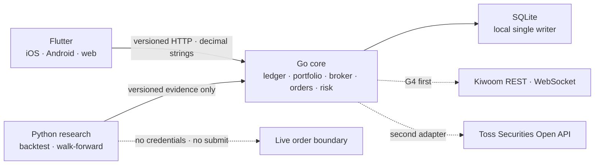

# Omni-Folio

[한국어](README.md) · [日本語](README.ja.md) · [English](README.en.md) · [简体中文](README.zh-CN.md)

A local-first platform for personal portfolios across multiple brokerages and safe automated trading. One Flutter client serves iOS, Android, and web; Go owns authority over the ledger, brokers, orders, and risk; Python handles reproducible research and backtesting only.

[Current status](#status) · [Architecture](#architecture) · [Quick start](#quick-start) · [Workflows](#workflows) · [Commands](#commands) · [Documentation](#documentation) · [Safety principles](#safety)

The Korean README is the source of truth for keeping the structure, commands, and supported scope consistent across all four languages. Linked design and verification documents are available in Korean or English. README translations do not imply that the app supports those display languages.

> [!IMPORTANT]
> Live trading and broker connections are currently disabled. Backtest and strategy results in this repository do not guarantee returns and are not investment advice.

<a id="status"></a>

## Current status

| Gate | Status | Evidence |
|---|---|---|
| G0 Architecture and contracts | Passed locally | Versioned OpenAPI/JSON Schema, separate runtime responsibilities, repository-wide commands |
| G1 Local ledger | Automated checks passed | CSV review and atomic application; exact trade, cash, split, and FX replay; FIFO cost and stored-price valuation; schema v26/backup v20 and recovery of supported older formats |
| G2 Flutter client | Partially passed | iOS, Android, and web release builds, automated parser/widget checks, and Android emulator frame measurements. Test-plugin exclusion verified in the unsigned iOS package. Physical-device, manual screen-reader, and store checks remain |
| G3 Research and paper execution | Partially passed | Reproducible backtests, walk-forward validation, holdouts, candidate registration, and local paper fills, performance, halt, and recovery. Long-running operation and completeness of source delivery remain unverified |
| G4 Brokers, charts, and orders | In progress | Local sample charts, stored reconciliation and order-history views, and credential-free synthetic Kiwoom contracts. Credentialed market-data and mock-order observations, recovery of orders with unknown outcomes, and all live-trading stages remain |

Detailed status and completion criteria are maintained in [`PLAN.md`](PLAN.md) and [`GATES.md`](GATES.md).

<a id="architecture"></a>

## Architecture



- Flutter and Python have neither brokerage credentials nor authority to submit orders.
- Only Go core can change the canonical ledger and order state.
- SQLite is an intentional choice for the local single-writer stage. Multi-replica configurations and Kubernetes manifests will wait for PostgreSQL migration, restore, and load evidence.
- After entering G6, local Kubernetes verification will use `Kind + Podman`. No Kind cluster has been provisioned, and no manifests will be created before G6 evidence is available.
- Toss Securities informs the use of plain terminology and a calm information hierarchy; its screens, trademarks, and trade dress are not copied.

Decision rationale follows [`docs/adr/0001-runtime-and-monorepo.md`](docs/adr/0001-runtime-and-monorepo.md); broker priority and UX contracts follow [`docs/broker-priority-and-ux.md`](docs/broker-priority-and-ux.md).

<a id="quick-start"></a>

## Quick start

Required tools:

- GNU Make 3.81+
- asdf 0.20+
- `curl`
- Docker Engine + Compose v2 (only needed for container execution)

The project's [`.tool-versions`](.tool-versions) pins Flutter 3.47.1 stable, Go 1.24.5, and Python 3.14.5. The Python research runtime has no third-party packages.

```sh
git clone https://github.com/YouSangSon/Omni-Folio.git
cd Omni-Folio
asdf install
make bootstrap
make check
make smoke
```

`make test`, `make check`, and `make smoke` record the owner PID, command, and start identity, plus child PGIDs and start identities, in a temporary root for each run. On success, failure, SIGINT, or SIGTERM, traps clean up process groups and temporary/build/coverage/bytecode artifacts. If a signal such as SIGKILL bypasses the traps, the next run uses the same ownership evidence to reclaim stale groups and roots. Reused PIDs and concurrent runs are preserved; owned children are reclaimed even if their group leader has already exited. Current tests create no Podman/Kind resources. Future local Kubernetes verification will clean up only resources identified by per-run session labels and recorded resource IDs. Until that wrapper exists, general cleanup will not delete other sessions' containers or clusters. Use `make clean` to clear the full Flutter/QA caches as well.

### Run the app

First terminal:

```sh
make run-core WEB_ORIGIN=http://localhost:8081
```

Second terminal:

```sh
make seed-demo
make run-client
```

- API: `http://127.0.0.1:8080`
- Flutter web: `http://localhost:8081`
- Local DB: `data/omni-folio.db`

`make seed-demo` sends the existing `golden-import.csv` through the real preview/apply APIs to populate USD cash, AAPL holdings and FIFO cost, and realized PnL, providing a useful first screen. It creates no separate mock API or bypass writes and does not reinsert events already applied. Skip this command to start directly with your own data. In a running app, press refresh at the top to display the sample ledger.

`make run-core` explicitly passes `contracts/fixtures/market-bars.csv`, so you can view a sample instrument chart from the AAPL holding. Both the screen and API identify it as `샘플 데이터 · 실시간 아님` (sample data · not real time). To check fail-closed behavior without a fixture, use `make run-core MARKET_FIXTURE=`.

To use a different API port, change both core and client:

```sh
make run-core CORE_ADDR=127.0.0.1:18080 WEB_ORIGIN=http://localhost:8081
make seed-demo API_URL=http://127.0.0.1:18080
make run-client API_URL=http://127.0.0.1:18080
```

`OMNI_API_URL` is a Flutter build-time value and must not contain secrets. Make does not load `.env` automatically.

To check the local API on an Android ARM64 device or emulator, install the release APK as shown below. Start core on the host first and use an ID from `adb devices`. The device's `127.0.0.1` refers to the device itself, so `adb reverse` connects it to the host API. This APK currently uses a debug signing key for local verification; store distribution validation is separate.

```sh
cd apps/client
flutter build apk --release --target-platform android-arm64 --dart-define=OMNI_API_URL=http://127.0.0.1:8080
OMNI_ANDROID_DEVICE=emulator-5554
adb -s "$OMNI_ANDROID_DEVICE" reverse tcp:8080 tcp:8080
adb -s "$OMNI_ANDROID_DEVICE" install -r build/app/outputs/flutter-apk/app-release.apk
```

On macOS with Xcode, run this from the repository root to build an unsigned iOS release without the test plugin. The pinned Flutter SDK and cached dependencies are required. It removes `integration_test` only from a temporary copy of the committed app and verifies unchanged production dependency locks, preserving the original app’s profile harness.

```sh
make check-ios-release
make client-ios-release API_URL=http://127.0.0.1:8080
```

The outputs are `output/ios-release-<source SHA>/Runner.app` and `build.json`. `COMPLETE` confirms that binary checks and owned temporary-resource cleanup succeeded. Existing output is preserved. Signing, installation, physical-device, and store checks are separate. See the [build mechanism and evidence](gates/g2-client.md#ios-release-packaging-2026-10-25).

<a id="workflows"></a>

## Verifiable vertical slices

### CSV import

Preview does not change the ledger. Apply the returned `preview_id` with a new idempotency key.

On History, paste text or use `CSV 파일 선택` to load a `UTF-8` file up to `1MiB`. Selection alone sends and applies nothing; review the contents, then run preview and apply separately. Cancellation and read errors preserve the existing input and results. [File input verification scope](gates/g4p-first-run-import-recovery.md#csv-file-selection)

To prepare one record without a CSV file, use `거래 직접 입력` → `검토용 초안 만들기`. This replaces the entire CSV draft; cancellation preserves the existing input and results. All 10 record types are supported, and buy/sell cash is calculated with exact decimals. It uses the current local default account `account-main` and default symbol mapping `AAPL`, and sends no orders. Run preview and apply separately from the draft. If the apply outcome is unknown, keep the app open and retry the same request instead of entering the trade again. After changing the CSV or switching tabs, `이전 요청 재시도` sends the original request. That retry can change the ledger if it has not been applied yet. Retry information lasts only for the app session. [Manual entry and result attribution](gates/g4p-first-run-import-recovery.md#manual-entry)

CSV types are `DEPOSIT`, `WITHDRAWAL`, `BUY`, `SELL`, `DIVIDEND`, `FEE`, `TAX`, `SPLIT`, `CASH_VOID`, and `FX_EXCHANGE`. Amounts and quantities are canonical decimal strings; cash-event signs and the zero cash impact of splits are validated before application. Only `CASH_VOID` uses the optional `corrects_source_event_id` column, and its amount must be the exact opposite of an already applied cash-like event in the same account and currency. The original is not deleted; Flutter preview shows the original source/type/currency/amount alongside the offsetting amount. `FX_EXCHANGE` requires the selling leg's `currency`/negative `amount` and a different buying leg's `counter_currency`/positive `counter_amount` in one row. Neither amount represents an exchange rate or current market quote; record fees in separate `FEE` rows.

```sh
preview_file="$(mktemp)"
curl -fsS -X POST \
  -H 'Content-Type: text/csv' \
  --data-binary @contracts/fixtures/golden-import.csv \
  http://127.0.0.1:8080/v1/imports/preview > "$preview_file"

preview_id="$(python3 -c 'import json,sys; print(json.load(open(sys.argv[1]))["preview_id"])' "$preview_file")"
curl -fsS -X POST \
  -H 'Content-Type: application/json' \
  --data "{\"preview_id\":\"$preview_id\",\"idempotency_key\":\"local-apply-001\"}" \
  http://127.0.0.1:8080/v1/imports/apply

curl -fsS http://127.0.0.1:8080/v1/portfolio/snapshot
rm -f "$preview_file"
```

The golden fixture expects 3 new rows, revision `rev_0000000003`, USD cash `778`, 6 AAPL shares, and cost basis `300.6`. Dynamic IDs and timestamps vary between runs.

### Export ledger activity as CSV

Save the verified ledger's public activity fields as CSV. The export preserves newest-first ordering from one database observation and excludes account and internal IDs. Numbers and timestamps retain their original strings; original and correction rows remain together.

```sh
mkdir -p -m 700 data/exports
(cd services/core && go run . ledger-export \
  -db ../../data/omni-folio.db \
  -out ../../data/exports/ledger.csv)
```

The `ledger-activity-export.v1` receipt reports the revision, row count and SHA256. Existing output is never overwritten. Exceeding 10,000 rows or 32 MiB, or an unsafe symbol label, fails the export. The output directory must belong to the current user and disallow writes by other users; its ancestor path must also be trusted. This CSV is neither a backup nor a reimport format. Import every column as text in a spreadsheet. [Contract and limitations](gates/g1r-ledger-activity-export.md)

### Transition an existing ledger to chronological replay

schema26/backup v20 uses the FIFO v2 policy with exact UTC ordering. A DB with an existing ledger cannot run normally after migration alone. Stop the old core, preserve the original backup, and follow [G1.20's preview → review → activate → verify new backup procedure](gates/g1p-chronological-ledger-replay.md#로컬-전환-절차). Distinguish validation of archived historical backups from activation of the current policy.

### Local sample OHLCV chart

```sh
curl -fsS 'http://127.0.0.1:8080/v1/market-data/candles?symbol=AAPL&interval=1d'
```

The response returns canonical decimal strings with `price_adjustment=unspecified`, `source=local_fixture`, `sample=true`, and `state=stale`. Open AAPL from the holdings screen to see a price/volume chart, `30일/90일/365일/전체` (30 days/90 days/365 days/all) display ranges relative to the last received bar, the price-adjustment basis, source/as-of information, a screen-reader summary, and an exact OHLCV table sharing the selected range. `unspecified` means that price adjustment has not been verified. This client-side range selection neither fetches new quotes nor establishes candle completeness. The fixture is for contract and UI verification only, not current prices or investment decisions.

The existing `market-bars.csv` provides neither instrument IDs nor price currency, so the API's `instrument_id` and `currency` are `null`. The screen also states that the instrument association and currency cannot be verified. Load the sample with explicit IDs and currency using `make run-core MARKET_FIXTURE=contracts/fixtures/market-bars-identified.csv`. The extended CSV appends exactly `instrument_id,currency` after the existing 10 columns, with the same values in every row. These values are declarations by the source, not exchange verification. The detail screen rejects data whose ID or currency differs from the selected holding and retains the previous valid data and timestamp.

Both formats use `bar_time_basis=unspecified`. `at` is only an ordered timestamp representation; it does not establish the trading day, bar start/end, or the bar to which a fill belongs. Because price adjustment and time basis remain unverified, average-cost lines and ledger trade markers are not displayed yet. The original CSV and research artifact hashes remain unchanged. See [G4W](gates/g4w-chart-source-basis.md) for verification scope.

### Instrument ledger average cost and trade history

From holdings → instrument detail → `원장 평균단가·매매 보기` (view ledger average cost and trades) at the top, view the current remaining average cost and the latest 50 buys and sells. This view is accessible even when quote fetching fails. If refresh fails, the previous result and its as-of time are retained together.

```sh
curl -fsS 'http://127.0.0.1:8080/v1/portfolio/instrument-ledger?instrument_id=instrument_aapl&currency=USD'
```

Use the instrument ID and currency from the existing snapshot unchanged. The view aggregates all imported accounts at one ledger version, preserving remaining FIFO cost and quantity as exact decimal strings and displaying only the average with half-even rounding to 8 decimal places. The golden fixture gives 6 shares, cost USD 300.6, and average USD 50.1. Zero quantity yields a `null` average; no trade history yields 404. `has_more=true` means older trades have been omitted.

Trade rows retain their original values without split adjustment, while current cost reflects ledger splits. Local records are not broker-confirmed fills, and this screen does not enable average-cost lines or trade markers on the chart. See [G4X verification scope](gates/g4x-instrument-ledger-detail.md).

### Direct FX observation foundation

G1.10 preserves FX observations in the direction `1 base_currency = rate quote_currency` in a schema v10 `STRICT`/insert-only series. It validates source observation identity, exact decimal rate, observed/fetched/recorded UTC timestamps, and the canonical row hash, rejecting conflicts with the same source, pair, and observed-at time. `GET /v1/market-data/fx/latest` returns only the exact direction observed and fetched before an explicit `as_of`, retaining `sample=true` and `state=stale`. It neither automatically inverts the rate nor uses `FX_EXCHANGE` cash legs as exchange rates.

This fixture writer and GET contract remain unchanged. Owner FX inputs use the separate version journal below and never enter this GET. There is no automatic provider ingestion or scheduler; `PortfolioSnapshot.valuation_status` remains `unavailable`.

### Versioned owner FX inputs and performance

Import a complete direct FX file into an existing DB to use one selected input version across cash, current KRW valuation, TWR, XIRR, and KRW conversion of USD indices. The direction is `1 USD = rate KRW`; inverse and cross rates are not inferred.

```sh
(cd services/core && go run . owner-fx-import -db ../../data/omni-folio.db -input ../../contracts/fixtures/owner-fx-usdkrw-sample.json)
```

This old `sample=true` example is synthetic and does not satisfy the current valuation's 24-hour age limit. Real inputs follow the [closed input contract](contracts/owner-fx-series.schema.json). Submit the complete set of points with a new `source_version` to correct it; empty `points` withdraw that direction. Removed points are never borrowed from older versions, and retrying an old version does not reactivate it. A direction cannot mix fixture and owner inputs, even after withdrawal.

`storage_check=verified` proves storage integrity only. The Korean app keeps its owner-input warning even with `sample=false`. Observation, capture, recording times, and the 24-hour limit are checked separately; this does not certify security prices, broker quotes, or provider accuracy. [Policy, recovery, and verification scope](gates/g1w-owner-fx-series.md)

### Valuation and performance from owner-declared security prices

Import a price file for an instrument already admitted through CSV into the existing DB. Use the ledger's canonical ID (`instrument_aapl` for `AAPL`); display-label case does not require changing the ledger.

```sh
(cd services/core && go run . owner-price-import -db ../../data/omni-folio.db -input ../../contracts/fixtures/owner-price-aapl-sample.json)
```

In the [input contract](contracts/owner-price-series.schema.json), `unadjusted` declares a price in the stated currency per ledger share at the observation instant, without retrospective split or dividend adjustment. Post-split holdings need a price strictly later than the last split. This old `sample=true` synthetic example fails the current valuation's 24-hour condition.

The latest complete file per instrument and currency feeds valuation, TWR, XIRR, and KRW/USD index comparison. A new `source_version` replaces all points; empty `points` withdraws them. Missing historical points never fall back, and retrying an old file does not reactivate it. Existing fixture/Kiwoom prices cannot share that instrument/currency, even after withdrawal. The Korean app's owner-price warning is independent of sample and FX warnings. Storage verification does not certify provider accuracy or current market prices. [Units, recovery, and verification scope](gates/g1x-owner-price-series.md)

In the Korean app, open **Connections → Import price, FX and index files**, select UTF-8 JSON (up to 1MiB), then explicitly **Review input → Store reviewed file**. Both KRW and USD benchmark series are supported. Review checks input format only; it does not certify admission, currentness or provider authority. New versions replace the complete series; empty price/FX series withdraw observations. If storage is uncertain, retry the same original until a matching receipt arrives. Pending requests survive navigation during the app session, but not app termination. Confirm perpetual storage rights for the file. [Contract and verification scope](gates/g1y-owner-data-import.md)

### Annualized return adjusted for deposits and withdrawals

Use `입출금을 반영한 수익률 보기` on Home to read since-inception `XIRR`. It combines dated external cash flows with the current KRW valuation, without counting trades, dividends, or costs as additional deposits or withdrawals. It annualizes actual UTC calendar days on a 365-day basis.

Only a unique result appears as the main return. A result without certified uniqueness appears only as a reference candidate in details; missing prices, historical FX, or numerical failures never become 0%. Any sample observation keeps the report marked as sample. The app does not present this as verified current brokerage performance.

```sh
curl -fsS http://127.0.0.1:8080/v1/portfolio/xirr
```

[Policy, sources, and verification scope](gates/g1s-portfolio-xirr.md)

### Cumulative return with cash-flow effects removed

Use `입출금 영향을 뺀 누적 수익률 보기` in the return detail to read since-inception `TWR`. It links asset changes between external cash-flow boundaries without annualizing them. External flows precede internal events at the same timestamp; canceled original cash records are also removed from historical balances.

A missing historical price or direct FX rate, or one older than 24 hours, makes the result unavailable. Nonpositive intermediate capital and ambiguous split price units are also unsupported. A full withdrawal is not shown as a total loss, and results containing sample observations are not actual investment performance.

```sh
curl -fsS http://127.0.0.1:8080/v1/portfolio/twr
```

[Calculation policy, sources, and verification scope](gates/g1t-portfolio-twr.md)

### Cash-flow checkpoint chart and table

Open `입출금 구간별 성과 보기` from TWR detail for the KRW cumulative return and checkpoint chart/table in one response. Only external-flow boundaries and the report end are evaluated: one deposit gives two points. Dashed guides do not represent a daily price path. Evaluation boundary times differ from market observation times.

Price/FX provenance and sample warnings remain visible. A failed refresh retains the entire prior observation and its original cutoff. The table exposes server-rounded ratios and processing phases at the same timestamp. Actual market data, daily history, and deployment remain separate.

```sh
curl -fsS http://127.0.0.1:8080/v1/portfolio/twr/checkpoints
```

[Contract, calculation, and verification scope](gates/g1z-twr-checkpoints.md)

### Stored KRW and USD benchmark source versions

Benchmark inputs support both `KRW` and `USD`. Provide a normalized index file declaring `price_index`, `gross_total_return`, or `net_total_return`. Both files below are `sample` examples rather than actual market data.

For dividend-reinvested comparisons, the priority candidates are KOSPI 200 TR in KRW and S&P 500 Total Return in USD. An input file needs confirmed series identity, currency variant, observation time, and storage/display rights. Actual datasets and permissions have not been secured. See the [official definitions, use conditions, and adoption steps](gates/g1u-benchmark-series.md#benchmark-source-policy).

```sh
(cd services/core && go run . benchmark-import -db ../../data/omni-folio.db -input ../../contracts/fixtures/benchmark-krw-sample.json)
(cd services/core && go run . benchmark-import -db ../../data/omni-folio.db -input ../../contracts/fixtures/benchmark-usd-sample.json)
(cd services/core && go run . benchmark-status -db ../../data/omni-folio.db -benchmark-id synthetic_usd)
```

`authority=owner_declared` identifies owner-provided data; `storage_check=verified` confirms stored integrity only. Changed content or `fetched_at` under the same `source_version` is rejected, and retrying an older version does not change the latest selection. Actual index dividend/split definitions and data usage rights still need separate verification. Same-period comparison of stored inputs is available below.

[Input contract, recovery policy, and verification scope](gates/g1u-benchmark-series.md)

### Compare indexes over the same period

Open `같은 기간의 지수와 비교하기` from TWR detail to read the latest stored version of each index together. One response owns the ledger, report cutoff, and comparison period. `KRW` indexes use their native return; `USD` indexes show both native and won-converted returns.

```sh
curl -fsS http://127.0.0.1:8080/v1/portfolio/benchmarks
```

The difference is the published portfolio return minus the won-based index return, in `%p`. Dividend and tax basis remain visible; missing FX preserves only the native value. Observations older than24hours, a zero starting index, and missing inputs are unavailable rather than zero. Sample inputs are not certified performance. Up to32 indexes are compared; failed refresh retains the entire previous comparison and cutoff.

[Policy, sources, and verification scope](gates/g1v-portfolio-benchmark-comparison.md)

### Watchlist and stored prices

Open `관심종목` in the app bar to add or remove up to 50 Korean (XKRX·KRW) and US (XNAS/XNYS·USD) symbols. The server stores this preference separately from holdings, the ledger, and listing authority. Entering a symbol does not verify that it is listed.

Prices must match the saved market, symbol, and currency. Read the independent owner-input, sample, stale notices and observation times. Missing or ambiguous data hides that row's price while preserving other rows. A new watched symbol may have no price; existing price-file admission still requires a symbol present in the ledger.

After an uncertain save, retry the same change or reload the current list. Pending intent survives navigation during the app session, but not app termination. Live quotes and automatic refresh are not provided.

```sh
curl -fsS http://127.0.0.1:8080/v1/watchlist
```

[Persistence, retry, recovery, and verification scope](gates/g4y-stored-watchlist.md)

### Direct-FX cash valuation

G1.11's `GET /v1/portfolio/cash-valuation` values replay-verified current ledger cash only in the requested base currency. It requires canonical UTC `as_of` and `base_currency`, validating ledger events and the entire FX series in the same read transaction. Except for matching currencies and zero balances, it uses only direct observations in the `cash currency -> base currency` direction, including the 24-hour boundary from observation time. It uses no inverse rates, cross rates, interpolation, `FX_EXCHANGE` inference, or display rounding.

If any required pair is missing or older than 24 hours, only native-currency cash lines and issues are returned; the aggregate total is hidden. Even a complete result using local fixtures remains `sample=true`, `status=stale_sample`. This API covers cash only, does not value holdings, PnL, performance, or current market prices, and is not connected to Flutter screens. `PortfolioSnapshot.valuation_status` remains `unavailable`.

```sh
curl -fsS 'http://127.0.0.1:8080/v1/portfolio/cash-valuation?base_currency=KRW&as_of=2026-01-11T14:00:00Z'
```

### Durable security price observation foundation

Ahead of holding valuation, G1.12 preserves local fixture security prices in the `STRICT`/insert-only series introduced in schema v11. It validates source identity, instrument ID, symbol, venue, currency, a positive canonical price, `price_adjustment=unspecified`, observed/fetched/recorded UTC timestamps, and the canonical row hash. Internal exact-as-of queries fix every identity dimension and select only observations whose three timestamps are at or before the cutoff.

Backup v8 at the G4U checkpoint validates price-series digests/counts and migrated legacy artifacts to schema v13 in owned copies without changing the originals. Current schema v26/backup v20 preserves that price proof as well. An empty restore candidate must have the same table DDL, latest index, and insert-only triggers as the embedded migrations. No public API, Flutter screen, provider request, scheduler, or broker-backed holding/PnL/performance valuation was added; `PortfolioSnapshot.valuation_status` remains `unavailable`.

### Stored-price native-currency holding valuation

G1.13's `native_holding_valuation_v1` revalidates the current ledger snapshot, append-only event proof, and entire security-price series in the same read-only transaction. It calculates native-currency market value and unrealized PnL using a local fixture price no older than 24 hours only when exactly one as-of venue matches the holding's internal instrument ID, symbol, and currency. Multiple venues, missing or stale values, or future observed/fetched/recorded timestamps leave a sanitized issue on the affected line and hide all per-currency aggregates.

G1.15 connects this existing model to `GET /v1/portfolio/holding-valuation` and the Flutter holding detail `저장 가격으로 평가 보기` (view valuation using stored prices). Responses omit internal instrument/observation IDs and show quantity, cost, native-currency value, unrealized PnL, and price provenance at the same ledger revision. Omitting `as_of` uses the server's current UTC time; explicit cutoffs must be canonical UTC. Failed queries preserve both the previous result's as-of time and revision without exposing error details.

```sh
curl -fsS 'http://127.0.0.1:8080/v1/portfolio/holding-valuation'
```

Totals are hidden when stored prices are missing or older than 24 hours. `make seed-demo` populates only the transaction ledger, so missing prices are expected. Even with all prices present, results remain local sample/stale data; currencies are not combined, and historical costs are not converted at current FX rates. No provider ingestion, whole-portfolio total, or live/current authority was added; `PortfolioSnapshot.valuation_status` remains `unavailable`. Since G1.14, snapshot/OpenAPI explicitly declares `fifo_exact_else_half_even_residual_8_v1`. Existing finite-decimal FIFO allocations remain exact; only repeating decimals are quantized with half-even rounding. Residual cost stays in open lots and is consumed in full on final liquidation. This analytical policy does not replace tax cost-basis rules.

### Credential-free Kiwoom latest trade

G4Q validates the official `ka10079` one-tick response through synthetic in-memory responses in the existing Kiwoom OAuth/read transport. Its canonical internal DTO returns only the six-digit KRX symbol, exact price magnitude, provider `cntr_tm`, and a separate fetch timestamp. Invalid rows, time reversal, different prices in the same second, and trades later than the local receive time cause rejection of the entire response.

G4Q itself adds no real credentials, external requests, public API, or DB writer. Because the official response lacks a durable event ID and explicit timezone/price-adjustment evidence, the next stage, G4S, stores only a conservative observation slot rather than a trade ID.

### Credential-free Kiwoom durable latest-trade observation

G4S stores G4Q's `KiwoomLatestTrade` DTO in the price series extended in schema v12, using only an internal Go writer. Sources are separated into `kiwoom_mock` and `kiwoom_production`. Identity is an observation slot combining `ka10079`, environment, internal instrument ID, `XKRX`, six-digit symbol, `KRW`, `unspecified`, and the provider-observed second, rather than a provider trade ID. The same price in the same slot is a no-op even on repeated fetches; different prices in the same second, tampered IDs, and non-KRX/KRW identities are rejected.

These stored values do not yet confer valuation authority. Existing holding valuation and public snapshots continue to read only `local_fixture`; no scheduler, route, Flutter screen, real credentials, or order decisions were added.

### Owner-declared instrument listing ownership

G4U lets the owner explicitly declare the current relationship between `(venue,symbol,currency)` and an internal instrument ID through schema v13's append-only `DECLARE`/`REVOKE` ledger. Kiwoom one-shot capture stops before requesting a token if the active listing is missing, revoked, or corrupted; new price writers recheck the same relationship inside the insert transaction. Existing v12 prices are preserved, but ownership is not inferred from symbol conventions or past prices.

Backup v8 compares the full listing hash and event/active counts between the original and restore candidate. This ledger does not establish provider verification, historical effective dating, freshness, or valuation/strategy/order authority, and there is no external registration API/UI yet.

### Credential-free Kiwoom realtime price

G4R uses only the standard library to validate a registration packet for one KRX-format symbol on official WebSocket `0B` and `REAL` JSON frames. Signed current prices are preserved as exact magnitudes, field `20` as a date-free `provider_clock`, and local receive time separately as `received_at`. The same symbol/clock/price within one frame is returned once; different prices for the same clock cause an ambiguity error that rejects the entire frame. External input is limited to 1 MiB and 100 entries.

WebSocket connections, LOGIN/PING, reconnection/resubscription, backpressure, credentials, persistence, and public API/UI are not yet present. The value semantics of official FID `9081` are also left uninterpreted until actual observation, so the DTO makes no venue claim. This internal DTO therefore does not establish live/current/freshness status or durable trade/price observations.

### Internal synthetic order recovery, execution authority, reconciliation, and mock submit

K2A/K2B0 internally verify Kiwoom `LIMIT`/`KRW`/`KRX` intents and append-only lifecycles, `SUBMIT_UNKNOWN` duplicate prevention, cancel/fill replay, and atomic fill reconciliation for already known order numbers in Go. K2B1 preserves synthetic `kt00009` fill rows for an explicit date as a non-joinable scan. K2C verifies a default-blocking kill switch, per-process lease/fencing, and BUY limits for `005930`/`000660`: 10 shares, KRW 1 million per order, and KRW 1 million in active reservations per account. K2B2 reproduces official `kt10000` mock limit-order requests with synthetic credentials and in-memory transport, verifying token preflight, durable dispatch-before-write, no write retries, opaque ACKs, and unknown/reject branches. There are no external broker calls, public order API/UI, or live authority.

```sh
cd services/core
go test -run '^(TestK2A|TestK2B0|TestK2B1|TestK2B2|TestK2C)' -count=1 ./...
```

K2B0 does not associate a `SUBMIT_UNKNOWN` without an order number even when an order has matching attributes and timestamps. Terminal pagination in K2B1 does not establish completion of the entire fill history, nor does it combine a date with a timezone-free fill time to manufacture UTC. K2B2 writes are never retried automatically, including on 401; unclear outcomes wait for lookup and reconciliation rather than resubmission. Actual credentialed mock observations, lookup recovery of unknown submissions, cash/position/fee/loss/market-hours/stale-data limits, owner/strategy approval, broker/ledger reconciliation, and Flutter order workflows remain.

### Credential-free known-good broker snapshot

G4H atomically stores only KRX snapshots with `complete=true` from existing synthetic `KiwoomSnapshot` data in Go's internal SQLite storage. Identical payloads with the same account/environment/exchange/fetched-at do not duplicate raw snapshots; reconciliation records are stored separately per ledger revision. Payload conflicts or incomplete snapshots do not replace the previous known-good snapshot. The difference between broker quantities and KRX/KRW instrument quantities at the ledger revision at storage time is fixed as exact decimals.

```sh
cd services/core
go test -run '^TestG4H' -count=1 ./...
```

Schema v13/backup v8 at the G4U checkpoint protected ledger events, cash-void/FX guards, direct FX observations, security price observations, instrument listings, raw broker snapshots, revisioned broker reconciliation, execution-authority events, risk reservations, the strategy registry, and the then-existing synthetic/paper orders as insert-only data. Current schema v26/backup v20 preserves those proofs together with G3.8C2 paper accounting, G3.8C3 account-global performance, G3.8D strategy-window evidence, and G3.8E paper safety policy/action recovery. G4H itself does not establish credentials, broker requests, scheduling, official freshness/timezone, cash/value reconciliation, public API/UI, or live readiness.

### Stored broker reconciliation read view

G4K reads G4H's latest stored result through `GET /v1/broker-reconciliation/latest` and displays it on Flutter's `연결` (Connections) screen. The API returns only provider/environment/exchange, storage time, ledger revision, and exact holding-quantity differences; it exposes no account references, internal IDs/hashes, or raw snapshots. `freshness=unverified` and `마지막 저장 스냅샷 · 현재 상태 아님` (last stored snapshot · not the current state) explicitly identify the result as something other than a real-time balance.

```sh
curl -fsS http://127.0.0.1:8080/v1/broker-reconciliation/latest
```

No stored record yields 404. If the latest raw snapshot lacks a reconciliation record or has corrupted hash/metadata, the route fails closed with a generic 500 rather than falling back to an older result. G4M summarizes matching/mismatching counts and fetch/storage times from the same stored object on the home screen, opening per-instrument differences through `연결에서 자세히 보기` (view details in Connections). Neither screen refreshes the broker or places orders, nor claims reconciliation of cash, valuations, fees, orders, or fills.

### Local order lifecycle read view

G4L reruns the recovery proof for the existing append-only order log, then returns only a display-oriented lifecycle through `GET /v1/orders`. Responses use `source=local_order_log`, `broker_freshness=unverified`, and contain no account/client/provider/internal IDs. Flutter's `연결` (Connections) screen neither queries the broker afresh nor sends/cancels orders; it labels orders with unknown outcomes `브로커 결과 미확정 · 재주문 금지` (broker outcome unknown · do not resubmit).

```sh
curl -fsS http://127.0.0.1:8080/v1/orders
```

An empty log returns `orders=[]`. Any corruption in hashes, metadata, transition replay, or recorded timestamps causes a generic 500 and fails closed. Failed refreshes retain the last valid screen without presenting it as the current broker state.

### Research and automated improvement

After registration, view the last registered result in the app through **연결 (Connections) → 백테스트 보고서 보기** (view backtest report). `GET /v1/research/report` chooses one result by registration order, including results that failed promotion. This is independent of the currently selected strategy. With no data, it displays an empty state; if the latest data is corrupted or uses an unsupported format, it does not substitute older data. A failed manual refresh retains the screen's existing result and observation time.

The screen reads stored metrics rather than recalculating them from the original bars. Walk-forward validation reports the mean return, maximum drawdown, and combined completed trades of candidates reselected in each window; the final candidate's parameters apply only to the separate holdout evaluation. This is neither current portfolio performance nor order authority. [Supported formats and verification](gates/g3ag-research-report.md)

```sh
make run-research
make run-improvement
```

To calculate a new SMA signal from a research candidate, use the offline CLI below. `research.csv` is the original input actually used to generate the candidate; `latest.csv` contains ordered OHLCV bars for the same six-digit KRX symbol. Its last timestamp must follow the research sample, and at least slow window + 1 bars are needed to determine the previous crossover. Follow [G3.8G1](gates/g3q-paper-signal-proposals.md) for detailed contracts and limitations.

```bash
PYTHONDONTWRITEBYTECODE=1 PYTHONPATH=services/research python3 -m omni_research.signal_cli \
  --bars /path/to/latest.csv \
  --research-bars /path/to/research.csv \
  --artifact /path/to/strategy-improvement-result.json
```

JSON on stdout is a target-quantity **proposal** calculated from untrusted local input; it does not execute orders. Its own hash and the input's promotion flag do not prove research performance, so verification of Go's registered result and current selection cannot be skipped. `none` means no new proposal; `"0"` for `death_cross` is a liquidation target. Adding `--watch` to the command emits an NDJSON proposal for each newly observed last bar. First read the [delivery and restart limitations of generation-only watch](gates/g3t-paper-proposal-watch.md). Currently, `paper-run-loop` runs only performance evaluation and safety policies; continuous input and paper-fill integration remain in G3.8G2.

The [manual local paper workflow](docs/local-paper-workflow.md) connects initialization, original CSV validation, paper fills, performance safety policies, and new proposal admission through `paper-init`, `paper-import-bars`, and `paper-execute -arm-paper`. It runs fixtures without connecting to a real brokerage and halts its own execution authority on exit. Actual OS signal/stale-owner and combined restart verification passed locally in [G3.8G2B](gates/g3s-local-paper-workflow.md). This does not establish completed always-on automated trading or live trading.

Python `--bundle` outputs the proposal together with the original CSV used in its calculation. Passing it once to Go's `paper-execute -bundle FILE -arm-paper` applies existing validation without rereading the original paths. Limits are 1 MiB per CSV and 4 MiB for the entire JSON. [Exact-byte delivery gate](gates/g3u-paper-input-bundle.md)

Use `paper-input-status -db PATH -account ACCOUNT -selection-event EVENT -bundle FILE` to compare one saved input with the database's bars, first receipt, signal and order records through a read-only connection. These records are not a completion ACK, freshness proof or execution authorization; inspection does not decide whether to replay. [Usage and meaning](docs/local-paper-workflow.md#saved-input-status)

`--watch --bundle` can pipe into stdin of a separate `paper-execute-stream -arm-paper`. This command arms once, renews its ownership lease between inputs, and cleans up the reader and authority on stop, EOF, or error. It provides neither automatic rearming nor a durable queue; confirm execution through DB records rather than stdout. [Continuous fixture usage](docs/local-paper-workflow.md#명시적으로-연속-fixture-소비하기), [verification gate](gates/g3w-paper-input-stream.md)

The strategy-improvement runner evaluates a finite set of long-only SMA candidates using expanding walk-forward validation and opens the final holdout once per run. Results can be only `paper_candidate` or `no_promotion`; they gain no credentials, order authority, or authority for live promotion.

To evaluate with whole-share paper fills, fees, taxes, and partial fills, pass `--config contracts/fixtures/strategy-improvement-paper-config.json` to the same CLI. This v2 uses exact money arithmetic and ratios rounded half-even to 28 decimal places, separately from v1 results. The registration example below is for v1 only. The current registry and signal submission reject v2; its results establish neither automatic promotion nor equivalence to the complete paper runner. See the [calculation contract and verification](gates/g3ai-paper-compatible-research.md).

Go core registers v1 local results in the insert-only registry introduced in schema v13 and preserved in current schema v26. `no_promotion` is retained as rejection evidence but cannot be selected. Because direct comparison with the current champion is not implemented yet, selecting a `paper_candidate` requires an explicit CLI action and optimistic concurrency. Rollback appends a new event only to the previous selection or `no_strategy`.

```sh
candidate_file="$(mktemp)"
PYTHONPATH=services/research python3 -m omni_research.improve_cli \
  --bars contracts/fixtures/strategy-market-bars.csv \
  --config contracts/fixtures/strategy-improvement-config.json \
  --output "$candidate_file"

(cd services/core && go run . strategy-register \
  -db ../../data/omni-folio.db \
  -artifact "$candidate_file")
rm -f "$candidate_file"
```

To select a registered result's `result_sha256`, use `strategy-select -result-sha256 ... -expected-current-event ...`. The initial expected event is `no_event`; afterward use `current_event_id` from `strategy-status` or the previous output. To roll back, pass the current event ID to both `-expected-current-event` and `-source-event` in `strategy-rollback`. This manual rollback halts/fences all active execution authorities and then appends selection history in the same transaction; any failed record rolls back the entire transaction. Selection alone does not grant order authority.

### Credential-free paper accounting and performance evidence

G3.8C2 uses the exact eligible closed bar after the transaction-owned sequence cutoff in `paper-signal.v3`. Fill prices model a bar's open ex post using final volume known only later; they are not evidence of opening-auction or live broker fills. The account-global session must match the current policy SHA; a signed target delta creates BUY/SELL, and a zero target requests full reduction. Only one active order is allowed per account/symbol.

KRX quantities are whole shares up to `4611686018427387903`; capacity is `floor(volume * max_participation)`. A fixed KRW fee, SELL-only tax, and adverse slippage apply exactly to each non-zero fill. Replay of the sole `order_events.FILL_RECORDED` journal derives cash, FIFO lots/cost, fees, tax, slippage, and realized PnL while blocking overdrafts and overselling. Admission and fills require the current lease/fence and write to neither Kiwoom transport nor the general ledger. The database/backup contract at this C2 checkpoint was schema v17/backup v11; the current C3 contract succeeds it.

```sh
cd services/core
go test -run '^TestG38C2Paper' -count=1 ./...
```

G3.8C3 fixes the transaction-current order/market cutoff and complete same-`as_of` `paper_fixture` daily closes for every open position. Cash-only points also require a close anchor under the same cutoff. Replay of the sole fill journal calculates account-global cash, open cost, market value, realized/unrealized/total PnL, equity, and scale-8 half-even return/drawdown.

G3.8D uses only C3 points after the current selection, tied to the same selection ID and strategy result. The first point is a zero-return baseline; later points recompute the window's peak, return, and drawdown exactly. The then-current schema v19/backup v13 independently restores this append-only strategy-window series; v12/schema v18 migrates to an empty D log in an owned copy without changing the original.

G3.8E adds `paper-strategy-performance-safety.v1`, which consumes only the recovered latest G3.8D row for the same selection. Fewer than 2 samples yields `INSUFFICIENT`; maximum drawdown of at least 0.1 takes priority and yields `HALT_AND_ROLLBACK`; otherwise cumulative return at or below -0.05 yields `HALT_AND_ROLLBACK`; all other cases yield `HOLD`. The action is one transaction that deterministically halts captured armed accounts with fencing in lexical order and performs a one-pop rollback of the exact current selection. Schema v20/backup v14 and v13 owned-copy proof validate the full provenance. This internal boundary establishes no scheduler, public API/UI, broker calls, promotion, deployment, live authority, or profitability claim. Verification evidence is in [`gates/g3n-paper-performance-policy.md`](gates/g3n-paper-performance-policy.md).

G3.8F1 adds a local one-shot CLI callable by an external timer, launchd, systemd timer, or Kubernetes CronJob. `omni-core paper-run-due -db <path> -account <kiwoom_account_...>` chooses the latest available local fixture close and completes G3.8C3 account performance, G3.8D strategy-window performance, and G3.8E safety policy in order. Even with retries or two concurrent owners, a completed chain for the same close converges on the same durable result after root recovery verification. Detailed evidence is in [`gates/g3o-scheduled-paper-runner.md`](gates/g3o-scheduled-paper-runner.md).

G3.8F2 adds `omni-core paper-run-loop -db <path> -account <kiwoom_account_...>`. A schema v21 singleton lease binds the current strategy selection to the account and increases the fencing token monotonically. With a 10-second heartbeat and 30-second TTL, the runner revalidates its exact claim inside every C3/D/E transaction. A stale owner is reclaimed only after TTL; SIGINT/SIGTERM, errors, and normal rollback exits conditionally release only their own claim. Because the current selection is global, this local runner is also globally serialized. Detailed evidence is in [`gates/g3p-always-on-paper-runner.md`](gates/g3p-always-on-paper-runner.md).

This evidence consists of local ex-post fixture results. A daemon process has been added, but no public API/UI, broker-backed valuation, credentialed/live execution, deployment, alerting, CronJob packaging, shadow/live promotion, or profitability claims are added.

<a id="commands"></a>

## Main commands

```text
make bootstrap        Prepare local dependencies
make format           Apply Go/Dart formatting
make lint             Run Go vet, Flutter analyze, and Python compilation checks
make test             Run Go, Flutter, and Python unit tests
make check            Check format, lint, tests, and JSON contracts; clean test artifacts
make clean            Clean local artifacts, including Flutter/QA caches
make smoke            Check ledger/local market HTTP vertical slices with a temporary DB
make run-core         Migrate, then run the local Go API with an explicit sample market fixture
make run-client       Run the Flutter web client
make run-research     Run the deterministic backtest fixture
make run-improvement  Run the walk-forward strategy fixture
```

## Run in containers

```sh
cp .env.example .env
docker compose -f infra/compose.yaml config --quiet
docker compose -f infra/compose.yaml up --build
curl -fsS http://127.0.0.1:8080/readyz
docker compose -f infra/compose.yaml down
```

Compose runs a non-root/read-only core after a one-shot migration and exposes the API only on loopback. With no authentication or TLS, it must not be used as a publicly exposed service. Named volumes persist after `down`. Use `down -v` only when intentionally deleting local ledger data.

Runtime limits allocate `0.25` CPU and `512 MiB` to `migrate`, and `0.75` CPU and `1536 MiB` to `core`, totaling `1 vCPU` and `2 GiB`. Each container rotates logs across `3` files of `10 MB`. These are not build-resource limits or throughput guarantees. For private remote verification, first check the [shared-VM entry conditions](gates/g6-deployment.md#single-node-resource-budget) and use SSH. Application of these settings in the VM runtime remains unverified.

<a id="documentation"></a>

## Repository layout

```text
apps/client/       Flutter iOS · Android · web client
services/core/     Go ledger/API authority
services/research/ Python backtest and strategy improvement
contracts/         OpenAPI, JSON Schema, cross-runtime fixtures
gates/             Per-stage acceptance and evidence
infra/             local OCI/Compose profile
docs/              Goals, ADRs, research, and broker/UX documents
```

Find documents by purpose in [`docs/README.md`](docs/README.md). Do not attach security vulnerabilities or exposed credentials to public issues; follow the procedure in [`SECURITY.md`](SECURITY.md).

## Troubleshooting

- `go: go.mod file not found`: use `make bootstrap` or root Make commands from the repository root.
- Flutter device/package errors: run `flutter doctor` and `cd apps/client && flutter pub get`. Without Chrome, use `FLUTTER_DEVICE=web-server make run-client`.
- Port `8080` conflict: change both core and `API_URL`, as in the `18080` example above.
- Browser API failures: match the Flutter host/port and `WEB_ORIGIN` exactly. Wildcard CORS is not supported.
- Compose `unhealthy`: inspect `/readyz` failures using `docker compose -f infra/compose.yaml logs core`.
- Moving/backing up SQLite: stop core first. `*.db-wal` and `*.db-shm` are runtime sidecars of the same DB.

<a id="safety"></a>

## Safety principles

- Live trading is off by default and cannot be enabled with a UI toggle or a single environment variable.
- Do not put broker secrets, access tokens, real account numbers, or original transaction exports into Git, fixtures, or logs.
- K2A preserves an order as `SUBMIT_UNKNOWN` after a timeout/crash and blocks both that order and new submissions for the account. K2C adds a default-blocking kill switch, DB lease/fencing, and immutable reservations. K2B2 mock writes are attempted only once after durable dispatch; unclear responses do not trigger resubmission. K2B0/K2B1 lookup results alone are not used to arbitrarily resolve unknown outcomes.
- Strategies are not promoted on returns alone. Costs, latency, data leakage, drawdown, operational health, and owner approval must be addressed.
- Prove survivability and recoverability first. Returns cannot be guaranteed.

## License

No separate open-source license has been granted. Public visibility of the repository is not the same as permission to reuse its code.
