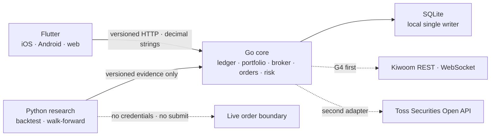

# Omni-Folio

[한국어](README.md) · [日本語](README.ja.md) · [English](README.en.md) · [简体中文](README.zh-CN.md)

個人向けの複数証券会社のポートフォリオ管理と、安全な自動売買のための local-first プラットフォームです。Flutter で iOS・Android・web を提供し、Go が台帳・ブローカー・注文・リスクの権限を持ちます。Python は再現可能な研究とバックテストのみを担当します。

[現在の状態](#status) · [アーキテクチャ](#architecture) · [クイックスタート](#quick-start) · [利用の流れ](#workflows) · [コマンド](#commands) · [ドキュメント](#documentation) · [安全原則](#safety)

韓国語 README を基準に、4言語の構成・コマンド・対応範囲をまとめて更新します。リンク先の詳細設計・検証ドキュメントは韓国語または英語で提供しています。README の翻訳は、アプリの表示言語への対応を意味しません。

> [!IMPORTANT]
> 現在、実取引とブローカー接続は無効です。このリポジトリのバックテスト・戦略の結果は利益を保証するものではなく、投資助言でもありません。

<a id="status"></a>

## 現在の状態

| Gate | 状態 | 根拠 |
|---|---|---|
| G0 アーキテクチャ・契約 | ローカル検証通過 | バージョンを明示した OpenAPI/JSON Schema、ランタイムごとの責任分離、リポジトリ共通コマンド |
| G1 ローカル台帳 | ローカル検証通過 | CSV の確認と原子的な反映、取引・現金・株式分割・FX の正確な再生、FIFO 原価・保存価格による評価、schema v24/backup v18 と対応する旧形式の復元 |
| G2 Flutter クライアント | 一部検証通過 | iOS・Android・web のリリースビルド、自動パーサー・ウィジェット検査、Android エミュレーターでのフレーム計測。未署名 iOS パッケージのテストプラグイン除外を確認。実機・手動スクリーンリーダー・ストア検証は未完了 |
| G3 研究・模擬実行 | 一部検証通過 | 再現可能なバックテスト・walk-forward・ホールドアウト、候補登録、ローカル模擬約定・成績・停止・復旧。長期運用とソース引き渡しの完全性は未検証 |
| G4 ブローカー・チャート・注文 | 進行中 | ローカルのサンプルチャート、保存済み照合・注文記録の参照、認証情報を使わない Kiwoom の合成契約。実際の認証を伴う相場・模擬注文の観察、結果未確定注文の復旧、すべての実取引段階は未完了 |

詳細な状態と完了条件は [`PLAN.md`](PLAN.md) と [`GATES.md`](GATES.md) で管理します。

<a id="architecture"></a>

## アーキテクチャ



- Flutter と Python は証券会社の認証情報や注文送信権限を持ちません。
- 正規の台帳と注文状態を変更できるのは Go core だけです。
- SQLite はローカルの単一 writer 段階での意図的な選択です。PostgreSQL の migration・restore・負荷検証の根拠がそろうまでは、multi-replica や Kubernetes manifest を作成しません。
- G6 に進んだ後のローカル Kubernetes 検証環境は `Kind + Podman` です。現在 Kind クラスターは provision しておらず、G6 の根拠がそろうまでは manifest も作成しません。
- Toss Securities のわかりやすい用語と落ち着いた情報階層を参考にしますが、画面・商標・trade dress は複製しません。

判断の根拠は [`docs/adr/0001-runtime-and-monorepo.md`](docs/adr/0001-runtime-and-monorepo.md)、ブローカーの対応順序と UX 契約は [`docs/broker-priority-and-ux.md`](docs/broker-priority-and-ux.md) に従います。

<a id="quick-start"></a>

## クイックスタート

必要なツール:

- GNU Make 3.81+
- asdf 0.20+
- `curl`
- Docker Engine + Compose v2（コンテナー実行時のみ必要）

プロジェクトの [`.tool-versions`](.tool-versions) は Flutter 3.47.1 stable、Go 1.24.5、Python 3.14.5 を固定しています。Python research runtime にサードパーティーパッケージはありません。

```sh
git clone https://github.com/YouSangSon/Omni-Folio.git
cd Omni-Folio
asdf install
make bootstrap
make check
make smoke
```

`make test`、`make check`、`make smoke` は、実行ごとの temp root に owner の PID・command・start identity と、子プロセスの PGID・start identity を記録します。成功・失敗・SIGINT/SIGTERM 時には trap がプロセスグループと temp/build/coverage/bytecode を片付けます。SIGKILL のように trap が実行されなかった場合は、次回実行時に同じ所有権の根拠を使って stale group と root を回収します。PID が再利用されたプロセスや並行実行は保護し、group leader が先に終了した所有下の子プロセスも回収します。現在のテストは Podman/Kind リソースを作成しません。今後のローカル Kubernetes 検証では、実行ごとの session label と記録した resource ID のみを使って片付けます。その wrapper ができるまでは、通常の cleanup で他セッションのコンテナーやクラスターを削除しません。Flutter/QA のキャッシュもすべて消去する場合は `make clean` を使います。

### アプリの起動

1つ目のターミナル:

```sh
make run-core WEB_ORIGIN=http://localhost:8081
```

2つ目のターミナル:

```sh
make seed-demo
make run-client
```

- API: `http://127.0.0.1:8080`
- Flutter web: `http://localhost:8081`
- local DB: `data/omni-folio.db`

`make seed-demo` は、最初の画面で内容を確認できるよう、既存の `golden-import.csv` を実際の preview/apply API に通し、USD 現金、AAPL の保有数量と FIFO 原価、実現損益を登録します。別の mock API や迂回書き込みは作らず、適用済みのイベントも再登録しません。最初から個人データを使う場合は、このコマンドだけ省略してください。起動中のアプリでは上部の更新ボタンを押すとサンプル台帳が表示されます。

`make run-core` は `contracts/fixtures/market-bars.csv` を明示的に渡すため、AAPL の保有項目でサンプル銘柄チャートを確認できます。画面と API の両方に `샘플 데이터 · 실시간 아님`（サンプルデータ・リアルタイムではありません）と表示します。fixture なしで fail-closed 動作を確認する場合は `make run-core MARKET_FIXTURE=` を使います。

別の API ポートを使う場合は、core と client の両方を変更します。

```sh
make run-core CORE_ADDR=127.0.0.1:18080 WEB_ORIGIN=http://localhost:8081
make seed-demo API_URL=http://127.0.0.1:18080
make run-client API_URL=http://127.0.0.1:18080
```

`OMNI_API_URL` は Flutter のビルド時の値です。secret を含めてはいけません。Make は `.env` を自動では読み込みません。

Android ARM64 端末またはエミュレーターからローカル API を確認するには、以下のように release APK をインストールします。先にホストで core を起動し、`adb devices` に表示された ID を使ってください。端末の `127.0.0.1` は端末自身を指すため、`adb reverse` でホストの API に接続します。この APK は現在 debug key で署名したローカル検証用で、ストア配布の検証は別途必要です。

```sh
cd apps/client
flutter build apk --release --target-platform android-arm64 --dart-define=OMNI_API_URL=http://127.0.0.1:8080
OMNI_ANDROID_DEVICE=emulator-5554
adb -s "$OMNI_ANDROID_DEVICE" reverse tcp:8080 tcp:8080
adb -s "$OMNI_ANDROID_DEVICE" install -r build/app/outputs/flutter-apk/app-release.apk
```

macOS と Xcode でテストプラグインを含まない未署名 iOS リリースを作るには、リポジトリのルートで実行します。固定された Flutter SDK とキャッシュ済みの依存関係が必要です。コミット済みアプリの一時コピーからのみ `integration_test` を削除し、本番用依存関係のロックが変わらないことを確認するため、元のアプリの profile harness は維持されます。

```sh
make check-ios-release
make client-ios-release API_URL=http://127.0.0.1:8080
```

出力は `output/ios-release-<source SHA>/Runner.app` と `build.json` です。`COMPLETE` がある場合に、バイナリ検査と所有する一時リソースの回収まで成功しています。既存の出力は上書きしません。署名・インストール・実機・ストア検証は別途必要です。[ビルドの仕組みと検証根拠](gates/g2-client.md#ios-release-packaging-2026-10-25)を参照してください。

<a id="workflows"></a>

## 検証可能な垂直スライス

### CSV インポート

Preview は台帳を変更しません。返された `preview_id` を新しい idempotency key とともに apply します。

取引履歴画面ではテキストを貼り付けるか、`CSV 파일 선택` から `UTF-8`・`1MiB` 以下のファイルを読み込みます。選択だけでは送信・反映されません。内容を確認し、プレビューと反映をそれぞれ実行します。キャンセル・読み込みエラーでは既存の入力と結果を保持します。[ファイル入力の検証範囲](gates/g4p-first-run-import-recovery.md#csv-file-selection)

CSV ファイルなしで1件を準備するには、`거래 직접 입력` → `검토용 초안 만들기` を使います。既存の CSV 下書き全体を置き換え、キャンセル時は入力と結果を保持します。10種類の記録に対応し、売買の現金額は正確な10進数で計算します。現在のローカル既定口座 `account-main` と既定の銘柄解決 `AAPL` を使い、注文は送信しません。下書きからプレビューと反映を個別に実行してください。反映結果が不明な場合は、アプリを閉じたり同じ取引を新規入力したりせず、同じリクエストを再試行します。CSV の変更やタブ移動後は `이전 요청 재시도` で元のリクエストを送ります。未反映なら、この再試行で台帳が変更される場合があります。再試行情報はアプリのセッション中のみ保持します。[直接入力と結果の区別](gates/g4p-first-run-import-recovery.md#manual-entry)

CSV の type は `DEPOSIT`、`WITHDRAWAL`、`BUY`、`SELL`、`DIVIDEND`、`FEE`、`TAX`、`SPLIT`、`CASH_VOID`、`FX_EXCHANGE` です。金額と数量は正規化された10進数文字列で、現金イベントの符号と split の現金影響がゼロであることを apply 前に検証します。任意の `corrects_source_event_id` 列を使うのは `CASH_VOID` だけで、適用済みの同一口座・通貨の cash-like event に対して正確に逆符号の金額でなければなりません。原本は削除せず、Flutter preview には原本の source/type/currency/amount と相殺金額を併せて表示します。`FX_EXCHANGE` は、売却側の `currency`/負の `amount` と、異なる通貨の購入側の `counter_currency`/正の `counter_amount` を1行に指定する必要があります。この2つの金額は為替レートや現在の相場を意味せず、手数料は別の `FEE` 行に記録します。

```sh
preview_file="$(mktemp)"
curl -fsS -X POST \
  -H 'Content-Type: text/csv' \
  --data-binary @contracts/fixtures/golden-import.csv \
  http://127.0.0.1:8080/v1/imports/preview > "$preview_file"

preview_id="$(python3 -c 'import json,sys; print(json.load(open(sys.argv[1]))["preview_id"])' "$preview_file")"
curl -fsS -X POST \
  -H 'Content-Type: application/json' \
  --data "{\"preview_id\":\"$preview_id\",\"idempotency_key\":\"local-apply-001\"}" \
  http://127.0.0.1:8080/v1/imports/apply

curl -fsS http://127.0.0.1:8080/v1/portfolio/snapshot
rm -f "$preview_file"
```

Golden fixture の期待値は新規3行、revision `rev_0000000003`、USD cash `778`、AAPL 6株、cost basis `300.6` です。動的な ID と timestamp は実行ごとに変わります。

### 台帳履歴の CSV エクスポート

検証済み台帳の公開履歴フィールドを CSV に保存します。同じ DB 観測の新しい順を保ち、口座・内部 ID は除外します。数値と日時は元の文字列を保持し、元の行と訂正行は両方残します。

```sh
mkdir -p -m 700 data/exports
(cd services/core && go run . ledger-export \
  -db ../../data/omni-folio.db \
  -out ../../data/exports/ledger.csv)
```

`ledger-activity-export.v1` の receipt は revision・行数・SHA256 を示します。既存の出力は上書きしません。10,000行・32 MiB の上限超過や安全でない銘柄表記がある場合は失敗します。出力先フォルダーは現在のユーザー所有で、他ユーザーの書き込みを許可せず、上位パスも信頼できる必要があります。この CSV は backup・再取り込み形式ではありません。表計算ソフトでは全列をテキストとして取り込んでください。[契約と制限](gates/g1r-ledger-activity-export.md)

### 既存台帳の時系列再生ポリシーへの切り替え

schema24/backup v18 は、正確な UTC 順序による FIFO v2 ポリシーを使用します。既存の台帳がある DB は、migrate だけでは正常に実行できません。旧 core を停止して原本の backup を保全したうえで、[G1.20 の preview → 確認 → activate → 新 backup の検証手順](gates/g1p-chronological-ledger-replay.md#로컬-전환-절차)に従います。過去の backup の保管検証と、現在のポリシーの有効化は区別します。

### ローカルサンプルの OHLCV チャート

```sh
curl -fsS 'http://127.0.0.1:8080/v1/market-data/candles?symbol=AAPL&interval=1d'
```

レスポンスは正規化された10進数文字列とともに `price_adjustment=unspecified`、`source=local_fixture`、`sample=true`、`state=stale` を返します。保有画面で AAPL を開くと、価格・出来高チャート、最後に受信した足を基準とする `30일/90일/365일/전체`（30日/90日/365日/全期間）の表示範囲、価格調整の基準、source/as-of、スクリーンリーダー向け要約と選択範囲を共有する正確な OHLCV 表を確認できます。`unspecified` は価格調整の有無が未確認であることを意味します。このクライアント側の範囲選択は、新たな相場取得や足データの完全性を意味しません。fixture は契約・UI 検証用であり、現在の相場や投資判断の資料ではありません。

既存の `market-bars.csv` は銘柄 ID と価格通貨を提供しないため、API の `instrument_id` と `currency` は `null` です。画面にも対応関係と通貨を確認できない旨を表示します。ID・通貨を明示したサンプルは `make run-core MARKET_FIXTURE=contracts/fixtures/market-bars-identified.csv` で読み込みます。拡張 CSV では既存10列の後ろに `instrument_id,currency` をそのまま追加し、すべての行の値が同じである必要があります。2つの値はデータソースによる宣言であり、取引所による検証を意味しません。詳細画面は、選択した保有銘柄と ID・通貨が異なるデータを拒否し、直前の正常なデータと時刻を保持します。

どちらの形式も `bar_time_basis=unspecified` です。`at` は整列された時刻表記にすぎず、取引日・足の開始/終了・約定が属する足を証明しません。価格調整と時間基準が未確認のため、平均取得単価の線と台帳の売買マーカーはまだ表示しません。原本 CSV と研究 artifact hash は変わりません。検証範囲は [G4W](gates/g4w-chart-source-basis.md) を参照してください。

### 銘柄台帳の平均原価と売買記録

保有 → 銘柄詳細 → 上部の `원장 평균단가·매매 보기`（台帳の平均単価・売買を見る）から、現在の残存平均原価と直近50件の売買を確認します。相場取得に失敗している間も開けます。更新に失敗した場合は、以前の結果と基準時点を併せて保持します。

```sh
curl -fsS 'http://127.0.0.1:8080/v1/portfolio/instrument-ledger?instrument_id=instrument_aapl&currency=USD'
```

既存 snapshot の銘柄 ID と通貨をそのまま使います。1つの台帳バージョンでインポート済みの全口座を集計し、残存 FIFO 原価と数量を正確な10進数文字列で保持します。平均のみを小数点以下8桁の half-even で表示します。Golden fixture は6株・原価 USD 300.6・平均 USD 50.1 です。数量が0なら平均は `null`、売買記録がまったくなければ404です。`has_more=true` は、より古い売買が省略されていることを意味します。

売買行は株式分割で修正していない原本で、現在の原価には台帳上の分割を反映します。ローカル記録は証券会社が確認した約定ではなく、この画面によってチャート上の平均線・売買マーカーが有効になることもありません。[G4X の検証範囲](gates/g4x-instrument-ledger-detail.md)を参照してください。

### 直接為替観測値の保存基盤

G1.10 は `1 base_currency = rate quote_currency` 方向の為替観測値を schema v10 の `STRICT`/insert-only series に保存します。データソースの観測 identity、正確な10進数レート、observed/fetched/recorded の UTC 時刻、正規化した行の hash を検証し、同じ source・pair・observed-at での競合を拒否します。`GET /v1/market-data/fx/latest` は、明示された `as_of` 以前に観測・受信した完全に同じ方向の値のみを返し、`sample=true`、`state=stale` を維持します。反対方向の自動逆算や、`FX_EXCHANGE` の現金 leg を為替レートとして使うことはありません。

この fixture writer と GET の契約は維持します。直接入力為替は以下の別のバージョン journal に保存し、この GET には混ぜません。provider の自動取得や scheduler はなく、`PortfolioSnapshot.valuation_status` は引き続き `unavailable` です。

### 直接入力した為替のバージョン保管と成績への適用

完全な直接為替ファイルを既存 DB に取り込むと、現金・現在の KRW 評価・TWR・XIRR・USD 指数の KRW 換算で同じ入力バージョンを使用します。方向は `1 USD = rate KRW` で、逆数やクロスレートは推測しません。

```sh
(cd services/core && go run . owner-fx-import -db ../../data/omni-folio.db -input ../../contracts/fixtures/owner-fx-usdkrw-sample.json)
```

この古い `sample=true` の例は合成資料で、現在評価の24時間条件を満たしません。実際の入力は[閉じた入力契約](contracts/owner-fx-series.schema.json)に従います。修正は新しい `source_version` で全点を提出し、空の `points` はその方向の使用を撤回します。削除された点を旧バージョンから補わず、旧バージョンの再試行でも最新選択は変わりません。同じ方向で fixture と直接入力は混在できず、撤回後も出所の区分を維持します。

`storage_check=verified` は保存内容の整合性のみを示します。`sample=false` でも韓国語アプリの直接入力為替の案内は残ります。観測・取得・記録時刻と24時間条件を別々に検証し、銘柄価格・証券会社の相場・提供者の正確性を認証しません。[方針・復元・検証範囲](gates/g1w-owner-fx-series.md)

### 入出金を反映した年率リターン

ホームの `입출금을 반영한 수익률 보기` から、台帳開始以降の `XIRR` を確認できます。日付付きの外部入出金と現在の KRW 評価額を使い、売買・配当・費用を追加入出金として二重計算しません。UTC の実際の暦日数を365日基準で年率換算します。

唯一性を確認した結果だけを代表リターンとして表示します。唯一性を保証できない値は詳細の参考候補とし、価格・過去の為替の不足や数値計算の失敗を 0% で代用しません。サンプル観測を一つでも使えば sample 表示を維持します。証券会社の現在の運用成績を確認したものとしては表示しません。

```sh
curl -fsS http://127.0.0.1:8080/v1/portfolio/xirr
```

[方針・出典・検証範囲](gates/g1s-portfolio-xirr.md)

### 入出金の影響を除いた累積収益率

収益率詳細の `입출금 영향을 뺀 누적 수익률 보기` から台帳開始以降の `TWR` を確認できます。外部入出金の境界ごとの資産変化を連結し、年率換算はしません。同一時刻では外部入出金を先に処理し、取り消した元の現金記録は過去残高からも除きます。

各境界の過去価格・直接為替が不足する場合や24時間を超える場合は計算しません。途中の資本が0以下になる経路や、分割時の価格単位が不明な場合も計算不可です。全額出金を全額損失として表示せず、サンプル観測を含む結果は実際の投資成績ではありません。

```sh
curl -fsS http://127.0.0.1:8080/v1/portfolio/twr
```

[計算基準・出典・検証範囲](gates/g1t-portfolio-twr.md)

### KRW・USD 比較指数の原本バージョン保管

比較用の入力は `KRW` と `USD` の両方に対応します。`price_index`、`gross_total_return`、`net_total_return` のいずれかを明示した正規化指数ファイルを使用します。下記の2ファイルは `sample` の例で、実際の市場データではありません。

```sh
(cd services/core && go run . benchmark-import -db ../../data/omni-folio.db -input ../../contracts/fixtures/benchmark-krw-sample.json)
(cd services/core && go run . benchmark-import -db ../../data/omni-folio.db -input ../../contracts/fixtures/benchmark-usd-sample.json)
(cd services/core && go run . benchmark-status -db ../../data/omni-folio.db -benchmark-id synthetic_usd)
```

`authority=owner_declared` は所有者が提供した資料、`storage_check=verified` は保存内容の整合性のみを確認したことを示します。同じ `source_version` の内容や `fetched_at` が変わると競合として拒否し、過去のバージョンの再試行で最新の選択を変更しません。実際の指数の配当・分割定義とデータ利用権限は別途確認が必要です。保存資料の同期間比較は下記で提供します。

[入力契約・復元方針・検証範囲](gates/g1u-benchmark-series.md)

### 同じ期間の指数と比較

TWR 詳細の `같은 기간의 지수와 비교하기` から、保存した各指数の最新バージョンをまとめて確認できます。1つの応答で台帳・基準時刻・比較期間を揃えます。`KRW` 指数はそのまま、`USD` 指数は元の通貨とウォン換算の収益率を区別します。

```sh
curl -fsS http://127.0.0.1:8080/v1/portfolio/benchmarks
```

差は公開したポートフォリオ収益率からウォン基準の指数収益率を引いた `%p` です。配当・税金の基準も表示し、為替が不足する場合は元の通貨の値だけを保持します。24時間を超えた観測、開始指数0、資料不足は計算不可とし、サンプルを実際の成績として認証しません。一度に最大32指数を比較し、更新失敗時は以前の比較全体と基準時刻を維持します。

[方針・出典・検証範囲](gates/g1v-portfolio-benchmark-comparison.md)

### 直接為替による現金評価

G1.11 の `GET /v1/portfolio/cash-valuation` は、再生検証済みの現在の台帳現金を、要求された基準通貨のみで評価します。正規の UTC `as_of` と `base_currency` が必須で、同じ読み取り transaction 内で台帳イベントと FX series 全体を検証します。同一通貨と残高0の場合を除き、`cash currency -> base currency` 方向の直接観測値のみを使い、観測時刻から24時間ちょうどまでを含めます。逆算・クロスレート・補間・`FX_EXCHANGE` による推論・表示用の丸めは行いません。

欠落した pair、または24時間より古い pair が1つでもあれば、原通貨の現金行と問題のみを返し、集計総額を非表示にします。local fixture による完全な結果でも `sample=true`、`status=stale_sample` です。この API は現金専用で、保有資産・損益・成績・現在の相場は評価せず、Flutter 画面にも接続していません。`PortfolioSnapshot.valuation_status` は引き続き `unavailable` です。

```sh
curl -fsS 'http://127.0.0.1:8080/v1/portfolio/cash-valuation?base_currency=KRW&as_of=2026-01-11T14:00:00Z'
```

### 銘柄価格観測値の永続化基盤

G1.12 は保有資産評価に先立ち、local fixture の銘柄価格を schema v11 で導入した `STRICT`/insert-only series に保存します。source identity、instrument ID、symbol、venue、currency、正の正規化価格、`price_adjustment=unspecified`、observed/fetched/recorded の UTC 時刻、正規化した行の hash を検証します。内部の exact-as-of 取得は、すべての identity 次元を固定し、3つの時刻が cutoff 以下の観測値だけを選びます。

G4U checkpoint の backup v8 は価格 series の digest/count を検証し、legacy artifact を原本を変更しない所有下のコピーで schema v13 に migration しました。現在の schema v24/backup v18 もその価格の検証根拠を保全します。空の復元候補にも、embedded migration と同一の table DDL・latest index・insert-only trigger が必要です。公開 API、Flutter 画面、provider リクエスト、scheduler、ブローカーに基づく保有・損益・成績評価は追加しておらず、`PortfolioSnapshot.valuation_status` は引き続き `unavailable` です。

### 保存価格による原通貨建て保有資産評価

G1.13 の `native_holding_valuation_v1` は、同じ read-only transaction 内で、現在の ledger snapshot と append-only event proof、security-price series 全体を再検証します。保有資産の内部 instrument ID・symbol・currency に対応する as-of 時点の venue がちょうど1つの場合に限り、24時間以内の local fixture 価格で原通貨の時価と未実現損益を計算します。複数の venue、欠落、stale、未来の observed/fetched/recorded 値がある場合は、その行に機密情報を除いた問題を記載し、すべての通貨別集計を非表示にします。

G1.15 は、この既存モデルを `GET /v1/portfolio/holding-valuation` と Flutter の保有資産にある `저장 가격으로 평가 보기`（保存価格による評価を見る）詳細画面に接続します。内部 instrument/observation ID はレスポンスから除き、数量・原価・原通貨評価額・未実現損益と価格の出所を、同じ台帳 revision で表示します。`as_of` を省略するとサーバーの現在 UTC 時刻を使い、明示的な cutoff は正規の UTC のみを受け付けます。取得失敗時は以前の結果の基準時点と revision を併せて保持し、エラー詳細は公開しません。

```sh
curl -fsS 'http://127.0.0.1:8080/v1/portfolio/holding-valuation'
```

保存価格がない場合や24時間より古い場合、合計は非表示になります。`make seed-demo` が登録するのは取引台帳だけなので、価格の欠落は正常です。すべての価格があっても local sample/stale であり、異なる通貨の合算や、現在の為替による過去原価の換算は行いません。provider ingestion、ポートフォリオ全体の合計、live/current としての権威は追加しておらず、`PortfolioSnapshot.valuation_status` は引き続き `unavailable` です。G1.14 以降、snapshot/OpenAPI は `fifo_exact_else_half_even_residual_8_v1` を明示します。既存の有限小数による FIFO 配賦は正確なまま維持し、循環小数だけを half-even で量子化します。残余原価は未決済 lot に残り、最終決済時にすべて消費されます。この分析用ポリシーは税務上の原価規則を代替しません。

### 認証情報を使わない Kiwoom の最新約定

G4Q は公式 `ka10079` の1ティック応答を、既存 Kiwoom OAuth/read transport の合成 in-memory 応答で検証します。KRX の6桁 symbol、正確な価格の絶対値、provider の `cntr_tm`、別途取得した fetch 時刻のみを正規の内部 DTO として返します。不正な行、時刻の逆行、同じ秒の異なる価格、ローカル受信時刻より未来の約定は全体を拒否します。

G4Q 自体は実際の認証情報・外部リクエスト・公開 API・DB writer を追加しません。公式応答には永続的な event ID と明示的な timezone/price-adjustment の根拠がないため、次の段階の G4S では trade ID ではなく、保守的な観測スロットとしてのみ保存します。

### 認証情報を使わない Kiwoom の最新約定観測値の永続化

G4S は、G4Q の `KiwoomLatestTrade` DTO を Go 内部 writer のみで、schema v12 で拡張した価格 series に保存します。source は `kiwoom_mock` と `kiwoom_production` に分けます。identity は provider trade ID ではなく、`ka10079`・環境・内部 instrument ID・`XKRX`・6桁 symbol・`KRW`・`unspecified`・provider の観測秒をまとめた観測スロットです。同じスロットの同じ価格は fetch を繰り返しても no-op で、同じ秒の異なる価格・改ざんされた ID・KRX/KRW 以外の identity は拒否します。

この保存値は、まだ評価の根拠としての権威を持ちません。既存の holding valuation と公開 snapshot は引き続き `local_fixture` のみを読み取り、scheduler・route・Flutter 画面・実際の認証情報・注文判断は追加していません。

### 所有者が宣言する銘柄 listing の対応関係

G4U は、schema v13 の append-only `DECLARE`/`REVOKE` 台帳で、`(venue,symbol,currency)` と内部 instrument ID の現在の対応関係を所有者が明示できるようにします。Kiwoom の one-shot capture は、active listing が存在しないか、撤回・破損していれば token リクエスト前に停止します。新しい価格 writer は insert transaction 内で同じ対応関係を再確認します。既存の v12 価格は保全しますが、銘柄コードの慣例や過去価格から対応関係の所有権を作り出すことはありません。

Backup v8 は listing 全体の hash と event/active count を原本と復元候補で比較します。この台帳は provider による検証、過去の有効期間管理、freshness、評価・戦略・注文の権限を意味せず、外部登録 API/UI もまだありません。

### 認証情報を使わない Kiwoom のリアルタイム価格

G4R は公式 WebSocket `0B` の単一 KRX-format symbol の登録 packet と `REAL` JSON frame のみを標準ライブラリで検証します。符号付きの現在価格は正確な絶対値として、フィールド `20` は日付のない `provider_clock` として、ローカル受信時刻は別の `received_at` として保持します。同じ frame の同一 symbol/clock/price は1回だけ返し、同じ clock の異なる価格は曖昧性エラーとして全体を拒否します。外部入力は1 MiB・100 entries に制限します。

WebSocket 接続、LOGIN/PING、再接続・再購読、backpressure、認証情報、永続化、公開 API/UI はまだありません。公式 FID `9081` の値の意味も実際の観察前には解釈しないため、DTO は venue を主張しません。したがって、この内部 DTO は live/current/freshness や、永続的な約定・価格観測の根拠にはなりません。

### 内部の合成注文復旧・実行権限・照合・mock 送信

K2A/K2B0 は Go 内部で Kiwoom の `LIMIT`/`KRW`/`KRX` intent と append-only lifecycle、`SUBMIT_UNKNOWN` の重複防止、cancel/fill replay、既知の注文番号に対する原子的な約定照合を検証します。K2B1 は明示的な日付を持つ合成 `kt00009` 約定行を、注文に結合できない scan として保存します。K2C はデフォルトで遮断する kill switch、プロセスごとの lease/fencing、`005930`・`000660` の BUY に対する10株・1注文100万ウォン・口座内の有効予約100万ウォンの上限を検証します。K2B2 は合成認証情報と in-memory transport で公式 `kt10000` mock 指値リクエストを再現し、token preflight、書き込み前の永続的な dispatch 記録、書き込みの再試行禁止、opaque ACK と unknown/reject の分岐を検証します。外部 broker 呼び出し、公開注文 API/UI、live 権限はありません。

```sh
cd services/core
go test -run '^(TestK2A|TestK2B0|TestK2B1|TestK2B2|TestK2C)' -count=1 ./...
```

K2B0 は属性・時刻が同じ注文が見えても、注文番号のない `SUBMIT_UNKNOWN` を結合しません。K2B1 の terminal pagination も約定履歴全体の取得完了を意味せず、日付と timezone のない約定時刻を組み合わせて UTC を作ることもありません。K2B2 の書き込みは401を含めて自動再試行せず、結果が不明なら再注文せずに参照・照合を待ちます。実際の認証を伴う mock 観察、unknown-submit の照会による復旧、現金・ポジション・手数料・損失・市場時間・stale-data の制限、owner/strategy 承認、broker/ledger 照合、Flutter の注文フローは未完了です。

### 認証情報を使わない正常確認済み broker snapshot

G4H は既存の合成 `KiwoomSnapshot` のうち `complete=true` の KRX snapshot のみを Go 内部の SQLite に原子的に保存します。同じ account/environment/exchange/fetched-at かつ同じ payload の場合は raw snapshot を重複保存せず、ledger revision ごとの照合記録を別に残します。payload の競合や不完全な snapshot は以前の正常確認済みデータを変更しません。保存時点の ledger revision における KRX/KRW の銘柄数量と broker 数量の差を正確な10進数で固定します。

```sh
cd services/core
go test -run '^TestG4H' -count=1 ./...
```

G4U checkpoint の schema v13/backup v8 は、ledger event、cash-void/FX guard、直接為替観測、銘柄価格観測、instrument listing、raw broker snapshot、revision ごとの broker 照合、execution-authority event、risk reservation、strategy registry と当時の synthetic/paper 注文を insert-only で保護しました。現在の schema v24/backup v18 は、その検証根拠と G3.8C2 paper accounting、G3.8C3 account-global performance、G3.8D strategy-window evidence、G3.8E paper safety policy/action recovery を併せて保全します。G4H 自体は認証情報、broker リクエスト、スケジューリング、公式 freshness/timezone、現金・評価額の照合、公開 API/UI、live readiness を証明しません。

### 保存済み broker 照合結果の参照画面

G4K は G4H の最新保存結果を `GET /v1/broker-reconciliation/latest` で読み取り、Flutter の `연결`（接続）画面に表示します。API は provider/environment/exchange、保存時刻、ledger revision、正確な保有数量の差分だけを返し、account reference、内部 ID/hash、raw snapshot は公開しません。`freshness=unverified` と `마지막 저장 스냅샷 · 현재 상태 아님`（最後に保存したスナップショット・現在の状態ではありません）で、この結果がリアルタイム残高ではないことを明示します。

```sh
curl -fsS http://127.0.0.1:8080/v1/broker-reconciliation/latest
```

保存記録がなければ404、最新の raw snapshot に照合 record がない場合や hash/metadata が破損している場合は、過去の結果に戻らず、詳細を伏せた500で fail-closed します。G4M は同じ保存オブジェクトの一致・不一致数と取得・保存時刻をホームに要約し、`연결에서 자세히 보기`（接続で詳細を見る）から銘柄別の差分を開きます。どちらの画面も broker の更新や注文を実行せず、現金・評価額・手数料・注文・約定を照合済みとは表示しません。

### ローカル注文 lifecycle の参照画面

G4L は既存の append-only 注文ログの復旧検証を再実行した後、`GET /v1/orders` で表示用 lifecycle だけを返します。レスポンスは `source=local_order_log`、`broker_freshness=unverified` で、account/client/provider/internal ID は含みません。Flutter の `연결`（接続）画面は broker への新たな照会や注文の送信・取り消しを行わず、結果未確定の注文を `브로커 결과 미확정 · 재주문 금지`（ブローカーの結果未確定・再注文禁止）と表示します。

```sh
curl -fsS http://127.0.0.1:8080/v1/orders
```

空のログは `orders=[]` です。hash・metadata・transition replay・記録時刻のどれか1つでも破損していれば、詳細を伏せた500で fail-closed します。更新に失敗した場合は最後の正常な画面を保持しますが、現在の broker 状態とは表示しません。

### 研究と自動改善

登録後、アプリの **연결（接続）→ 백테스트 보고서 보기**（バックテスト報告書を見る）から最後に登録した結果を参照します。`GET /v1/research/report` は登録順に1件を選び、昇格に失敗した結果も含みます。現在選択されている戦略とは独立しています。データがなければ空の状態を表示し、最新データが破損しているか対応形式外なら、以前のデータで代替しません。手動更新に失敗した場合は、画面の既存の結果と観測時刻を保持します。

画面は保存された指標を読み取り、原本の足データから再計算はしません。区間別の検証は、各区間で選び直した候補の平均リターン・最大ドローダウン・完了取引の合計です。最終候補のパラメーターは別のホールドアウト評価にのみ適用されます。現在のポートフォリオ成績や注文権限を意味しません。[対応形式と検証](gates/g3ag-research-report.md)

```sh
make run-research
make run-improvement
```

研究候補から新しい SMA シグナルを計算するには、次の offline CLI を使います。`research.csv` は候補生成に実際に使った原本で、`latest.csv` は同じ KRX 6桁銘柄の整列された OHLCV です。最後の時刻は研究標本より後でなければならず、直前のクロスを判定するために slow window + 1本以上の足が必要です。詳細な契約と制限は [G3.8G1](gates/g3q-paper-signal-proposals.md) に従います。

```bash
PYTHONDONTWRITEBYTECODE=1 PYTHONPATH=services/research python3 -m omni_research.signal_cli \
  --bars /path/to/latest.csv \
  --research-bars /path/to/research.csv \
  --artifact /path/to/strategy-improvement-result.json
```

stdout の JSON は、信頼できないローカル入力から計算した目標数量の**提案**であり、注文は実行しません。自身の hash や入力の promotion 表示は研究成績の証明ではないため、Go の登録結果・現在の選択の検証を省略できません。`none` は新しい提案なし、`death_cross` の `"0"` は全決済の目標です。上のコマンドに `--watch` を追加すると、新たに観察した最後の足ごとに NDJSON の提案を出力します。先に[生成専用 watch の引き渡し・再起動の制限](gates/g3t-paper-proposal-watch.md)を読んでください。現在の `paper-run-loop` は成績評価・安全ポリシーのみを実行し、継続入力と模擬約定の接続は G3.8G2 に残っています。

[手動ローカル paper の使い方](docs/local-paper-workflow.md)にある `paper-init`、`paper-import-bars`、`paper-execute -arm-paper` で、初期化・原本 CSV 検証・模擬約定・成績の安全ポリシー・新しい提案の受け付けをつなぎます。実際の証券会社には接続しない fixture 実行で、終了時は自身の実行権限を停止します。実際の OS signal/stale-owner と複合的な再起動検証は [G3.8G2B](gates/g3s-local-paper-workflow.md) でローカル検証を通過しました。常時自動売買や実取引の完成を意味しません。

Python の `--bundle` は、提案と計算に使った原本 CSV をまとめて出力します。Go の `paper-execute -bundle FILE -arm-paper` で一度渡すと、原本のパスを読み直さず既存の検証を通します。各 CSV は1 MiB、JSON 全体は4 MiB が上限です。[正確な byte 引き渡しの gate](gates/g3u-paper-input-bundle.md)

保存した入力1件は `paper-input-status -db PATH -account ACCOUNT -selection-event EVENT -bundle FILE` で、DB の足・初回 receipt・シグナル・注文記録と読み取り専用で照合できます。記録は完了 ACK・freshness・実行許可ではなく、照会は再実行の可否を判断しません。[使い方と意味](docs/local-paper-workflow.md#saved-input-status)

`--watch --bundle` は、別の `paper-execute-stream -arm-paper` の stdin pipe に接続できます。このコマンドは一度だけ有効化し、入力の合間にも所有 lease を更新し、停止・EOF・エラー時に reader と権限を片付けます。自動再有効化や durable queue ではなく、実行は stdout の代わりに DB 記録で確認します。[連続 fixture の使い方](docs/local-paper-workflow.md#명시적으로-연속-fixture-소비하기)、[検証 gate](gates/g3w-paper-input-stream.md)

戦略改善 runner は有限個の long-only SMA 候補を expanding walk-forward で評価し、final holdout を一度だけ開きます。結果は `paper_candidate` または `no_promotion` だけで、認証情報・注文・live 昇格の権限は得られません。

Go core はこのローカル結果を、schema v13 で導入し現在の schema v24 でも保全している insert-only registry に登録します。`no_promotion` も却下の根拠として保全しますが、選択はできません。`paper_candidate` の選択には、現在の champion と直接比較するロジックがまだないため、明示的な CLI と optimistic concurrency が必要です。rollback は直前の選択または `no_strategy` に戻す新しいイベントの追記のみです。

```sh
candidate_file="$(mktemp)"
PYTHONPATH=services/research python3 -m omni_research.improve_cli \
  --bars contracts/fixtures/strategy-market-bars.csv \
  --config contracts/fixtures/strategy-improvement-config.json \
  --output "$candidate_file"

(cd services/core && go run . strategy-register \
  -db ../../data/omni-folio.db \
  -artifact "$candidate_file")
rm -f "$candidate_file"
```

登録結果の `result_sha256` を選択する場合は `strategy-select -result-sha256 ... -expected-current-event ...` を使います。最初の expected event は `no_event`、以後は `strategy-status` または直前の出力の `current_event_id` です。取り消す場合は `strategy-rollback` に現在の event ID を `-expected-current-event` と `-source-event` の両方で渡します。この手動 rollback は、同じ transaction 内ですべての有効な execution authority を halt/fence してから選択履歴を追記し、どれか1つでも記録に失敗すれば全体をロールバックします。選択状態だけで注文権限が付与されることはありません。

### 認証情報を使わない paper 会計と成績の検証根拠

G3.8C2 は、`paper-signal.v3` の transaction 所有の sequence cutoff より後の、条件を正確に満たす確定足を使います。約定価格は、後から判明する最終出来高を持つ足の始値を事後的にモデル化するため、寄り付きオークションや実際の broker 約定の根拠にはなりません。Account-global session と現在の policy SHA が一致する必要があり、符号付きの目標差分から BUY/SELL を作り、目標0は全量縮小を要求します。Account/symbol ごとの active order は1つだけです。

KRX 数量は最大 `4611686018427387903` の整数株で、capacity は `floor(volume * max_participation)` です。ゼロでない各 fill に、固定 KRW 手数料、SELL のみの税金、不利な slippage を正確に適用します。唯一の `order_events.FILL_RECORDED` journal の再生から現金、FIFO lot/cost、手数料、税金、slippage、実現 PnL を導出し、残高を超える引き出し・保有数を超える売却を遮断します。Admission と fill には現在の lease/fence が必要で、Kiwoom transport や general ledger には書き込みません。この C2 checkpoint の database/backup 契約は schema v17/backup v11 で、現在の C3 契約がこれを引き継いでいます。

```sh
cd services/core
go test -run '^TestG38C2Paper' -count=1 ./...
```

G3.8C3 は transaction 時点の order/market cutoff と、すべての未決済ポジションについて同一 `as_of` の完全な `paper_fixture` 日足終値を固定します。現金のみの point も同じ cutoff 以下の終値 anchor が必要で、唯一の fill journal の再生から account-global の現金・未決済原価・時価・実現/未実現/合計 PnL・equity と、小数点以下8桁 half-even のリターン/ドローダウンを計算します。

G3.8D は、現在の選択後で、同じ selection ID と strategy result に結び付いた C3 point だけを使います。最初の point はリターン0の基準点で、その後の point は当該区間の peak・return・drawdown を正確に再計算します。当時の schema v19/backup v13 はこの append-only strategy-window series を独立して復元し、v12/schema v18 は原本を変更しない所有下のコピーで空の D log に migration します。

G3.8E は、復元された同じ選択の最新 G3.8D 行のみを使用する `paper-strategy-performance-safety.v1` を追加します。標本が2つ未満なら `INSUFFICIENT`、max drawdown が0.1以上なら優先して `HALT_AND_ROLLBACK`、それ以外で cumulative return が-0.05以下なら `HALT_AND_ROLLBACK`、残りは `HOLD` です。action は、取得済みの armed account を辞書順で決定的に fencing halt し、正確な現在の選択を1段戻す1つの transaction です。schema v20/backup v14 と v13 の所有下コピーの検証根拠が、由来全体を検証します。この内部境界は scheduler、公開 API/UI、broker 呼び出し、昇格、デプロイ、live 権限、収益性の主張を意味しません。検証根拠は [`gates/g3n-paper-performance-policy.md`](gates/g3n-paper-performance-policy.md) にあります。

G3.8F1 は、外部 timer、launchd、systemd timer、Kubernetes CronJob から呼び出せるローカル one-shot CLI を追加します。`omni-core paper-run-due -db <path> -account <kiwoom_account_...>` は、利用可能な最新 local fixture の終値を選び、G3.8C3 account performance、G3.8D strategy-window performance、G3.8E safety policy を順番に完了します。同じ終値に対する完了 chain は、再試行や2つの owner の並行実行でも root recovery 検証後に同じ永続結果へ収束します。詳細な根拠は [`gates/g3o-scheduled-paper-runner.md`](gates/g3o-scheduled-paper-runner.md) にあります。

G3.8F2 は `omni-core paper-run-loop -db <path> -account <kiwoom_account_...>` を追加します。schema v21 の singleton lease が現在の戦略選択と account を結び付け、fencing token を単調増加させます。runner は10秒の heartbeat と30秒の TTL を使い、C3/D/E の各 transaction 内で正確な claim を再検証します。stale owner は TTL 経過後にのみ回収し、SIGINT/SIGTERM・エラー・正常な rollback による終了では自身の claim のみを条件付きで release します。現在の選択がグローバルであるため、この local runner もグローバルに直列化します。詳細な根拠は [`gates/g3p-always-on-paper-runner.md`](gates/g3p-always-on-paper-runner.md) にあります。

これらの根拠はローカルの事後的な fixture 結果です。daemon process 自体は追加されましたが、公開 API/UI、broker に基づく評価、認証情報/live 実行、デプロイ、alerting、CronJob packaging、shadow/live 昇格、収益性の主張は追加していません。

<a id="commands"></a>

## 主なコマンド

```text
make bootstrap        ローカル dependency の準備
make format           Go/Dart format の適用
make lint             Go vet、Flutter analyze、Python compile の検査
make test             Go、Flutter、Python の単体テスト
make check            format、lint、test、JSON contract 検査後にテスト生成物を削除
make clean            Flutter/QA キャッシュを含むローカル生成物の削除
make smoke            一時 DB による ledger・local market HTTP 垂直スライスの検査
make run-core         migrate 後に local Go API と明示的な sample market fixture を実行
make run-client       Flutter web client の起動
make run-research     deterministic backtest fixture の実行
make run-improvement  walk-forward strategy fixture の実行
```

## コンテナーでの実行

```sh
cp .env.example .env
docker compose -f infra/compose.yaml config --quiet
docker compose -f infra/compose.yaml up --build
curl -fsS http://127.0.0.1:8080/readyz
docker compose -f infra/compose.yaml down
```

Compose は one-shot migration 後に non-root/read-only core を実行し、API を loopback のみに公開します。認証・TLS がないため、インターネットに公開するサービスとして使用してはいけません。Named volume は `down` 後も保持されます。`down -v` はローカル台帳データを意図的に削除する場合にのみ使ってください。

実行上限は `migrate` が `0.25` CPU・`512 MiB`、`core` が `0.75` CPU・`1536 MiB` で、合計 `1 vCPU`・`2 GiB` です。各コンテナーのログは `10 MB` のファイル `3` 個でローテーションします。ビルドのリソース上限や処理性能の保証ではありません。非公開のリモート検証では、先に[共有 VM の開始条件](gates/g6-deployment.md#single-node-resource-budget)を確認して SSH を使ってください。VM ランタイムへの適用は未検証です。

<a id="documentation"></a>

## リポジトリ構成

```text
apps/client/       Flutter iOS · Android · web クライアント
services/core/     Go の台帳/API 権限
services/research/ Python のバックテストと戦略改善
contracts/         OpenAPI、JSON Schema、ランタイム間共有 fixture
gates/             段階ごとの受け入れ条件と検証根拠
infra/             ローカル OCI/Compose profile
docs/              目標、ADR、研究、broker/UX ドキュメント
```

ドキュメントは [`docs/README.md`](docs/README.md) から目的別に探せます。脆弱性や認証情報の漏えいは公開 issue に添付せず、[`SECURITY.md`](SECURITY.md) の手順に従ってください。

## トラブルシューティング

- `go: go.mod file not found`: リポジトリのルートで `make bootstrap` またはルートの Make コマンドを使います。
- Flutter の device/package エラー: `flutter doctor`、`cd apps/client && flutter pub get` を実行します。Chrome がない場合は `FLUTTER_DEVICE=web-server make run-client` を使います。
- `8080` ポートの競合: 上の `18080` の例と同じように、core と `API_URL` の両方を変更します。
- ブラウザーからの API 呼び出し失敗: Flutter の host/port と `WEB_ORIGIN` を正確に合わせます。wildcard CORS はサポートしていません。
- Compose の `unhealthy`: `docker compose -f infra/compose.yaml logs core` で `/readyz` の失敗を確認します。
- SQLite の移動/バックアップ: 最初に core を停止します。`*.db-wal` と `*.db-shm` は同じ DB の runtime sidecar です。

<a id="safety"></a>

## 安全原則

- 実取引はデフォルトで無効で、UI の切り替えや1つの環境変数だけでは有効化できません。
- broker secret、access token、実際の口座番号、原本の取引 export は Git・fixture・ログに含めません。
- K2A は timeout/crash 後の注文を `SUBMIT_UNKNOWN` として保存し、同じ注文と当該口座の新規 submit を遮断します。K2C はデフォルトで遮断する kill switch、DB lease/fencing、immutable reservation を追加します。K2B2 の mock 書き込みは永続的な dispatch 記録後に一度だけ試み、不明確な応答に対して再注文しません。K2B0/K2B1 の参照結果だけで unknown を任意に確定しません。
- 戦略はリターンだけでは昇格させません。コスト・遅延・データリーク（将来情報の混入）・drawdown・運用の健全性と owner の承認が必要です。
- まず生存性と復旧可能性を証明します。利益は保証できません。

## ライセンス

現在、別途オープンソースライセンスを付与していません。リポジトリの公開閲覧が可能であることと、コードを再利用する権利は同じではありません。
