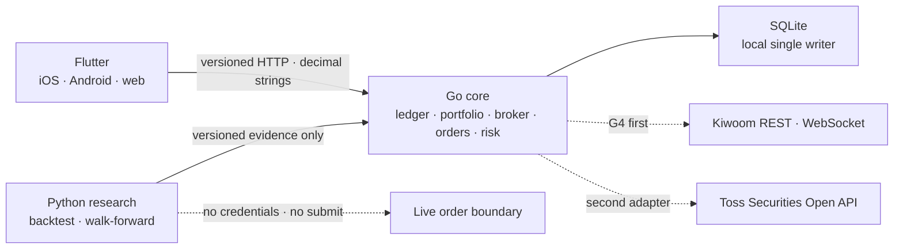

# Omni-Folio

[한국어](README.md) · [日本語](README.ja.md) · [English](README.en.md) · [简体中文](README.zh-CN.md)

개인용 멀티 증권 포트폴리오와 안전한 자동매매를 위한 local-first 플랫폼입니다. Flutter 하나로 iOS·Android·web을 제공하고, Go가 원장·브로커·주문·리스크의 권한을 소유하며, Python은 재현 가능한 연구와 백테스트만 담당합니다.

[현재 상태](#status) · [아키텍처](#architecture) · [빠른 시작](#quick-start) · [사용 흐름](#workflows) · [명령](#commands) · [문서](#documentation) · [안전 원칙](#safety)

한국어 README를 기준으로 네 언어의 구성·명령·지원 범위를 함께 갱신합니다. 연결된 상세 설계와 검증 문서는 한국어 또는 영어로 제공됩니다. README 번역은 앱의 표시 언어 지원을 뜻하지 않습니다.

> [!IMPORTANT]
> 현재 실거래와 브로커 연결은 비활성입니다. 이 저장소의 백테스트·전략 결과는 수익을 보장하지 않으며 투자 조언이 아닙니다.

<a id="status"></a>

## 현재 상태

| Gate | 상태 | 증거 |
|---|---|---|
| G0 아키텍처·계약 | 로컬 통과 | 버전이 명시된 OpenAPI/JSON Schema, 런타임 책임 분리, 저장소 공통 명령 |
| G1 로컬 원장 | 로컬 통과 | CSV 검토·원자적 반영, 정확한 거래·현금·분할·FX 재생, FIFO 원가·저장 가격 평가, schema v26/backup v20와 지원하는 과거 형식의 복구 |
| G2 Flutter 클라이언트 | 부분 통과 | iOS·Android·web 릴리스 빌드, 자동 파서·위젯 검사와 Android 에뮬레이터 프레임 측정. iOS 무서명 패키지의 테스트 플러그인 제외 확인. 실기기·수동 스크린 리더·스토어 검증은 남음 |
| G3 연구·모의 실행 | 부분 통과 | 재현 가능한 백테스트·walk-forward·홀드아웃, 후보 등록, 로컬 모의 체결·성과·중지·복구. 장기 운영·소스 전달의 완결성은 미검증 |
| G4 브로커·차트·주문 | 진행 중 | 로컬 샘플 차트, 저장된 대조·주문 기록 조회, 자격 증명 없는 키움 합성 계약. 실제 인증을 사용하는 시세·모의주문 관찰, 결과 미확정 주문 복구와 모든 실거래 단계는 남음 |

세부 상태와 완료 조건은 [`PLAN.md`](PLAN.md)와 [`GATES.md`](GATES.md)에서 관리합니다.

<a id="architecture"></a>

## 아키텍처



- Flutter와 Python에는 증권사 credential이나 주문 제출 권한이 없습니다.
- Go core만 canonical 원장과 주문 상태를 변경할 수 있습니다.
- SQLite는 로컬 단일 writer 단계의 의도적인 선택입니다. PostgreSQL migration·restore·load evidence 전에는 multi-replica나 Kubernetes manifest를 만들지 않습니다.
- G6 진입 뒤의 로컬 Kubernetes 검증 기준은 `Kind + Podman`입니다. 현재 Kind 클러스터는 provision하지 않았고, G6 증거 전에는 manifest도 만들지 않습니다.
- 토스증권의 쉬운 용어와 차분한 정보 위계를 참고하되 화면·상표·trade dress는 복제하지 않습니다.

결정 근거는 [`docs/adr/0001-runtime-and-monorepo.md`](docs/adr/0001-runtime-and-monorepo.md), 브로커 순서와 UX 계약은 [`docs/broker-priority-and-ux.md`](docs/broker-priority-and-ux.md)를 따릅니다.

<a id="quick-start"></a>

## 빠른 시작

필요한 도구:

- GNU Make 3.81+
- asdf 0.20+
- `curl`
- Docker Engine + Compose v2 (컨테이너 실행 시에만 필요)

프로젝트의 [`.tool-versions`](.tool-versions)는 Flutter 3.47.1 stable, Go 1.24.5, Python 3.14.5를 고정합니다. Python research runtime에는 제3자 패키지가 없습니다.

```sh
git clone https://github.com/YouSangSon/Omni-Folio.git
cd Omni-Folio
asdf install
make bootstrap
make check
make smoke
```

`make test`, `make check`, `make smoke`는 실행별 temp root에 owner PID·command·start identity와 child PGID·start identity를 기록합니다. 성공·실패·SIGINT/SIGTERM에서는 trap이 프로세스 그룹과 temp/build/coverage/bytecode를 정리하고, SIGKILL처럼 trap을 건너뛴 경우에는 다음 실행이 동일 소유권 증거로 stale group과 root를 회수합니다. PID 재사용이나 동시 실행은 보존하며, group leader가 먼저 종료된 owned child도 회수합니다. 현재 테스트는 Podman/Kind 리소스를 만들지 않습니다. 이후 로컬 Kubernetes 검증은 실행별 session label과 기록한 resource ID로만 정리하며, 그 wrapper가 생기기 전에는 일반 cleanup이 다른 세션의 컨테이너나 cluster를 삭제하지 않습니다. 전체 Flutter/QA 캐시까지 비우려면 `make clean`을 사용합니다.

### 앱 실행

첫 번째 터미널:

```sh
make run-core WEB_ORIGIN=http://localhost:8081
```

두 번째 터미널:

```sh
make seed-demo
make run-client
```

- API: `http://127.0.0.1:8080`
- Flutter web: `http://localhost:8081`
- local DB: `data/omni-folio.db`

`make seed-demo`는 판단 가능한 첫 화면을 위해 기존 `golden-import.csv`를 실제 preview/apply API로 통과시켜 USD 현금, AAPL 보유 수량과 FIFO 원가, 실현 손익을 채웁니다. 별도 mock API나 우회 쓰기를 만들지 않으며, 이미 적용된 이벤트는 다시 넣지 않습니다. 개인 데이터를 바로 시작하려면 이 명령만 생략하세요. 실행 중인 앱에서는 상단 새로고침을 누르면 샘플 원장이 표시됩니다.

`make run-core`는 `contracts/fixtures/market-bars.csv`를 명시적으로 전달하므로 AAPL 보유 항목에서 샘플 종목 차트를 확인할 수 있습니다. 화면과 API 모두 이를 `샘플 데이터 · 실시간 아님`으로 표시합니다. fixture 없이 fail-closed 동작을 확인하려면 `make run-core MARKET_FIXTURE=`를 사용합니다.

다른 API 포트를 사용할 때는 core와 client를 함께 바꿉니다.

```sh
make run-core CORE_ADDR=127.0.0.1:18080 WEB_ORIGIN=http://localhost:8081
make seed-demo API_URL=http://127.0.0.1:18080
make run-client API_URL=http://127.0.0.1:18080
```

`OMNI_API_URL`은 Flutter build-time 값이며 secret을 넣으면 안 됩니다. Make는 `.env`를 자동으로 읽지 않습니다.

Android ARM64 기기나 에뮬레이터에서 로컬 API를 확인할 때는 아래처럼 release APK를 설치합니다. core는 먼저 호스트에서 실행하고, `adb devices`에 나온 ID를 사용하세요. 기기의 `127.0.0.1`은 기기 자체이므로 `adb reverse`로 호스트 API에 연결합니다. 이 APK는 현재 debug key로 서명한 로컬 검증용이며 스토어 배포 검증은 별도입니다.

```sh
cd apps/client
flutter build apk --release --target-platform android-arm64 --dart-define=OMNI_API_URL=http://127.0.0.1:8080
OMNI_ANDROID_DEVICE=emulator-5554
adb -s "$OMNI_ANDROID_DEVICE" reverse tcp:8080 tcp:8080
adb -s "$OMNI_ANDROID_DEVICE" install -r build/app/outputs/flutter-apk/app-release.apk
```

macOS와 Xcode에서 테스트 플러그인을 제외한 iOS 무서명 릴리스를 만들려면 저장소 루트에서 실행합니다. 고정된 Flutter SDK와 캐시된 의존성이 필요합니다. 커밋된 앱의 임시 복사본에서만 `integration_test`를 제거하고 운영 의존성 잠금이 그대로인지 확인하므로, 원본 앱의 profile harness는 유지됩니다.

```sh
make check-ios-release
make client-ios-release API_URL=http://127.0.0.1:8080
```

결과는 `output/ios-release-<source SHA>/Runner.app`과 `build.json`입니다. `COMPLETE`가 있어야 바이너리 검사와 소유 임시 자원 정리까지 성공한 결과입니다. 기존 출력은 덮어쓰지 않습니다. 서명·설치·실기기·스토어 검증은 별도입니다. [빌드 원리와 검증 근거](gates/g2-client.md#ios-release-packaging-2026-10-25)를 참고하세요.

<a id="workflows"></a>

## 검증 가능한 수직 슬라이스

### CSV import

Preview는 원장을 변경하지 않습니다. 반환된 `preview_id`를 새 idempotency key와 함께 apply합니다.

거래 내역 화면에서 텍스트를 붙여 넣거나 `CSV 파일 선택`으로 `UTF-8`·`1MiB` 이하 파일을 불러옵니다. 선택만으로 전송·적용되지 않으며, 내용을 확인한 뒤 미리보기와 적용을 각각 실행합니다. 취소·읽기 오류는 기존 입력과 결과를 보존합니다. [파일 입력의 검증 범위](gates/g4p-first-run-import-recovery.md#csv-file-selection)

CSV 없이 한 건을 준비하려면 `거래 직접 입력` → `검토용 초안 만들기`를 사용하세요. 기존 CSV 초안 전체를 바꾸며, 취소하면 기존 입력과 결과를 보존합니다. 10가지 기록 유형을 지원하고 매수·매도 현금은 정확한 소수로 계산합니다. 현재 로컬 기본 계좌 `account-main`과 기본 종목 해석 `AAPL`을 사용하며 실제 주문은 보내지 않습니다. 초안에서 미리보기와 반영을 각각 실행하세요. 반영 여부가 불확실하면 앱을 닫거나 같은 거래를 새로 작성하지 말고 같은 요청을 재시도하세요. 다른 CSV로 바꿨거나 탭을 이동했다면 `이전 요청 재시도`로 원래 요청을 보냅니다. 아직 미반영이면 이 재시도가 원장을 변경할 수 있습니다. 재시도 정보는 앱 세션 안에서만 유지됩니다. [직접 입력과 결과 구분](gates/g4p-first-run-import-recovery.md#manual-entry)

CSV type은 `DEPOSIT`, `WITHDRAWAL`, `BUY`, `SELL`, `DIVIDEND`, `FEE`, `TAX`, `SPLIT`, `CASH_VOID`, `FX_EXCHANGE`입니다. 금액과 수량은 canonical decimal string이며, 현금 event 부호와 split의 zero cash impact는 apply 전에 검증됩니다. `CASH_VOID`만 optional `corrects_source_event_id` column을 사용하며, 이미 적용된 같은 계좌·통화 cash-like event의 exact 반대 금액이어야 합니다. 원본은 삭제되지 않고 Flutter preview에 원본 source/type/currency/amount와 상쇄 금액이 함께 표시됩니다. `FX_EXCHANGE`는 매도 leg의 `currency`/음수 `amount`와 서로 다른 매수 leg의 `counter_currency`/양수 `counter_amount`를 하나의 행에 요구합니다. 두 금액은 환율이나 현재 시세를 뜻하지 않으며 수수료는 별도 `FEE` 행으로 기록합니다.

```sh
preview_file="$(mktemp)"
curl -fsS -X POST \
  -H 'Content-Type: text/csv' \
  --data-binary @contracts/fixtures/golden-import.csv \
  http://127.0.0.1:8080/v1/imports/preview > "$preview_file"

preview_id="$(python3 -c 'import json,sys; print(json.load(open(sys.argv[1]))["preview_id"])' "$preview_file")"
curl -fsS -X POST \
  -H 'Content-Type: application/json' \
  --data "{\"preview_id\":\"$preview_id\",\"idempotency_key\":\"local-apply-001\"}" \
  http://127.0.0.1:8080/v1/imports/apply

curl -fsS http://127.0.0.1:8080/v1/portfolio/snapshot
rm -f "$preview_file"
```

Golden fixture의 기대값은 신규 3행, revision `rev_0000000003`, USD cash `778`, AAPL 6주, cost basis `300.6`입니다. 동적 ID와 timestamp는 매 실행마다 달라집니다.

### 원장 활동 CSV 내보내기

검증된 원장의 공개 거래 필드를 CSV로 저장합니다. 같은 DB 관찰의 최신 순서를 유지하고 계좌·내부 ID는 제외합니다. 숫자와 시각은 원문 문자열을 보존하며, 원본과 정정 행은 함께 남습니다.

```sh
mkdir -p -m 700 data/exports
(cd services/core && go run . ledger-export \
  -db ../../data/omni-folio.db \
  -out ../../data/exports/ledger.csv)
```

`ledger-activity-export.v1` 영수증에는 revision·행 수·SHA256이 나옵니다. 기존 출력은 덮어쓰지 않습니다. 최대 10,000행·32 MiB를 넘거나 안전하지 않은 종목 표기가 있으면 실패합니다. 출력 폴더는 현재 사용자 소유이며 다른 사용자에게 쓰기가 허용되지 않아야 하고, 상위 경로도 신뢰할 수 있어야 합니다. 이 CSV는 backup·재가져오기 형식이 아닙니다. 스프레드시트에서는 모든 열을 텍스트로 가져오세요. [계약과 한계](gates/g1r-ledger-activity-export.md)

### 기존 원장의 시간 재생 정책 전환

schema26/backup v20은 정확한 UTC 순서의 FIFO v2 정책을 사용합니다. 기존 원장이 있는 DB는 migrate만으로 정상 실행되지 않습니다. 구 core를 중지하고 원본 backup을 보존한 뒤 [G1.20의 preview → 검토 → activate → 새 backup 검증 절차](gates/g1p-chronological-ledger-replay.md#로컬-전환-절차)를 따릅니다. 과거 backup의 보관 검증과 현재 정책 활성화를 구분합니다.

### Local sample OHLCV chart

```sh
curl -fsS 'http://127.0.0.1:8080/v1/market-data/candles?symbol=AAPL&interval=1d'
```

응답은 canonical decimal string과 함께 `price_adjustment=unspecified`, `source=local_fixture`, `sample=true`, `state=stale`를 반환합니다. 보유 화면에서 AAPL을 열면 가격·거래량 chart, 마지막 수신 봉 기준 `30일/90일/365일/전체` 표시 범위, 가격 조정 기준, source/as-of, screen-reader summary와 선택 범위를 공유하는 정확한 OHLCV 표를 볼 수 있습니다. `unspecified`는 가격 조정 여부를 확인하지 못했다는 뜻입니다. 이 client-side 범위 선택은 새 시세 조회나 candle completeness를 뜻하지 않으며, fixture는 계약·UI 검증용일 뿐 현재 시세나 투자 판단 자료가 아닙니다.

기존 `market-bars.csv`는 종목 ID·가격 통화를 제공하지 않으므로 API의 `instrument_id`와 `currency`는 `null`입니다. 화면에서도 연결·통화를 확인할 수 없다고 표시합니다. ID·통화를 명시한 샘플은 `make run-core MARKET_FIXTURE=contracts/fixtures/market-bars-identified.csv`로 읽습니다. 확장 CSV는 기존 10개 열 뒤에 `instrument_id,currency`를 정확히 추가하며 모든 행의 값이 같아야 합니다. 두 값은 원천의 선언이며 거래소 검증을 뜻하지 않습니다. 상세 화면은 선택한 보유 종목과 다른 ID·통화의 자료를 거절하고 이전 정상 자료와 시각을 유지합니다.

두 형식 모두 `bar_time_basis=unspecified`입니다. `at`은 정렬된 시각 표기일 뿐 거래일·봉 시작/종료·체결의 소속 봉을 증명하지 않습니다. 가격 조정과 시간 기준이 미확인이라 평균단가 선·원장 매매 마커는 아직 표시하지 않습니다. 원본 CSV와 연구 artifact hash는 바뀌지 않습니다. 검증 범위는 [G4W](gates/g4w-chart-source-basis.md)를 참고합니다.

### 종목 원장 평균원가와 매매 기록

보유 → 종목 상세 → 상단 `원장 평균단가·매매 보기`에서 현재 잔여 평균원가와 최근 매수·매도 50건을 확인합니다. 시세 조회 실패 중에도 진입할 수 있습니다. 새로고침 실패 시 이전 결과와 기준시점을 함께 유지합니다.

```sh
curl -fsS 'http://127.0.0.1:8080/v1/portfolio/instrument-ledger?instrument_id=instrument_aapl&currency=USD'
```

기존 snapshot의 종목 ID와 통화를 그대로 사용합니다. 한 원장 버전에서 모든 가져온 계좌를 합산하며, 남은 FIFO 원가와 수량은 정확한 소수 문자열로 보존하고 평균만 소수 8자리 half-even으로 표시합니다. Golden fixture는 6주·원가 USD 300.6·평균 USD 50.1입니다. 수량이 0이면 평균은 `null`, 매매 기록이 전혀 없으면 404입니다. `has_more=true`는 더 오래된 매매가 생략됐다는 뜻입니다.

매매 행은 분할로 고치지 않은 원본이며 현재 원가는 원장 분할을 반영합니다. 로컬 기록은 증권사 확인 체결이 아니고, 이 화면은 차트 위의 평균선·매매 마커를 활성화하지 않습니다. [G4X 검증 범위](gates/g4x-instrument-ledger-detail.md)를 참고합니다.

### Direct FX observation foundation

G1.10은 `1 base_currency = rate quote_currency` 방향의 환율 관측값을 schema v10 `STRICT`/insert-only series에 보존합니다. source observation identity, exact decimal rate, observed/fetched/recorded UTC 시각과 canonical row hash를 검증하며 같은 source·pair·observed-at 충돌을 거절합니다. `GET /v1/market-data/fx/latest`는 explicit `as_of` 이전에 관측되고 수신된 exact 방향만 반환하고 `sample=true`, `state=stale`를 유지합니다. 반대 방향을 자동 역산하거나 `FX_EXCHANGE` cash leg를 환율로 사용하지 않습니다.

이 fixture writer와 GET 계약은 그대로 유지합니다. 직접 입력 환율은 아래의 별도 버전 journal로 들어오며 이 GET에 섞이지 않습니다. provider 자동 수집과 scheduler는 없고 `PortfolioSnapshot.valuation_status`는 계속 `unavailable`입니다.

### 직접 입력 환율의 버전 보관과 성과 연결

소유자가 준비한 직접 환율 파일을 기존 DB에 반영하면 현금·현재 KRW 평가·TWR·XIRR·USD 지수의 원화 환산이 같은 입력 버전을 사용합니다. 방향은 `1 USD = rate KRW`이며 역산이나 교차환율을 만들지 않습니다.

```sh
(cd services/core && go run . owner-fx-import -db ../../data/omni-folio.db -input ../../contracts/fixtures/owner-fx-usdkrw-sample.json)
```

이 파일은 오래된 `sample=true` 예시입니다. 실제 자료가 아니며 현재 평가의 24시간 조건을 충족하지 않습니다. 실제 파일은 [닫힌 입력 계약](contracts/owner-fx-series.schema.json)을 따릅니다. 자료를 수정할 때 새 `source_version`으로 전체 점을 제출하며, 빈 `points`는 해당 방향의 사용을 철회합니다. 빠진 점을 이전 버전에서 채우지 않으며 과거 버전 재시도도 최신 버전을 바꾸지 않습니다. 한 방향은 fixture와 직접 입력을 혼합할 수 없고 철회 후에도 출처 구분은 유지됩니다.

`storage_check=verified`는 저장 무결성만 뜻합니다. `sample=false`여도 화면에는 “직접 입력 환율 사용” 안내가 남습니다. 관측·수집·기록 시각과 24시간 조건을 별도로 검증하며, 종목 가격·브로커 시세·공식 제공자의 정확성을 인증하지 않습니다. [정책·복구·검증 범위](gates/g1w-owner-fx-series.md)

### 직접 입력 종목 가격으로 평가·성과 계산

먼저 CSV로 반영한 종목의 가격 파일을 기존 DB에 넣습니다. 종목 ID는 원장의 canonical ID(`AAPL`은 `instrument_aapl`)를 사용하고 표시명 대소문자를 바꾸기 위해 원장을 수정하지 않습니다.

```sh
(cd services/core && go run . owner-price-import -db ../../data/omni-folio.db -input ../../contracts/fixtures/owner-price-aapl-sample.json)
```

[입력 계약](contracts/owner-price-series.schema.json)의 `unadjusted`는 관측 순간 원장 1주당 해당 통화 가격이라는 소유자 선언입니다. 과거 분할·배당을 소급 조정하지 않습니다. 분할 후 보유 수량에는 마지막 분할 시각보다 엄격히 늦은 가격이 필요합니다. 이 예시는 오래된 `sample=true` 합성 자료이므로 현재 평가의 24시간 조건을 충족하지 않습니다.

한 종목·통화의 최신 파일 전체를 평가·TWR·XIRR·KRW/USD 지수 비교에 사용합니다. 새 `source_version`은 전체 교체, 빈 `points`는 철회이며 빠진 과거 점을 이전 버전에서 채우거나 옛 파일 재시도로 되살리지 않습니다. 같은 종목·통화는 기존 fixture/Kiwoom 가격과 섞을 수 없고 철회 후에도 이 구분이 남습니다. 한국어 화면의 “직접 입력 가격 사용” 안내는 `sample` 및 환율 안내와 독립적입니다. 저장 검증은 제공자의 정확성·현재 시세 인증이 아닙니다. [단위·복구·검증 범위](gates/g1x-owner-price-series.md)

앱의 **연결 → 가격·환율·지수 파일 가져오기**에서 UTF-8 JSON(최대 1MiB)을 선택하고 **입력 형식 검토 → 검토한 파일 저장**을 누릅니다. KRW·USD 지수를 모두 지원합니다. 검토는 입력 형식만 확인하며 저장 가능 여부·최신성·제공사 인증을 보증하지 않습니다. 새 버전은 전체 대체이고 빈 가격·환율은 철회입니다. 저장 여부가 불확실하면 일치하는 확인서를 받을 때까지 같은 원본으로 재시도하세요. 화면 이동 중 대기는 유지되지만 앱 종료 후에는 유지되지 않습니다. 파일의 영구 보관 권한도 확인하세요. [계약·검증 범위](gates/g1y-owner-data-import.md)

### 입출금을 반영한 연환산 수익률

홈의 `입출금을 반영한 수익률 보기`에서 원장 시작 이후의 `XIRR`을 조회합니다. 입출금 날짜와 현재 KRW 평가액을 함께 사용하며, 거래·배당·비용을 추가 입출금으로 중복 계산하지 않습니다. UTC 날짜의 실제 일수를 365일 기준으로 연환산합니다.

유일한 계산값만 대표 수익률로 표시합니다. 유일성을 보장하지 못한 값은 상세의 참고 후보로 구분하며, 가격·과거 환율 누락이나 수치 계산 실패는 0%로 대신하지 않습니다. 예시 관측이 하나라도 쓰이면 sample 표시를 유지합니다. 앱은 현재 증권사 성과를 확인한 것으로 표현하지 않습니다.

```sh
curl -fsS http://127.0.0.1:8080/v1/portfolio/xirr
```

[정책·출처·검증 범위](gates/g1s-portfolio-xirr.md)

### 입출금 영향을 뺀 누적 수익률

수익률 상세의 `입출금 영향을 뺀 누적 수익률 보기`에서 원장 시작 이후의 `TWR`을 조회합니다. 입출금 경계별 자산 변화를 이어 계산하며 연환산하지 않습니다. 동일 시각의 외부 입출금을 먼저 처리하고, 정정된 원본 현금 기록은 과거 잔액에서도 제외합니다.

각 경계에 필요한 과거 가격·직접 환율이 없거나 24시간을 넘으면 계산하지 않습니다. 중간 자본이 0 이하인 경로와 분할의 가격 단위가 모호한 경우도 계산 불가로 표시합니다. 전액 출금은 전액 손실로 표시하지 않으며, 예시 관측을 포함한 결과는 실제 투자 성과가 아닙니다.

```sh
curl -fsS http://127.0.0.1:8080/v1/portfolio/twr
```

[계산 기준·출처·검증 범위](gates/g1t-portfolio-twr.md)

### 입출금 구간별 성과 차트와 표

TWR 상세의 `입출금 구간별 성과 보기`에서 같은 응답에 담긴 KRW 누적 수익률과 계산점 차트·표를 확인합니다. 입출금 경계와 조회 기말만 표시하므로 입금이 한 번이면 두 점뿐이며, 점선은 일별 가격 경로가 아닙니다. 평가 경계 시각은 시장 가격 관측 시각과 다릅니다.

가격·환율 출처와 예시 경고를 유지하며, 새로고침 실패 시 이전 보고서 전체와 원래 기준 시점을 보존합니다. 표는 서버가 반올림한 비율과 같은 시각의 처리 단계를 제공합니다. 실제 시세·일별 이력·배포 검증과 구분합니다.

```sh
curl -fsS http://127.0.0.1:8080/v1/portfolio/twr/checkpoints
```

[계약·계산 원리·검증 범위](gates/g1z-twr-checkpoints.md)

### KRW·USD 비교 지수 원본 보관

비교 기준은 `KRW`와 `USD`를 모두 지원합니다. 원본은 `price_index`, `gross_total_return`, `net_total_return` 중 하나를 선언한 정규화 지수 파일이어야 합니다. 아래 두 파일은 `sample` 예제이며 실제 시장 자료가 아닙니다.

배당 재투자를 포함하는 실제 비교 자료는 KRW의 KOSPI 200 TR과 USD의 S&P 500 Total Return을 우선 검토합니다. 정확한 시리즈·통화 판·관측 시각·저장/표시 사용권을 확인한 파일이 필요합니다. 현재 실제 파일과 사용권은 확보하지 않았습니다. [공식 정의·사용 조건·도입 절차](gates/g1u-benchmark-series.md#benchmark-source-policy)를 확인하세요.

```sh
(cd services/core && go run . benchmark-import -db ../../data/omni-folio.db -input ../../contracts/fixtures/benchmark-krw-sample.json)
(cd services/core && go run . benchmark-import -db ../../data/omni-folio.db -input ../../contracts/fixtures/benchmark-usd-sample.json)
(cd services/core && go run . benchmark-status -db ../../data/omni-folio.db -benchmark-id synthetic_usd)
```

`authority=owner_declared`는 소유자가 제공한 자료라는 뜻이고, `storage_check=verified`는 저장된 내용의 무결성만 확인했다는 뜻입니다. 같은 `source_version`의 내용이나 `fetched_at`이 바뀌면 충돌로 거부하며, 과거 버전 재시도는 최신 선택을 바꾸지 않습니다. 실제 지수의 배당·분할 정의와 데이터 사용 권한은 별도 확인 대상입니다. 보관한 자료의 동일 기간 비교는 아래에서 제공합니다.

[입력 계약·복구 정책·검증 범위](gates/g1u-benchmark-series.md)

### 같은 기간의 지수와 비교

TWR 상세의 `같은 기간의 지수와 비교하기`에서 보관한 각 지수의 최신 버전을 함께 조회합니다. 모든 결과는 응답 하나의 원장·보고서 시점과 같은 기간을 사용합니다. `KRW` 지수는 그대로, `USD` 지수는 본래 통화 수익률과 원화 환산 수익률을 구분합니다.

```sh
curl -fsS http://127.0.0.1:8080/v1/portfolio/benchmarks
```

차이는 공개된 포트폴리오 수익률에서 원화 기준 지수 수익률을 뺀 `%p`입니다. 배당·세금 기준을 함께 표시하며, FX가 부족하면 본래 통화 값만 유지합니다. 24시간을 넘긴 관측·0인 시작 지수·자료 부족은 계산 불가로 표시하고 예시 자료를 실제 성과로 인증하지 않습니다. 한 번에 최대32개를 비교하며 새로고침 실패 시 이전 비교 전체와 시점을 유지합니다.

[정책·출처·검증 범위](gates/g1v-portfolio-benchmark-comparison.md)

### 관심종목과 저장 가격

앱 상단의 `관심종목`에서 한국(XKRX·KRW), 미국(XNAS/XNYS·USD) 종목을 최대 50개까지 등록·삭제합니다. 관심목록은 서버에 저장되며 보유자산·원장·종목 등록 권한과 별개입니다. 입력한 종목의 실제 상장 여부는 확인하지 않습니다.

가격은 시장·심볼·통화가 같은 저장 자료만 표시합니다. 직접 입력·샘플·오래된 가격 안내와 관측 시각을 확인하세요. 자료가 없거나 출처가 모호하면 해당 종목의 가격을 숨기고 다른 종목은 유지합니다. 새 관심종목에는 가격이 없을 수 있으며, 기존 가격 파일 입력은 원장에 등장한 종목만 허용합니다.

저장 응답을 놓치면 같은 변경을 재시도하거나 현재 목록을 다시 불러옵니다. 이때 요청은 앱 실행 중 화면 이동에도 유지되지만 앱 종료 후에는 유지되지 않습니다. 실시간 시세 연결·자동 갱신은 제공하지 않습니다.

```sh
curl -fsS http://127.0.0.1:8080/v1/watchlist
```

[저장·재시도·복구 계약과 검증 범위](gates/g4y-stored-watchlist.md)

### Direct-FX cash valuation

G1.11의 `GET /v1/portfolio/cash-valuation`은 replay-verified 현재 원장 cash를 요청한 기준통화로만 평가합니다. canonical UTC `as_of`와 `base_currency`를 필수로 받고, 같은 읽기 transaction에서 원장 event와 FX series 전체를 검증합니다. 동일 통화와 0 잔액 외에는 `cash currency -> base currency` 방향의 직접 관측만 사용하며, 관측 시각부터 24시간 경계를 포함합니다. inverse·cross·interpolation·`FX_EXCHANGE` 추론과 표시용 반올림은 사용하지 않습니다.

누락되거나 24시간보다 오래된 pair가 하나라도 있으면 native cash line과 문제만 반환하고 aggregate total은 숨깁니다. local fixture를 사용한 완전한 결과도 `sample=true`, `status=stale_sample`입니다. 이 API는 현금 전용이며 보유자산·손익·성과·현재 시세를 평가하지 않고 Flutter 화면에도 연결하지 않았습니다. `PortfolioSnapshot.valuation_status`는 계속 `unavailable`입니다.

```sh
curl -fsS 'http://127.0.0.1:8080/v1/portfolio/cash-valuation?base_currency=KRW&as_of=2026-01-11T14:00:00Z'
```

### Durable security price observation foundation

G1.12는 보유자산 평가에 앞서 local fixture 종목 가격을 schema v11에서 도입한 `STRICT`/insert-only series에 보존합니다. source identity, instrument ID, symbol, venue, currency, positive canonical price, `price_adjustment=unspecified`, observed/fetched/recorded UTC 시각과 canonical row hash를 검증합니다. 내부 exact-as-of 조회는 모든 identity 차원을 고정하고 세 시각이 cutoff 이하인 관측만 선택합니다.

G4U checkpoint의 backup v8은 가격 series digest/count를 검증하며 legacy artifact를 원본을 바꾸지 않는 owned copy에서 schema v13으로 migration했습니다. 현재 schema v26/backup v20도 그 가격 proof를 보존합니다. 빈 restore 후보는 embedded migration과 동일한 table DDL·latest index·insert-only trigger를 요구합니다. public API, Flutter 화면, provider 요청, scheduler 또는 broker-backed 보유·손익·성과 평가는 추가하지 않았고 `PortfolioSnapshot.valuation_status`는 계속 `unavailable`입니다.

### Stored-price native-currency holding valuation

G1.13의 `native_holding_valuation_v1`은 같은 read-only transaction에서 현재 ledger snapshot과 append-only event proof, 전체 security-price series를 다시 검증합니다. 보유자산의 internal instrument ID·symbol·currency에 연결되는 as-of venue가 정확히 하나일 때만 24시간 이내 local fixture 가격으로 원통화 시장가와 미실현손익을 계산합니다. 여러 venue, 누락, stale 또는 미래 observed/fetched/recorded 값은 해당 line에 sanitized issue를 남기고 모든 통화별 aggregate를 숨깁니다.

G1.15는 이 기존 모델을 `GET /v1/portfolio/holding-valuation`과 Flutter 보유자산의 `저장 가격으로 평가 보기` 상세에 연결합니다. 내부 instrument/observation ID는 응답에서 제외하며 수량·원가·원통화 평가액·미실현손익과 가격 provenance를 같은 원장 revision으로 표시합니다. `as_of` 생략 시 서버 UTC now를 쓰고 explicit cutoff는 canonical UTC만 받습니다. 조회 실패 시 이전 결과의 기준시점과 revision을 함께 보존하며 오류 상세는 노출하지 않습니다.

```sh
curl -fsS 'http://127.0.0.1:8080/v1/portfolio/holding-valuation'
```

저장 가격이 없거나 24시간보다 오래되면 합계는 숨겨집니다. `make seed-demo`는 거래 원장만 채우므로 가격 누락은 정상입니다. 모든 가격이 있어도 local sample/stale이며 통화를 합산하거나 현재환율로 역사적 원가를 환산하지 않습니다. provider ingestion, whole-portfolio total 또는 live/current authority는 추가하지 않았고 `PortfolioSnapshot.valuation_status`는 계속 `unavailable`입니다. G1.14부터 snapshot/OpenAPI는 `fifo_exact_else_half_even_residual_8_v1`을 명시합니다. 기존 유한 decimal FIFO 배분은 exact 유지하고 반복소수만 half-even 양자화하며, 잔여 원가는 열린 lot에 남아 최종 청산 때 모두 소비됩니다. 이 분석용 정책은 세무 원가 규칙을 대신하지 않습니다.

### Credential-free Kiwoom latest trade

G4Q는 공식 `ka10079` 1틱 응답을 기존 Kiwoom OAuth/read transport의 합성 in-memory 응답으로 검증합니다. KRX 6자리 symbol, exact 가격 magnitude, provider `cntr_tm`과 별도 fetch 시각만 canonical 내부 DTO로 반환하며 잘못된 row, 시간 역행, 같은 초의 서로 다른 가격과 로컬 수신 시각보다 미래인 체결은 전체 거절합니다.

G4Q 자체는 실제 credential·외부 요청·public API·DB writer를 추가하지 않습니다. 공식 응답에 durable event ID와 명시적 timezone/price-adjustment 근거가 없으므로 G4S는 다음 단계에서 trade ID가 아니라 보수적인 관측 슬롯으로만 저장합니다.

### Credential-free Kiwoom durable latest-trade observation

G4S는 G4Q의 `KiwoomLatestTrade` DTO를 Go 내부 writer로만 schema v12에서 확장한 가격 series에 저장합니다. source는 `kiwoom_mock` 또는 `kiwoom_production`으로 분리하고, identity는 provider trade ID가 아니라 `ka10079`·환경·내부 instrument ID·`XKRX`·6자리 symbol·`KRW`·`unspecified`·provider observed second를 묶은 관측 슬롯입니다. 같은 슬롯의 같은 가격은 반복 fetch여도 no-op이고, 같은 초의 다른 가격·tampered ID·비 KRX/KRW identity는 거절합니다.

이 저장값은 아직 valuation authority가 아닙니다. 기존 holding valuation과 public snapshot은 계속 `local_fixture`만 읽고, scheduler·route·Flutter 화면·실제 credential·주문 판단은 추가하지 않았습니다.

### Owner-declared instrument listing ownership

G4U는 schema v13의 append-only `DECLARE`/`REVOKE` 원장으로 `(venue,symbol,currency)`와 내부 instrument ID의 현재 관계를 소유자가 명시하게 합니다. 키움 one-shot capture는 active listing이 없거나 철회·손상됐으면 token 요청 전 중단하고, 신규 가격 writer는 insert transaction 안에서 같은 관계를 다시 확인합니다. 기존 v12 가격은 보존하지만 종목 코드 관례나 과거 가격에서 소유권을 만들지 않습니다.

Backup v8은 listing 전체 hash와 event/active count를 원본·복원 후보에서 비교합니다. 이 원장은 provider 검증, historical effective dating, freshness, valuation·strategy·order authority가 아니며 외부 등록 API/UI도 아직 없습니다.

### Credential-free Kiwoom realtime price

G4R는 공식 WebSocket `0B`의 단일 KRX-format symbol 등록 packet과 `REAL` JSON frame만 stdlib로 검증합니다. signed 현재가는 exact magnitude로, 필드 `20`은 날짜 없는 `provider_clock`, 로컬 수신 시각은 별도 `received_at`으로 보존합니다. 같은 frame의 동일 symbol/clock/price는 한 번만 반환하고 같은 clock의 다른 가격은 모호성 오류로 전체 거절합니다. 외부 입력은 1 MiB와 100 entries로 제한합니다.

WebSocket 연결, LOGIN/PING, 재연결·재구독, backpressure, credential, persistence, public API/UI는 아직 없습니다. 공식 FID `9081`의 값 의미도 실제 관찰 전에는 해석하지 않아 DTO가 venue를 주장하지 않습니다. 따라서 이 내부 DTO는 live/current/freshness나 durable 체결·가격 관측 근거가 아닙니다.

### Internal synthetic order recovery, execution authority, reconciliation, and mock submit

K2A/K2B0는 Go 내부에서 Kiwoom `LIMIT`/`KRW`/`KRX` intent와 append-only lifecycle, `SUBMIT_UNKNOWN` 중복 방지, cancel/fill replay와 이미 알려진 주문번호의 원자적 체결 조정을 검증합니다. K2B1은 명시 날짜의 synthetic `kt00009` 체결 row를 non-joinable scan으로 보존합니다. K2C는 기본 차단 kill switch, 프로세스별 lease/fencing, `005930`·`000660` BUY의 10주·주문 100만 원·계좌 활성 예약 100만 원 한도를 검증합니다. K2B2는 합성 credential과 in-memory transport로 공식 `kt10000` mock 지정가 요청을 재현하며 token preflight, durable dispatch-before-write, write 무재시도, opaque ACK와 unknown/reject 분기를 검증합니다. 외부 broker 호출, public 주문 API/UI와 live 권한은 없습니다.

```sh
cd services/core
go test -run '^(TestK2A|TestK2B0|TestK2B1|TestK2B2|TestK2C)' -count=1 ./...
```

K2B0는 속성·시간이 같은 주문이 보여도 주문번호 없는 `SUBMIT_UNKNOWN`을 결합하지 않습니다. K2B1의 terminal pagination도 전체 체결 이력 완료를 뜻하지 않으며 날짜와 timezone 없는 체결 시각을 합쳐 UTC를 만들지 않습니다. K2B2의 write는 401을 포함해 자동 재시도하지 않으며 결과가 불명확하면 재주문 대신 조회·reconciliation을 기다립니다. 실제 credentialed mock 관찰, unknown-submit 조회 복구, cash·position·fee·손실·시장시간·stale-data 한도, owner/strategy 승인, broker/ledger reconciliation과 Flutter 주문 흐름은 남아 있습니다.

### Credential-free known-good broker snapshot

G4H는 기존 합성 `KiwoomSnapshot` 중 `complete=true`인 KRX snapshot만 Go 내부 SQLite에 원자 저장합니다. 같은 account/environment/exchange/fetched-at와 같은 payload는 raw snapshot을 중복 저장하지 않고, ledger revision별 reconciliation record를 별도로 남깁니다. payload 충돌이나 불완전 snapshot은 이전 known-good를 바꾸지 않습니다. 저장 시점 ledger revision의 KRX/KRW 종목 수량과 broker 수량 차이를 exact decimal로 고정합니다.

```sh
cd services/core
go test -run '^TestG4H' -count=1 ./...
```

G4U checkpoint의 schema v13/backup v8은 ledger event, cash-void/FX guard, direct FX observation, security price observation, instrument listing, raw broker snapshot, revisioned broker reconciliation, execution-authority event, risk reservation, strategy registry와 당시 synthetic/paper 주문을 insert-only로 보호했습니다. 현재 schema v26/backup v20는 그 proof와 G3.8C2 paper accounting, G3.8C3 account-global performance, G3.8D strategy-window evidence, G3.8E paper safety policy/action recovery를 함께 보존합니다. G4H 자체는 credential, broker request, scheduling, 공식 freshness/timezone, 현금·평가금액 reconciliation, public API/UI 또는 live readiness를 증명하지 않습니다.

### Stored broker reconciliation read view

G4K는 G4H의 최신 저장 결과를 `GET /v1/broker-reconciliation/latest`로 읽어 Flutter `연결` 화면에 표시합니다. API는 provider/environment/exchange, 저장 시각, ledger revision과 exact 보유수량 diff만 반환하며 account reference, 내부 ID/hash, raw snapshot을 노출하지 않습니다. `freshness=unverified`와 `마지막 저장 스냅샷 · 현재 상태 아님`이 이 결과가 실시간 잔고가 아님을 명시합니다.

```sh
curl -fsS http://127.0.0.1:8080/v1/broker-reconciliation/latest
```

저장 기록이 없으면 404, 가장 최신 raw snapshot에 대조 record가 없거나 hash/metadata가 손상되었으면 과거 결과로 후퇴하지 않고 일반화된 500으로 fail-closed합니다. G4M은 같은 저장 객체의 일치·불일치 수와 수집·저장 시각을 홈에 요약하고 `연결에서 자세히 보기`로 종목별 차이를 엽니다. 두 화면 모두 broker refresh나 주문을 실행하지 않고 현금·평가금액·수수료·주문·체결을 대조했다고 표시하지 않습니다.

### Local order lifecycle read view

G4L은 기존 append-only 주문 로그의 recovery proof를 다시 실행한 뒤 `GET /v1/orders`로 표시용 lifecycle만 반환합니다. 응답은 `source=local_order_log`, `broker_freshness=unverified`이며 account/client/provider/internal ID를 포함하지 않습니다. Flutter `연결` 화면은 broker를 새로 조회하거나 주문을 전송·취소하지 않고, 결과 미확정 주문을 `브로커 결과 미확정 · 재주문 금지`로 표시합니다.

```sh
curl -fsS http://127.0.0.1:8080/v1/orders
```

빈 로그는 `orders=[]`이며, hash·metadata·transition replay·기록시각이 하나라도 손상되면 일반화된 500으로 fail-closed합니다. 새로고침 실패 시 마지막 정상 화면을 유지하되 현재 broker 상태라고 표시하지 않습니다.

### Research와 자동 개선

등록 후 앱의 **연결 → 백테스트 보고서 보기**에서 마지막 등록 결과를 조회합니다. `GET /v1/research/report`는 등록 순서로 하나를 고르며 승격 실패 결과도 포함합니다. 현재 선택된 전략과는 무관합니다. 자료가 없으면 빈 상태를 표시하고, 최신 자료가 손상되었거나 지원 형식을 벗어나면 이전 자료로 대체하지 않습니다. 수동 새로고침 실패 시 화면의 기존 결과·관측 시각은 유지합니다.

화면은 저장된 지표를 읽으며 원본 봉으로 재계산하지 않습니다. 구간별 검증은 매 구간 다시 선택한 후보들의 평균 수익률·최대 낙폭·합산 완료 거래이고, 최종 후보의 파라미터는 별도 홀드아웃 평가에만 적용됩니다. 현재 포트폴리오 성과나 주문 권한을 뜻하지 않습니다. [지원 형식과 검증](gates/g3ag-research-report.md)

```sh
make run-research
make run-improvement
```

연구 후보로 새 SMA 신호를 계산하려면 아래 offline CLI를 사용합니다. `research.csv`는 후보 생성에 실제로 쓴 원본이며, `latest.csv`는 같은 KRX 6자리 종목의 정렬된 OHLCV입니다. 마지막 시각은 연구 표본보다 뒤여야 하고, 이전 교차 판정을 위해 slow window + 1개 이상의 봉이 필요합니다. 자세한 계약과 한계는 [G3.8G1](gates/g3q-paper-signal-proposals.md)을 따릅니다.

```bash
PYTHONDONTWRITEBYTECODE=1 PYTHONPATH=services/research python3 -m omni_research.signal_cli \
  --bars /path/to/latest.csv \
  --research-bars /path/to/research.csv \
  --artifact /path/to/strategy-improvement-result.json
```

stdout의 JSON은 비신뢰 로컬 입력에서 계산한 목표 수량 **제안**이며 주문을 실행하지 않습니다. 자체 hash와 입력의 promotion 표시는 연구 성과 증명이 아니므로 Go의 등록 결과·현재 선택 검증을 생략할 수 없습니다. `none`은 새 제안 없음, `death_cross`의 `"0"`은 청산 목표입니다. 위 명령에 `--watch`를 추가하면 새로 관찰한 마지막 봉마다 NDJSON 제안을 출력합니다. [생성 전용 watch의 전달·재시작 한계](gates/g3t-paper-proposal-watch.md)를 먼저 읽으세요. 현재 `paper-run-loop`는 성과 평가·안전 정책만 실행하며 지속 입력·모의 체결 연결은 G3.8G2에 남아 있습니다.

[수동 로컬 paper 사용법](docs/local-paper-workflow.md)의 `paper-init`, `paper-import-bars`, `paper-execute -arm-paper`로 초기화·원본 CSV 검증·모의 체결·성과 안전정책·새 제안 접수를 연결합니다. 실제 증권사와 연결하지 않는 fixture 실행이며 종료 시 자신의 실행 권한을 중지합니다. 실제 OS signal/stale-owner와 복합 재시작 검증은 [G3.8G2B](gates/g3s-local-paper-workflow.md)에서 로컬 통과했습니다. 상시 자동매매나 실거래 완성을 뜻하지 않습니다.

Python `--bundle`은 제안과 계산에 사용한 원본 CSV를 함께 출력합니다. Go `paper-execute -bundle FILE -arm-paper`로 한 번 전달하면 원본 경로를 다시 읽지 않고 기존 검증을 거칩니다. 개별 CSV 1 MiB·전체 JSON 4 MiB 제한입니다. [정확한 byte 전달 gate](gates/g3u-paper-input-bundle.md)

보관 입력 한 건은 `paper-input-status -db PATH -account ACCOUNT -selection-event EVENT -bundle FILE`로 DB의 봉·최초 receipt·신호·주문 기록과 읽기 전용으로 대조합니다. 기록은 처리 완료 ACK·freshness·실행 승인이 아니며, 조회가 재실행 여부를 결정하지 않습니다. [조회 방법과 의미](docs/local-paper-workflow.md#saved-input-status)

`--watch --bundle`은 별도 `paper-execute-stream -arm-paper`의 stdin pipe로 연결할 수 있습니다. 이 명령은 한 번만 활성화하고 입력 사이에도 소유 임대를 갱신하며, 중지·EOF·오류에서 reader와 권한을 정리합니다. 자동 재활성화나 durable queue는 아니며 stdout 대신 DB 기록으로 실행을 확인합니다. [연속 fixture 사용법](docs/local-paper-workflow.md#명시적으로-연속-fixture-소비하기), [검증 gate](gates/g3w-paper-input-stream.md)

전략 개선 runner는 유한한 long-only SMA 후보를 expanding walk-forward로 평가하고 final holdout을 한 번만 엽니다. 결과는 `paper_candidate` 또는 `no_promotion`만 만들 수 있으며 credential·주문·live 승격 권한을 얻지 못합니다.

Go core는 이 로컬 결과를 schema v13에서 도입되어 현재 schema v26에도 보존된 insert-only registry에 등록합니다. `no_promotion`도 거절 evidence로 보존되지만 선택할 수 없습니다. `paper_candidate` 선택은 현재 champion과 직접 비교하는 로직이 아직 없으므로 명시적 CLI와 optimistic concurrency를 요구하며, rollback은 직전 선택이나 `no_strategy`로만 새 이벤트를 append합니다.

```sh
candidate_file="$(mktemp)"
PYTHONPATH=services/research python3 -m omni_research.improve_cli \
  --bars contracts/fixtures/strategy-market-bars.csv \
  --config contracts/fixtures/strategy-improvement-config.json \
  --output "$candidate_file"

(cd services/core && go run . strategy-register \
  -db ../../data/omni-folio.db \
  -artifact "$candidate_file")
rm -f "$candidate_file"
```

등록 결과의 `result_sha256`를 선택할 때는 `strategy-select -result-sha256 ... -expected-current-event ...`를 사용합니다. 최초 expected event는 `no_event`이고 이후에는 `strategy-status` 또는 직전 출력의 `current_event_id`입니다. 되돌리기는 `strategy-rollback`에 현재 event ID를 `-expected-current-event`와 `-source-event` 둘 다로 전달합니다. 이 수동 rollback은 모든 활성 execution authority를 같은 transaction에서 halt/fence한 뒤 선택 이력을 append하며, 어느 한 기록이라도 실패하면 전체를 되돌립니다. 선택 상태만으로 주문 권한이 생기지는 않습니다.

### Credential-free paper accounting and performance evidence

G3.8C2는 `paper-signal.v3`의 transaction-owned sequence cutoff 뒤 exact eligible closed bar를 사용합니다. 체결 가격은 later-known final volume을 가진 bar의 open을 ex-post 모델링하므로 opening-auction이나 live broker 체결 증거가 아닙니다. Account-global session과 현재 policy SHA가 같아야 하며, signed target delta가 BUY/SELL을 만들고 target zero는 전량 축소를 요청합니다. Account/symbol당 active order는 하나뿐입니다.

KRX 수량은 최대 `4611686018427387903`의 whole share이고 capacity는 `floor(volume * max_participation)`입니다. 각 non-zero fill에 fixed KRW fee, SELL-only tax와 adverse slippage를 exact 적용합니다. Sole `order_events.FILL_RECORDED` journal replay가 cash, FIFO lot/cost, fee, tax, slippage와 realized PnL을 파생하며 overdraft·oversell을 차단합니다. Admission과 fill은 current lease/fence를 요구하고 Kiwoom transport나 general ledger에 쓰지 않습니다. 이 C2 checkpoint의 database/backup contract는 schema v17/backup v11이었고 현재 C3 계약이 이를 승계합니다.

```sh
cd services/core
go test -run '^TestG38C2Paper' -count=1 ./...
```

G3.8C3는 transaction-current order/market cutoff와 모든 열린 포지션의 complete same-`as_of` `paper_fixture` 일봉 종가를 고정합니다. Cash-only point도 같은 cutoff 아래의 종가 anchor를 요구하며, sole fill journal replay에서 account-global cash·open cost·market value·realized/unrealized/total PnL·equity와 scale-8 half-even return/drawdown을 계산합니다.

G3.8D는 current selection 이후 같은 selection ID와 strategy result에 묶인 C3 point만 사용합니다. 첫 point는 zero-return baseline이고 이후 point는 그 구간의 peak·return·drawdown을 exact하게 재계산합니다. 당시 schema v19/backup v13은 이 append-only strategy-window series를 독립 복구하며, v12/schema v18은 원본을 바꾸지 않는 owned copy에서 empty D log로 migration합니다.

G3.8E는 recovered latest same-selection G3.8D row만 소비하는 `paper-strategy-performance-safety.v1`을 추가합니다. 표본 2개 미만은 `INSUFFICIENT`, max drawdown 0.1 이상은 우선 `HALT_AND_ROLLBACK`, 그 외 cumulative return -0.05 이하는 `HALT_AND_ROLLBACK`, 나머지는 `HOLD`입니다. action은 captured armed account를 lexical order로 deterministic fencing halt하고 exact current selection을 one-pop rollback하는 한 transaction이며, schema v20/backup v14와 v13 owned-copy proof가 전체 provenance를 검증합니다. 이 내부 경계는 scheduler, public API/UI, broker call, promotion, deployment, live authority나 수익성 주장이 아닙니다. 검증 근거는 [`gates/g3n-paper-performance-policy.md`](gates/g3n-paper-performance-policy.md)에 있습니다.

G3.8F1은 외부 timer, launchd, systemd timer 또는 Kubernetes CronJob이 호출할 수 있는 local one-shot CLI를 추가합니다. `omni-core paper-run-due -db <path> -account <kiwoom_account_...>`는 최신 available local fixture close를 골라 G3.8C3 account performance, G3.8D strategy-window performance, G3.8E safety policy를 순서대로 닫습니다. 같은 close의 완료 chain은 retry와 두 owner 동시 실행에서도 root recovery 검증 뒤 같은 durable 결과로 수렴합니다. 세부 근거는 [`gates/g3o-scheduled-paper-runner.md`](gates/g3o-scheduled-paper-runner.md)에 있습니다.

G3.8F2는 `omni-core paper-run-loop -db <path> -account <kiwoom_account_...>`를 추가합니다. schema v21 singleton lease가 current strategy selection과 account를 묶고 fencing token을 단조 증가시키며, runner는 10초 heartbeat와 30초 TTL로 C3/D/E 각 transaction 안에서 exact claim을 다시 검증합니다. stale owner는 TTL 이후에만 회수되고 SIGINT/SIGTERM·오류·정상 rollback 종료는 자기 claim만 조건부 release합니다. 현재 selection이 전역이라 이 local runner도 전역 직렬화합니다. 세부 근거는 [`gates/g3p-always-on-paper-runner.md`](gates/g3p-always-on-paper-runner.md)에 있습니다.

이 증거는 local ex-post fixture 결과입니다. daemon process 자체는 추가됐지만 public API/UI, broker-backed 평가, credential/live 실행, deployment, alerting, CronJob packaging, shadow/live promotion과 수익성 주장은 추가하지 않습니다.

<a id="commands"></a>

## 주요 명령

```text
make bootstrap        로컬 dependency 준비
make format           Go/Dart format 적용
make lint             Go vet, Flutter analyze, Python compile 검사
make test             Go, Flutter, Python 단위 테스트
make check            format, lint, test, JSON contract 검사 후 테스트 생성물 정리
make clean            Flutter/QA 캐시를 포함한 로컬 생성물 정리
make smoke            임시 DB 기반 ledger·local market HTTP 수직 슬라이스 검사
make run-core         migrate 후 local Go API와 명시적 sample market fixture 실행
make run-client       Flutter web client 실행
make run-research     deterministic backtest fixture 실행
make run-improvement  walk-forward strategy fixture 실행
```

## 컨테이너 실행

```sh
cp .env.example .env
docker compose -f infra/compose.yaml config --quiet
docker compose -f infra/compose.yaml up --build
curl -fsS http://127.0.0.1:8080/readyz
docker compose -f infra/compose.yaml down
```

Compose는 one-shot migration 뒤 non-root/read-only core를 실행하고 API를 loopback에만 공개합니다. 인증·TLS가 없으므로 외부 공개 서비스로 사용하면 안 됩니다. Named volume은 `down` 뒤에도 유지됩니다. `down -v`는 로컬 원장 데이터를 의도적으로 삭제할 때만 사용하세요.

실행 상한은 `migrate`에 `0.25` CPU·`512 MiB`, `core`에 `0.75` CPU·`1536 MiB`로 합계 `1 vCPU`·`2 GiB`입니다. 각 컨테이너의 로그는 `10 MB` 파일 `3`개로 회전합니다. 이는 빌드 자원 상한이나 처리 성능 보장이 아닙니다. 원격 비공개 검증은 [공유 VM 진입 조건](gates/g6-deployment.md#single-node-resource-budget)을 먼저 확인하고 SSH 경로를 사용하세요. 현재 VM 런타임 적용은 미검증입니다.

<a id="documentation"></a>

## 저장소 구조

```text
apps/client/       Flutter iOS · Android · web client
services/core/     Go ledger/API authority
services/research/ Python backtest and strategy improvement
contracts/         OpenAPI, JSON Schema, cross-runtime fixtures
gates/             단계별 acceptance와 evidence
infra/             local OCI/Compose profile
docs/              목표, ADR, research, broker/UX 문서
```

문서는 [`docs/README.md`](docs/README.md)에서 목적별로 찾을 수 있습니다. 보안 취약점이나 credential 노출은 공개 이슈에 붙이지 말고 [`SECURITY.md`](SECURITY.md)의 절차를 따르세요.

## 문제 해결

- `go: go.mod file not found`: 저장소 루트에서 `make bootstrap` 또는 root Make 명령을 사용합니다.
- Flutter device/package 오류: `flutter doctor`, `cd apps/client && flutter pub get`을 실행합니다. Chrome이 없으면 `FLUTTER_DEVICE=web-server make run-client`를 사용합니다.
- `8080` 포트 충돌: 위의 `18080` 예시처럼 core와 `API_URL`을 함께 바꿉니다.
- 브라우저 API 실패: Flutter host/port와 `WEB_ORIGIN`을 정확히 맞춥니다. wildcard CORS는 지원하지 않습니다.
- Compose `unhealthy`: `docker compose -f infra/compose.yaml logs core`로 `/readyz` 실패를 확인합니다.
- SQLite 이동/백업: core를 먼저 중지합니다. `*.db-wal`과 `*.db-shm`은 같은 DB의 runtime sidecar입니다.

<a id="safety"></a>

## 안전 원칙

- 실거래는 기본적으로 꺼져 있고 UI 토글이나 환경변수 하나로 켤 수 없습니다.
- broker secret, access token, 실제 계좌번호, 원본 거래 export를 Git·fixture·로그에 넣지 않습니다.
- K2A는 timeout/crash 뒤 주문을 `SUBMIT_UNKNOWN`으로 보존하고 같은 주문과 해당 계좌의 신규 submit을 차단합니다. K2C는 기본 차단 kill switch와 DB lease/fencing 및 immutable reservation을 추가합니다. K2B2 mock write는 durable dispatch 뒤 한 번만 시도하고 불명확한 응답을 재주문하지 않습니다. K2B0/K2B1의 조회 결과만으로 unknown을 임의 확정하지 않습니다.
- 전략은 수익률만으로 승격하지 않습니다. 비용·지연·데이터 누수·drawdown·운영 건강과 owner 승인이 필요합니다.
- 먼저 생존성과 복구 가능성을 증명합니다. 수익은 보장할 수 없습니다.

## 라이선스

현재 별도 오픈소스 라이선스를 부여하지 않았습니다. 저장소의 공개 열람 가능 여부와 코드 재사용 권한은 동일하지 않습니다.
