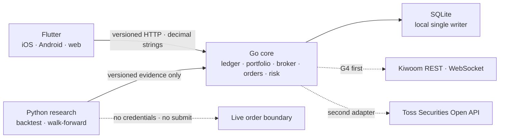

# Omni-Folio

[한국어](README.md) · [日本語](README.ja.md) · [English](README.en.md) · [简体中文](README.zh-CN.md)

面向个人多券商投资组合与安全自动交易的本地优先平台。通过 Flutter 同时提供 iOS、Android 和 web 客户端；Go 掌管账本、券商、订单与风险权限；Python 仅负责可复现的研究和回测。

[当前状态](#status) · [架构](#architecture) · [快速开始](#quick-start) · [使用流程](#workflows) · [命令](#commands) · [文档](#documentation) · [安全原则](#safety)

以韩语 README 为基准，同步更新四种语言的结构、命令与支持范围。链接中的详细设计和验证文档以韩语或英语提供。README 的翻译不代表应用支持对应的显示语言。

> [!IMPORTANT]
> 当前实盘交易和券商连接均未启用。本仓库的回测与策略结果不保证收益，也不构成投资建议。

<a id="status"></a>

## 当前状态

| Gate | 状态 | 证据 |
|---|---|---|
| G0 架构与契约 | 本地通过 | 带版本的 OpenAPI/JSON Schema、运行时职责分离、仓库统一命令 |
| G1 本地账本 | 本地通过 | CSV 审核与原子应用，精确重放交易、现金、拆股和 FX，FIFO 成本与存储价格估值，schema v25/backup v19 及受支持历史格式的恢复 |
| G2 Flutter 客户端 | 部分通过 | iOS、Android、web 发布构建、自动解析器和组件检查，以及 Android 模拟器帧性能测量。已验证未签名 iOS 包排除测试插件。真机、手动屏幕阅读器及应用商店验证仍待完成 |
| G3 研究与模拟执行 | 部分通过 | 可复现的回测、walk-forward、留出集评估、候选注册、本地模拟成交、绩效、停止与恢复。长期运行和源数据传递的完整性尚未验证 |
| G4 券商、图表与订单 | 进行中 | 本地样本图表、已存储的对账和订单记录查询、不使用凭据的 Kiwoom 合成契约。使用真实认证的行情与模拟订单观察、结果未确定订单的恢复及所有实盘阶段仍待完成 |

详细状态和完成条件由 [`PLAN.md`](PLAN.md) 与 [`GATES.md`](GATES.md) 管理。

<a id="architecture"></a>

## 架构



- Flutter 和 Python 不持有券商凭据，也没有提交订单的权限。
- 只有 Go core 能修改权威账本和订单状态。
- SQLite 是本地单写入者阶段的有意选择。在取得 PostgreSQL 迁移、恢复和负载证据之前，不创建多副本或 Kubernetes manifest。
- 进入 G6 后，本地 Kubernetes 验证以 `Kind + Podman` 为标准。目前尚未创建 Kind 集群，在取得 G6 证据之前也不创建 manifest。
- 参考 Toss Securities 易懂的用语和清晰克制的信息层级，但不复制其界面、商标或商业外观。

决策依据见 [`docs/adr/0001-runtime-and-monorepo.md`](docs/adr/0001-runtime-and-monorepo.md)，券商接入顺序和 UX 契约遵循 [`docs/broker-priority-and-ux.md`](docs/broker-priority-and-ux.md)。

<a id="quick-start"></a>

## 快速开始

所需工具：

- GNU Make 3.81+
- asdf 0.20+
- `curl`
- Docker Engine + Compose v2（仅容器运行时需要）

项目的 [`.tool-versions`](.tool-versions) 固定使用 Flutter 3.47.1 stable、Go 1.24.5 和 Python 3.14.5。Python 研究运行时不使用第三方包。

```sh
git clone https://github.com/YouSangSon/Omni-Folio.git
cd Omni-Folio
asdf install
make bootstrap
make check
make smoke
```

`make test`、`make check`、`make smoke` 会在每次运行的临时根目录中记录 owner PID、命令、启动标识，以及子进程 PGID 和启动标识。在成功、失败或收到 SIGINT/SIGTERM 时，trap 会清理进程组和 temp/build/coverage/bytecode；若因 SIGKILL 等原因跳过 trap，下一次运行会凭相同的所有权证据回收残留进程组和根目录。PID 被复用或并发运行的进程会被保留；即使进程组 leader 已先退出，属于本次运行的子进程也会被回收。当前测试不创建 Podman/Kind 资源。之后的本地 Kubernetes 验证只会按每次运行的 session label 和记录的 resource ID 清理；在对应 wrapper 建立之前，普通清理不会删除其他会话的容器或集群。如需连同全部 Flutter/QA 缓存一起清空，请使用 `make clean`。

### 运行应用

第一个终端：

```sh
make run-core WEB_ORIGIN=http://localhost:8081
```

第二个终端：

```sh
make seed-demo
make run-client
```

- API：`http://127.0.0.1:8080`
- Flutter web：`http://localhost:8081`
- 本地数据库：`data/omni-folio.db`

`make seed-demo` 通过实际的 preview/apply API 导入现有 `golden-import.csv`，填入 USD 现金、AAPL 持仓数量与 FIFO 成本、已实现盈亏，让首屏具备可判断的数据。它不创建额外的 mock API 或绕过正常流程写入，也不会重复插入已应用的事件。如需直接使用个人数据，只需跳过此命令。在运行中的应用顶部点击刷新即可看到样本账本。

`make run-core` 显式传入 `contracts/fixtures/market-bars.csv`，因此可从 AAPL 持仓查看样本证券图表。界面和 API 均将其标记为 `샘플 데이터 · 실시간 아님`（样本数据，非实时）。如需验证不提供 fixture 时的 fail-closed 行为，请使用 `make run-core MARKET_FIXTURE=`。

使用其他 API 端口时，需要同时修改 core 和 client。

```sh
make run-core CORE_ADDR=127.0.0.1:18080 WEB_ORIGIN=http://localhost:8081
make seed-demo API_URL=http://127.0.0.1:18080
make run-client API_URL=http://127.0.0.1:18080
```

`OMNI_API_URL` 是 Flutter 构建时的值，不得放入秘密信息。Make 不会自动读取 `.env`。

在 Android ARM64 设备或模拟器上验证本地 API 时，按下面的方式安装 release APK。先在主机上启动 core，并使用 `adb devices` 中显示的 ID。设备的 `127.0.0.1` 指向设备自身，因此需要通过 `adb reverse` 连接主机 API。此 APK 目前使用 debug key 签名，仅用于本地验证；应用商店分发验证另行进行。

```sh
cd apps/client
flutter build apk --release --target-platform android-arm64 --dart-define=OMNI_API_URL=http://127.0.0.1:8080
OMNI_ANDROID_DEVICE=emulator-5554
adb -s "$OMNI_ANDROID_DEVICE" reverse tcp:8080 tcp:8080
adb -s "$OMNI_ANDROID_DEVICE" install -r build/app/outputs/flutter-apk/app-release.apk
```

在 macOS 和 Xcode 上构建不含测试插件的未签名 iOS 发布包时，请在仓库根目录执行。需要固定版本的 Flutter SDK 和已缓存的依赖。此流程仅从已提交应用的临时副本中移除 `integration_test`，并确认生产依赖锁定内容不变，因此原应用的 profile harness 得以保留。

```sh
make check-ios-release
make client-ios-release API_URL=http://127.0.0.1:8080
```

输出为 `output/ios-release-<source SHA>/Runner.app` 和 `build.json`。存在 `COMPLETE` 才表示二进制检查和所属临时资源清理均已成功。不会覆盖已有输出。签名、安装、真机和应用商店验证需另行进行。参见[构建原理与验证依据](gates/g2-client.md#ios-release-packaging-2026-10-25)。

<a id="workflows"></a>

## 可验证的端到端功能切片

### CSV 导入

Preview 不修改账本。将返回的 `preview_id` 与新的幂等键一起提交给 apply。

在交易记录页面粘贴文本，或通过 `CSV 파일 선택` 读取不超过 `1MiB` 的 `UTF-8` 文件。仅选择文件不会发送或应用数据；确认内容后，分别执行预览和应用。取消或读取错误会保留原有输入与结果。[文件输入验证范围](gates/g4p-first-run-import-recovery.md#csv-file-selection)

无需 CSV 文件准备一条记录时，使用 `거래 직접 입력` → `검토용 초안 만들기`。这会替换整个 CSV 草稿；取消会保留原有输入与结果。支持全部 10 种记录类型，买卖现金金额以精确十进制计算。使用当前本地默认账户 `account-main` 和默认证券映射 `AAPL`，不会发送订单。从草稿分别执行预览和应用。如果应用结果未知，请保持应用打开并重试同一请求，不要重新录入同一交易。修改 CSV 或切换标签页后，使用 `이전 요청 재시도` 发送原始请求。如果尚未应用，此次重试可能修改账本。重试信息仅在本次应用会话中保留。[直接输入与结果归属](gates/g4p-first-run-import-recovery.md#manual-entry)

CSV type 包括 `DEPOSIT`、`WITHDRAWAL`、`BUY`、`SELL`、`DIVIDEND`、`FEE`、`TAX`、`SPLIT`、`CASH_VOID`、`FX_EXCHANGE`。金额和数量使用规范十进制字符串；现金事件的正负号与拆股的零现金影响会在 apply 前验证。只有 `CASH_VOID` 使用可选的 `corrects_source_event_id` 列，其金额必须与已应用的同账户、同币种现金类事件精确相反。原始事件不会被删除；Flutter 预览会同时显示原始 source/type/currency/amount 和冲销金额。`FX_EXCHANGE` 要求在同一行提供卖出侧的 `currency`/负数 `amount`，以及不同买入侧的 `counter_currency`/正数 `counter_amount`。这两个金额不代表汇率或当前行情，手续费通过单独的 `FEE` 行记录。

```sh
preview_file="$(mktemp)"
curl -fsS -X POST \
  -H 'Content-Type: text/csv' \
  --data-binary @contracts/fixtures/golden-import.csv \
  http://127.0.0.1:8080/v1/imports/preview > "$preview_file"

preview_id="$(python3 -c 'import json,sys; print(json.load(open(sys.argv[1]))["preview_id"])' "$preview_file")"
curl -fsS -X POST \
  -H 'Content-Type: application/json' \
  --data "{\"preview_id\":\"$preview_id\",\"idempotency_key\":\"local-apply-001\"}" \
  http://127.0.0.1:8080/v1/imports/apply

curl -fsS http://127.0.0.1:8080/v1/portfolio/snapshot
rm -f "$preview_file"
```

Golden fixture 的预期结果为新增 3 行、revision `rev_0000000003`、USD 现金 `778`、AAPL 6 股、成本基础 `300.6`。动态 ID 和时间戳每次运行都会不同。

### 导出账本活动 CSV

将已验证账本的公开活动字段保存为 CSV。导出保留同一次数据库观察中的倒序记录，排除账户和内部 ID。数字与时间保留原始字符串，原记录与更正记录都会保留。

```sh
mkdir -p -m 700 data/exports
(cd services/core && go run . ledger-export \
  -db ../../data/omni-folio.db \
  -out ../../data/exports/ledger.csv)
```

`ledger-activity-export.v1` 收据包含 revision、行数和 SHA256。不会覆盖已有输出。超过 10,000 行或 32 MiB，或存在不安全的证券标记时，导出会失败。输出文件夹必须属于当前用户、不得允许其他用户写入，并且上级路径也必须可信。此 CSV 既不是 backup，也不是重新导入格式。在电子表格中请将所有列作为文本导入。[契约与限制](gates/g1r-ledger-activity-export.md)

### 切换现有账本的时间重放策略

schema25/backup v19 使用按精确 UTC 顺序重放的 FIFO v2 策略。已有账本的数据库仅执行 migrate 无法正常运行。停止旧 core、保留原始备份后，请遵循 [G1.20 的 preview → 审核 → activate → 验证新备份流程](gates/g1p-chronological-ledger-replay.md#로컬-전환-절차)。历史备份的存档验证与当前策略的激活是两项不同的操作。

### 本地样本 OHLCV 图表

```sh
curl -fsS 'http://127.0.0.1:8080/v1/market-data/candles?symbol=AAPL&interval=1d'
```

响应使用规范十进制字符串，并返回 `price_adjustment=unspecified`、`source=local_fixture`、`sample=true`、`state=stale`。从持仓界面打开 AAPL，可查看价格与成交量图表、以最后收到的 K 线为基准的 `30일/90일/365일/전체`（30 天/90 天/365 天/全部）显示范围、价格复权依据、source/as-of、屏幕阅读器摘要，以及与所选范围一致的精确 OHLCV 表。`unspecified` 表示尚未确认是否复权。客户端的范围选择不代表重新查询行情或证明 K 线完整性；fixture 仅用于契约和 UI 验证，不是当前行情或投资决策资料。

现有 `market-bars.csv` 不提供证券 ID 和价格币种，因此 API 的 `instrument_id` 与 `currency` 为 `null`。界面也会说明无法确认关联关系和币种。可通过 `make run-core MARKET_FIXTURE=contracts/fixtures/market-bars-identified.csv` 读取明确指定 ID 和币种的样本。扩展 CSV 必须在原有 10 列后精确追加 `instrument_id,currency`，且所有行的值必须相同。这两个值只是数据源的声明，不代表经过交易所验证。详情界面会拒绝 ID 或币种与所选持仓不符的数据，并保留之前的正常数据及其时间。

两种格式均为 `bar_time_basis=unspecified`。`at` 只是用于排序的时间表示，不能证明交易日、K 线起止时间或成交归属的 K 线。由于价格复权与时间基准尚未确认，目前不显示平均成本线或账本买卖标记。原始 CSV 和研究 artifact hash 不变。验证范围见 [G4W](gates/g4w-chart-source-basis.md)。

### 证券账本平均成本与交易记录

在持仓 → 证券详情 → 顶部 `원장 평균단가·매매 보기`（查看账本平均成本与交易）中，可查看当前剩余持仓的平均成本及最近 50 笔买卖记录。即使行情查询失败，仍可进入。刷新失败时会同时保留之前的结果和基准时间。

```sh
curl -fsS 'http://127.0.0.1:8080/v1/portfolio/instrument-ledger?instrument_id=instrument_aapl&currency=USD'
```

直接使用现有 snapshot 中的证券 ID 和币种。在同一账本版本下汇总所有已导入账户；剩余 FIFO 成本和数量保持精确十进制字符串，仅平均值按 half-even 规则保留 8 位小数。Golden fixture 为 6 股、成本 USD 300.6、平均 USD 50.1。数量为 0 时平均值为 `null`；完全没有买卖记录时返回 404。`has_more=true` 表示省略了更早的买卖记录。

买卖行保留未经拆股调整的原始记录，当前成本则反映账本拆股事件。本地记录不代表券商确认的成交，该界面也不会启用图表上的平均线或买卖标记。参见 [G4X 验证范围](gates/g4x-instrument-ledger-detail.md)。

### 直接汇率观测基础

G1.10 将方向为 `1 base_currency = rate quote_currency` 的汇率观测值保存在 schema v10 的 `STRICT`/仅插入序列中。验证数据源观测标识、精确十进制汇率、observed/fetched/recorded UTC 时间和规范行哈希，并拒绝相同 source、pair、observed-at 的冲突。`GET /v1/market-data/fx/latest` 仅返回在显式 `as_of` 之前已观测且已接收的精确方向数据，并保持 `sample=true`、`state=stale`。不会自动计算反向汇率，也不会将 `FX_EXCHANGE` 的现金侧用作汇率。

保留此 fixture writer 和 GET 契约。直接输入汇率使用下方独立的版本 journal，不会混入此 GET。尚无 provider 自动采集或 scheduler；`PortfolioSnapshot.valuation_status` 继续保持 `unavailable`。

### 直接输入汇率的版本保存与收益计算

将完整的直接汇率文件导入现有 DB 后，现金、当前 KRW 估值、TWR、XIRR 和 USD 指数的 KRW 换算会使用同一输入版本。方向为 `1 USD = rate KRW`，不会推算反向或交叉汇率。

```sh
(cd services/core && go run . owner-fx-import -db ../../data/omni-folio.db -input ../../contracts/fixtures/owner-fx-usdkrw-sample.json)
```

这个过时的 `sample=true` 示例为合成资料，不能满足当前估值的24小时条件。实际输入遵循[封闭输入契约](contracts/owner-fx-series.schema.json)。修正时使用新的 `source_version` 提交全部数据点；空的 `points` 撤回该方向的使用。缺失点不会从旧版本补齐，重试旧版本也不会重新激活它。同一方向不能混合 fixture 和直接输入，撤回后仍保留来源归属。

`storage_check=verified` 仅证明存储完整性。即使 `sample=false`，韩语应用仍显示直接输入汇率的提示。观测、获取、记录时间和24小时条件分别验证，不认证证券价格、券商行情或提供者数据的准确性。[策略、恢复和验证范围](gates/g1w-owner-fx-series.md)

### 使用直接输入的证券价格计算估值与收益

针对已通过CSV录入账本的证券，将价格文件导入现有DB。使用账本的canonical ID（`AAPL`对应`instrument_aapl`）；不为显示名称的大小写修改账本。

```sh
(cd services/core && go run . owner-price-import -db ../../data/omni-folio.db -input ../../contracts/fixtures/owner-price-aapl-sample.json)
```

[输入契约](contracts/owner-price-series.schema.json)中的`unadjusted`表示所有者声明的观测时刻账本每股、以指定货币计价的价格，不追溯调整拆股或股息。拆股后的持仓需要严格晚于最后一次拆股时刻的价格。这个过时的`sample=true`合成示例不满足当前估值的24小时条件。

每个证券与货币使用最新文件的全部数据点，连接估值、TWR、XIRR及KRW/USD指数比较。新的`source_version`替换所有点，空的`points`撤回使用；缺失的历史点不从旧版本补齐，重试旧文件也不会重新激活它。同一证券与货币不能混合现有fixture/Kiwoom价格，撤回后仍保留此区分。韩语应用中的直接输入价格提示独立于sample和汇率提示。存储验证不认证提供者的准确性或当前市场价格。[单位、恢复与验证范围](gates/g1x-owner-price-series.md)

### 考虑出入金的年化收益率

在首页通过 `입출금을 반영한 수익률 보기` 查看账本开始以来的 `XIRR`。它结合带日期的外部现金流和当前 KRW 估值，不会将交易、股息或费用重复计为额外出入金。按 UTC 实际日历天数及一年365天进行年化。

只有确认唯一的结果才显示为主要收益率。尚未证明唯一的值仅在详情中作为参考候选；缺少价格、历史汇率或数值计算失败都不会被替换为 0%。只要使用了任何样例观测，就保留 sample 标识。应用不会将其表述为已验证的券商当前投资表现。

```sh
curl -fsS http://127.0.0.1:8080/v1/portfolio/xirr
```

[政策、来源与验证范围](gates/g1s-portfolio-xirr.md)

### 排除出入金影响的累计收益率

在收益率详情中通过 `입출금 영향을 뺀 누적 수익률 보기` 查看账本开始以来的 `TWR`。它连接外部现金流边界之间的资产变化，不进行年化。同一时刻先处理外部现金流；已撤销的原始现金记录也会从历史余额中移除。

任一边界缺少历史价格或直接汇率，或观测超过24小时，均不计算结果。中间资本为0或负数、拆股价格单位不明确的路径也显示为不可计算。全额取款不会显示为全部亏损；包含示例观测的结果不代表实际投资表现。

```sh
curl -fsS http://127.0.0.1:8080/v1/portfolio/twr
```

[计算规则、来源与验证范围](gates/g1t-portfolio-twr.md)

### KRW 与 USD 比较指数原始版本的保存

比较输入同时支持 `KRW` 和 `USD`。请提供明确声明 `price_index`、`gross_total_return` 或 `net_total_return` 的标准化指数文件。下列两个文件均为 `sample` 示例，并非实际市场数据。

对于包含股息再投资的比较，优先评估KRW版KOSPI 200 TR与USD版S&P 500 Total Return。输入文件需要确认准确序列、货币版本、观测时刻及存储/展示权限。目前尚未取得实际数据与使用权限。参见[官方定义、使用条件及导入步骤](gates/g1u-benchmark-series.md#benchmark-source-policy)。

```sh
(cd services/core && go run . benchmark-import -db ../../data/omni-folio.db -input ../../contracts/fixtures/benchmark-krw-sample.json)
(cd services/core && go run . benchmark-import -db ../../data/omni-folio.db -input ../../contracts/fixtures/benchmark-usd-sample.json)
(cd services/core && go run . benchmark-status -db ../../data/omni-folio.db -benchmark-id synthetic_usd)
```

`authority=owner_declared` 表示所有者提供的资料，`storage_check=verified` 仅确认保存内容的完整性。同一 `source_version` 的内容或 `fetched_at` 发生变化时会作为冲突拒绝；重试旧版本不会改变最新选择。实际指数的股息、拆股定义和数据使用权限仍需单独确认。下文提供基于已保存资料的同期比较。

[输入契约、恢复政策与验证范围](gates/g1u-benchmark-series.md)

### 比较同一期间的指数

在 TWR 详情通过 `같은 기간의 지수와 비교하기` 一起查看每个已保存指数的最新版本。一个响应统一账本、报告时点和比较期间。`KRW` 指数保持原币口径，`USD` 指数分别显示原币收益率和韩元换算收益率。

```sh
curl -fsS http://127.0.0.1:8080/v1/portfolio/benchmarks
```

差值是公开的组合收益率减去韩元口径指数收益率，单位为 `%p`。界面同时标明股息和税务口径；缺少汇率时保留原币数值。超过24小时的观测、起始指数为0或资料缺失均显示为不可计算，不把示例视为实际业绩认证。一次最多比较32个指数；刷新失败时保留上次比较整体及其时点。

[政策、来源与验证范围](gates/g1v-portfolio-benchmark-comparison.md)

### 使用直接汇率进行现金估值

G1.11 的 `GET /v1/portfolio/cash-valuation` 仅将通过重放验证的当前账本现金换算为请求指定的基准币种。必须提供规范 UTC `as_of` 和 `base_currency`，并在同一读取事务内验证账本事件和完整 FX 序列。除相同币种和零余额外，只使用 `cash currency -> base currency` 方向的直接观测值，有效范围包含观测时间起满 24 小时的边界。不使用反向汇率、交叉汇率、插值、`FX_EXCHANGE` 推断或显示用舍入。

只要有一组货币对缺失或超过 24 小时，就只返回原币现金行和问题，隐藏汇总总额。即使 local fixture 生成完整结果，也仍为 `sample=true`、`status=stale_sample`。此 API 仅处理现金，不评估持仓、盈亏、绩效或当前行情，也尚未连接 Flutter 界面。`PortfolioSnapshot.valuation_status` 继续保持 `unavailable`。

```sh
curl -fsS 'http://127.0.0.1:8080/v1/portfolio/cash-valuation?base_currency=KRW&as_of=2026-01-11T14:00:00Z'
```

### 持久化证券价格观测基础

G1.12 在持仓估值之前，将 local fixture 的证券价格保存在 schema v11 引入的 `STRICT`/仅插入序列中。验证 source identity、instrument ID、symbol、venue、currency、正数规范价格、`price_adjustment=unspecified`、observed/fetched/recorded UTC 时间和规范行哈希。内部精确 as-of 查询固定所有标识维度，只选择三个时间均不晚于 cutoff 的观测值。

G4U checkpoint 的 backup v8 验证价格序列的 digest/count，并在不修改原件的自有副本中将 legacy artifact 迁移到 schema v13。当前 schema v25/backup v19 也保留该价格证明。空恢复候选必须具有与内嵌 migration 相同的表 DDL、latest index 和仅插入 trigger。未增加公共 API、Flutter 界面、provider 请求、scheduler 或基于券商数据的持仓、盈亏、绩效估值；`PortfolioSnapshot.valuation_status` 继续保持 `unavailable`。

### 使用存储价格进行原币持仓估值

G1.13 的 `native_holding_valuation_v1` 在同一只读事务中重新验证当前账本 snapshot、仅追加事件证明和完整证券价格序列。只有与持仓的内部 instrument ID、symbol、currency 关联的 as-of venue 恰好只有一个时，才使用 24 小时内的 local fixture 价格计算原币市值和未实现盈亏。若存在多个 venue、缺失、过期或未来的 observed/fetched/recorded 值，就在对应行留下经过脱敏的问题，并隐藏所有按币种汇总的数据。

G1.15 将此现有模型连接到 `GET /v1/portfolio/holding-valuation` 和 Flutter 持仓中的 `저장 가격으로 평가 보기`（查看存储价格估值）详情。响应不包含内部 instrument/observation ID；数量、成本、原币估值、未实现盈亏与价格来源信息均显示在同一账本 revision 下。省略 `as_of` 时使用服务器当前 UTC 时间，显式 cutoff 只接受规范 UTC。查询失败时，同时保留之前结果的基准时间和 revision，不暴露错误详情。

```sh
curl -fsS 'http://127.0.0.1:8080/v1/portfolio/holding-valuation'
```

若没有存储价格或价格已超过 24 小时，合计会被隐藏。`make seed-demo` 只填入交易账本，因此价格缺失属于正常情况。即使所有价格齐全，结果仍属于本地样本/过期数据，不跨币种求和，也不使用当前汇率换算历史成本。未增加 provider 数据接入、整个投资组合总额或实盘/当前价格的权威依据，`PortfolioSnapshot.valuation_status` 继续保持 `unavailable`。从 G1.14 起，snapshot/OpenAPI 显式标明 `fifo_exact_else_half_even_residual_8_v1`。现有有限十进制的 FIFO 分摊保持精确，仅对循环小数使用 half-even 量化；剩余成本保留在未平仓 lot 中，最终清仓时全部消耗。此分析策略不能替代税务成本规则。

### 不使用凭据的 Kiwoom 最新成交

G4Q 通过现有 Kiwoom OAuth/read transport 的合成内存响应，验证官方 `ka10079` 单 tick 响应。规范内部 DTO 仅返回 KRX 6 位 symbol、精确价格绝对值、provider `cntr_tm` 和独立的 fetch 时间；若存在无效行、时间倒退、同一秒内不同价格或晚于本地接收时间的成交，则整体拒绝。

G4Q 本身不增加真实凭据、外部请求、公共 API 或数据库写入者。由于官方响应没有持久事件 ID 和明确的 timezone/price-adjustment 依据，G4S 下一阶段只将其保存为保守的观测槽位，而非 trade ID。

### 不使用凭据的 Kiwoom 持久化最新成交观测

G4S 仅通过 Go 内部 writer，将 G4Q 的 `KiwoomLatestTrade` DTO 写入 schema v12 扩展的价格序列。source 区分为 `kiwoom_mock` 和 `kiwoom_production`；标识不是 provider trade ID，而是由 `ka10079`、环境、内部 instrument ID、`XKRX`、6 位 symbol、`KRW`、`unspecified` 和 provider 观测秒组成的观测槽位。同一槽位同一价格即使重复 fetch 也为 no-op；同一秒内不同价格、被篡改的 ID 和非 KRX/KRW 标识都会被拒绝。

这些存储值还不是估值的权威依据。现有持仓估值和公共 snapshot 继续仅读取 `local_fixture`，未增加 scheduler、route、Flutter 界面、真实凭据或下单判断。

### 所有者声明的证券挂牌归属

G4U 通过 schema v13 的仅追加 `DECLARE`/`REVOKE` 账本，让所有者明确声明 `(venue,symbol,currency)` 与内部 instrument ID 的当前关系。若不存在 active listing，或其已撤销、损坏，Kiwoom one-shot capture 会在请求 token 前停止；新价格 writer 会在插入事务中再次确认相同关系。保留现有 v12 价格，但不会从证券代码惯例或历史价格推导归属。

Backup v8 在原件和恢复候选间比较完整 listing hash 及 event/active count。此账本不代表 provider 验证、历史生效日期、时效性，也不赋予估值、策略或订单权限；目前也没有外部注册 API/UI。

### 不使用凭据的 Kiwoom 实时价格

G4R 仅使用标准库验证官方 WebSocket `0B` 的单个 KRX 格式 symbol 注册 packet 和 `REAL` JSON frame。带符号的当前价保留为精确绝对值，字段 `20` 保留为不含日期的 `provider_clock`，本地接收时间单独保存为 `received_at`。同一 frame 中相同 symbol/clock/price 只返回一次；同一 clock 的不同价格会作为歧义错误整体拒绝。外部输入限制为 1 MiB 和 100 entries。

目前没有 WebSocket 连接、LOGIN/PING、重连与重新订阅、背压、凭据、持久化或公共 API/UI。在实际观察之前也不解释官方 FID `9081` 的值含义，因此 DTO 不声称其 venue。由此，此内部 DTO 不能作为实时性、当前性、时效性或持久成交与价格观测的证据。

### 内部合成订单恢复、执行权限、对账与模拟提交

K2A/K2B0 在 Go 内部验证 Kiwoom `LIMIT`/`KRW`/`KRX` intent、仅追加生命周期、`SUBMIT_UNKNOWN` 防重复、撤单/成交重放，以及已知订单号的原子成交核对调整。K2B1 将明确日期的合成 `kt00009` 成交行保存为不可用于关联的扫描记录。K2C 验证默认阻断的 kill switch、进程级 lease/fencing，以及 `005930`、`000660` BUY 的 10 股、单笔订单 100 万韩元、账户活跃预留额 100 万韩元限制。K2B2 使用合成凭据和内存 transport 复现官方 `kt10000` 模拟限价请求，验证 token preflight、持久化 dispatch-before-write、不重试写入、不透明 ACK 及 unknown/reject 分支。不存在外部券商调用、公共下单 API/UI 或实盘权限。

```sh
cd services/core
go test -run '^(TestK2A|TestK2B0|TestK2B1|TestK2B2|TestK2C)' -count=1 ./...
```

K2B0 即使看到属性和时间相同的订单，也不会将其与没有订单号的 `SUBMIT_UNKNOWN` 关联。K2B1 的末页分页也不代表已取得完整成交历史，不会将日期与缺少 timezone 的成交时间拼成 UTC。K2B2 写入不会自动重试，包括 401；结果不明确时，会等待查询与对账，而非重新下单。使用真实凭据的模拟环境观察、未知提交的查询恢复、现金/持仓/手续费/亏损/市场时间/过期数据限制、owner/strategy 审批、broker/ledger 对账和 Flutter 下单流程仍待完成。

### 不使用凭据的已知有效券商快照

G4H 仅将现有合成 `KiwoomSnapshot` 中 `complete=true` 的 KRX snapshot 原子保存到 Go 内部 SQLite。相同 account/environment/exchange/fetched-at 且 payload 相同的记录不会重复存储 raw snapshot，但会按 ledger revision 单独保留对账记录。payload 冲突或 snapshot 不完整时，不会覆盖之前的已知有效结果。保存时，将该 ledger revision 下 KRX/KRW 证券数量与券商数量的差额固定为精确十进制值。

```sh
cd services/core
go test -run '^TestG4H' -count=1 ./...
```

G4U checkpoint 的 schema v13/backup v8 以仅插入方式保护 ledger event、cash-void/FX guard、直接 FX 观测、证券价格观测、证券挂牌关系、券商原始快照、带 revision 的券商对账、执行权限事件、风险预留、策略注册表，以及当时的合成/模拟订单。当前 schema v25/backup v19 同时保留这些证明，以及 G3.8C2 模拟记账、G3.8C3 账户全局绩效、G3.8D 策略窗口证据和 G3.8E 模拟安全策略/动作恢复。G4H 本身不证明凭据、券商请求、调度、官方时效性/timezone、现金与估值金额对账、公共 API/UI 或实盘就绪。

### 已存储券商对账的只读视图

G4K 通过 `GET /v1/broker-reconciliation/latest` 读取 G4H 最新存储的结果，显示在 Flutter 的 `연결`（连接）界面。API 仅返回 provider/environment/exchange、存储时间、ledger revision 和精确的持仓数量差额，不暴露 account reference、内部 ID/hash 或 raw snapshot。`freshness=unverified` 和 `마지막 저장 스냅샷 · 현재 상태 아님`（最后保存的快照，非当前状态）明确说明此结果不是实时余额。

```sh
curl -fsS http://127.0.0.1:8080/v1/broker-reconciliation/latest
```

没有存储记录时返回 404；若最新 raw snapshot 缺少对账记录，或 hash/metadata 损坏，则不会退回历史结果，而是以通用化的 500 响应执行 fail-closed。G4M 在首页汇总同一存储对象的匹配/不匹配数量、采集与存储时间，并通过 `연결에서 자세히 보기`（在连接中查看详情）打开各证券差额。两个界面都不刷新券商数据或执行订单，也不会声称已核对现金、估值金额、手续费、订单或成交。

### 本地订单生命周期只读视图

G4L 重新执行现有仅追加订单日志的恢复证明后，通过 `GET /v1/orders` 仅返回用于显示的生命周期。响应包含 `source=local_order_log`、`broker_freshness=unverified`，不包含 account/client/provider/internal ID。Flutter 的 `연결` 界面不会重新查询券商、发送或撤销订单，并将结果未确定的订单显示为 `브로커 결과 미확정 · 재주문 금지`（券商结果未确定，禁止重新下单）。

```sh
curl -fsS http://127.0.0.1:8080/v1/orders
```

空日志返回 `orders=[]`；hash、metadata、状态转换重放或记录时间只要有一项损坏，就以通用化的 500 响应执行 fail-closed。刷新失败时保留最后的正常界面，但不将其标为当前券商状态。

### 研究与自动改进

注册后，可在应用的 **연결（连接）→ 백테스트 보고서 보기**（查看回测报告）中查询最后注册的结果。`GET /v1/research/report` 按注册顺序选择一项，也包含晋级失败的结果。该结果与当前选择的策略无关。没有数据时显示空状态；最新数据损坏或不属于支持格式时，不会用旧数据替代。手动刷新失败时，保留界面上已有的结果和观测时间。

界面读取已存储的指标，不使用原始 K 线重新计算。分段验证展示每段重新选择的候选的平均收益率、最大回撤及合计已完成交易；最终候选的参数仅用于单独的留出集评估。这不代表当前投资组合绩效或下单权限。[支持格式与验证](gates/g3ag-research-report.md)

```sh
make run-research
make run-improvement
```

如需基于研究候选计算新的 SMA 信号，请使用下列离线 CLI。`research.csv` 必须是实际用于生成候选的原始数据；`latest.csv` 是同一 KRX 6 位证券的有序 OHLCV。最后时间必须晚于研究样本；为判断前一次交叉，需要至少 slow window + 1 根 K 线。详细契约和限制遵循 [G3.8G1](gates/g3q-paper-signal-proposals.md)。

```bash
PYTHONDONTWRITEBYTECODE=1 PYTHONPATH=services/research python3 -m omni_research.signal_cli \
  --bars /path/to/latest.csv \
  --research-bars /path/to/research.csv \
  --artifact /path/to/strategy-improvement-result.json
```

stdout 的 JSON 是从不可信本地输入计算得到的目标数量**提案**，不会执行订单。自身 hash 和输入中的 promotion 标记不能证明研究绩效，因此不能省略 Go 注册结果及当前选择状态的验证。`none` 表示没有新提案，`death_cross` 的 `"0"` 是清仓目标。在上述命令中添加 `--watch`，即可在每次观测到新的最后一根 K 线时输出 NDJSON 提案。请先阅读[仅生成提案的 watch 的传递与重启限制](gates/g3t-paper-proposal-watch.md)。当前 `paper-run-loop` 仅执行绩效评估和安全策略，持续输入与模拟成交的连接仍属于 G3.8G2 的待办范围。

[手动本地 paper 使用方法](docs/local-paper-workflow.md)中的 `paper-init`、`paper-import-bars`、`paper-execute -arm-paper` 将初始化、原始 CSV 验证、模拟成交、绩效安全策略与新提案接收串联起来。这是不连接实际券商的 fixture 执行，退出时会停止自身执行权限。真实 OS signal/stale-owner 及组合重启验证已在 [G3.8G2B](gates/g3s-local-paper-workflow.md) 本地通过。这不代表已完成全天候自动交易或实盘交易。

Python 的 `--bundle` 会一起输出提案和计算所用的原始 CSV。通过 Go `paper-execute -bundle FILE -arm-paper` 一次传递后，不会重新读取原始路径，而是执行现有验证。单个 CSV 限制为 1 MiB，完整 JSON 限制为 4 MiB。[精确字节传递 gate](gates/g3u-paper-input-bundle.md)

使用 `paper-input-status -db PATH -account ACCOUNT -selection-event EVENT -bundle FILE`，可通过只读连接将一份已保存输入与 DB 中的 K 线、首次 receipt、信号及订单记录逐项核对。这些记录不代表完成 ACK、freshness 或执行授权；查询不会决定是否重新执行。[使用方法与含义](docs/local-paper-workflow.md#saved-input-status)

`--watch --bundle` 可通过 stdin pipe 连接单独的 `paper-execute-stream -arm-paper`。此命令只激活一次，在输入间隔中也会续租所有权 lease，并在停止、EOF 或错误时清理 reader 和权限。它不是自动重新激活机制或持久队列；请通过数据库记录而非 stdout 确认执行情况。[连续 fixture 使用方法](docs/local-paper-workflow.md#명시적으로-연속-fixture-소비하기)、[验证 gate](gates/g3w-paper-input-stream.md)

策略改进 runner 使用 expanding walk-forward 评估有限的仅做多 SMA 候选，且只打开最终留出集一次。结果只能为 `paper_candidate` 或 `no_promotion`，不会获得凭据、下单或晋级实盘的权限。

Go core 将这些本地结果注册到 schema v13 引入、并保留到当前 schema v25 的仅插入 registry 中。`no_promotion` 也会作为拒绝证据保留，但不可被选中。由于尚无与当前 champion 直接比较的逻辑，选择 `paper_candidate` 需要显式 CLI 和乐观并发控制；rollback 只能向日志追加新事件，退回前一次选择或 `no_strategy`。

```sh
candidate_file="$(mktemp)"
PYTHONPATH=services/research python3 -m omni_research.improve_cli \
  --bars contracts/fixtures/strategy-market-bars.csv \
  --config contracts/fixtures/strategy-improvement-config.json \
  --output "$candidate_file"

(cd services/core && go run . strategy-register \
  -db ../../data/omni-folio.db \
  -artifact "$candidate_file")
rm -f "$candidate_file"
```

按注册结果的 `result_sha256` 进行选择时，使用 `strategy-select -result-sha256 ... -expected-current-event ...`。首次 expected event 为 `no_event`，之后使用 `strategy-status` 或前一次输出的 `current_event_id`。回退时，将当前 event ID 同时作为 `-expected-current-event` 和 `-source-event` 传给 `strategy-rollback`。此手动 rollback 会在同一事务中先 halt/fence 所有活跃执行权限，再追加选择历史；任意记录失败，整个事务都会回滚。仅有选择状态不会产生下单权限。

### 不使用凭据的模拟记账与绩效证据

G3.8C2 使用 `paper-signal.v3` 的事务所持 sequence cutoff 之后精确符合条件的已收盘 K 线。成交价是用已知最终成交量的 K 线开盘价进行事后建模，因此不能作为开盘集合竞价或实盘券商成交证据。Account-global session 和当前 policy SHA 必须一致；带符号的目标差额产生 BUY/SELL，目标为零则请求全部减仓。每个 account/symbol 最多只有一个 active order。

KRX 数量必须为整股，最大 `4611686018427387903`，容量为 `floor(volume * max_participation)`。每笔非零成交精确应用固定 KRW 手续费、仅 SELL 收取的税及不利滑点。仅通过 `order_events.FILL_RECORDED` journal 重放，派生 cash、FIFO lot/cost、fee、tax、slippage 和 realized PnL，并阻止透支和超额卖出。接纳与成交均要求当前 lease/fence，且不写入 Kiwoom transport 或总账。此 C2 checkpoint 的数据库/备份契约为 schema v17/backup v11，现由 C3 契约承接。

```sh
cd services/core
go test -run '^TestG38C2Paper' -count=1 ./...
```

G3.8C3 固定事务当前的 order/market cutoff，以及全部未平仓头寸在同一 `as_of` 下完整的 `paper_fixture` 日 K 线收盘价。仅现金的数据点也要求同一 cutoff 下的收盘价 anchor；通过唯一成交 journal 的重放，计算账户全局 cash、open cost、market value、已实现/未实现/总 PnL、equity，以及按 half-even 保留 8 位小数的 return/drawdown。

G3.8D 仅使用当前选择之后、绑定同一 selection ID 和 strategy result 的 C3 数据点。第一个点为零收益基线，之后的点精确重新计算该区间的 peak、return 和 drawdown。当时的 schema v19/backup v13 可独立恢复此仅追加策略窗口序列；v12/schema v18 在不修改原件的自有副本中迁移，并生成空的 D log。

G3.8E 增加 `paper-strategy-performance-safety.v1`，只消费已恢复的最新同一 selection 的 G3.8D 行。少于 2 个样本时为 `INSUFFICIENT`；max drawdown 大于等于 0.1 时优先为 `HALT_AND_ROLLBACK`；否则 cumulative return 小于等于 -0.05 时为 `HALT_AND_ROLLBACK`；其余为 `HOLD`。action 是一个事务：按字典序对捕获的 armed account 执行确定性的 fencing halt，并对精确匹配的当前选择进行一次退栈回退；schema v20/backup v14 与 v13 自有副本证明会验证完整来源链。此内部边界不代表 scheduler、公共 API/UI、券商调用、晋级、部署、实盘权限或盈利能力。验证依据见 [`gates/g3n-paper-performance-policy.md`](gates/g3n-paper-performance-policy.md)。

G3.8F1 增加可由外部 timer、launchd、systemd timer 或 Kubernetes CronJob 调用的本地单次 CLI。`omni-core paper-run-due -db <path> -account <kiwoom_account_...>` 选择最新可用的 local fixture close，依次完成 G3.8C3 账户绩效、G3.8D 策略窗口绩效和 G3.8E 安全策略。同一 close 的完成链在重试或两个 owner 并发执行时，也会在 root recovery 验证后收敛到相同的持久化结果。详细依据见 [`gates/g3o-scheduled-paper-runner.md`](gates/g3o-scheduled-paper-runner.md)。

G3.8F2 增加 `omni-core paper-run-loop -db <path> -account <kiwoom_account_...>`。schema v21 的 singleton lease 将当前策略选择与账户绑定，并使 fencing token 单调递增；runner 使用 10 秒 heartbeat 和 30 秒 TTL，在 C3/D/E 的每个事务中重新验证精确 claim。stale owner 仅在 TTL 到期后才会被回收；SIGINT/SIGTERM、错误或正常 rollback 退出时，只会有条件地释放自己的 claim。由于当前 selection 是全局的，此本地 runner 也采用全局串行执行。详细依据见 [`gates/g3p-always-on-paper-runner.md`](gates/g3p-always-on-paper-runner.md)。

这些证据来自本地事后 fixture 结果。虽然已增加 daemon 进程本身，但没有增加公共 API/UI、基于券商数据的估值、凭据/实盘执行、部署、告警、CronJob 打包、shadow/live 晋级，也不构成盈利能力声明。

<a id="commands"></a>

## 主要命令

```text
make bootstrap        准备本地依赖
make format           应用 Go/Dart 格式化
make lint             执行 Go vet、Flutter analyze、Python compile 检查
make test             运行 Go、Flutter、Python 单元测试
make check            检查 format、lint、test、JSON contract 后清理测试产物
make clean            清理本地生成物，包括 Flutter/QA 缓存
make smoke            使用临时数据库检查 ledger、本地 market HTTP 端到端功能切片
make run-core         migrate 后运行本地 Go API 与显式样本 market fixture
make run-client       运行 Flutter web 客户端
make run-research     运行确定性的回测 fixture
make run-improvement  运行 walk-forward 策略 fixture
```

## 使用容器运行

```sh
cp .env.example .env
docker compose -f infra/compose.yaml config --quiet
docker compose -f infra/compose.yaml up --build
curl -fsS http://127.0.0.1:8080/readyz
docker compose -f infra/compose.yaml down
```

Compose 在一次性 migration 后运行 non-root/read-only core，并仅在 loopback 暴露 API。由于没有认证和 TLS，不得作为公开服务使用。Named volume 在 `down` 后仍会保留。只有在明确要删除本地账本数据时，才使用 `down -v`。

运行上限为：`migrate` 使用 `0.25` CPU 和 `512 MiB`，`core` 使用 `0.75` CPU 和 `1536 MiB`，合计 `1 vCPU` 和 `2 GiB`。每个容器的日志按 `3` 个 `10 MB` 文件轮转。这些限制不约束构建资源，也不保证处理性能。进行非公开远程验证前，请先确认[共享 VM 准入条件](gates/g6-deployment.md#single-node-resource-budget)，并通过 SSH 访问。目前尚未验证这些设置在 VM 运行时的实际应用。

<a id="documentation"></a>

## 仓库结构

```text
apps/client/       Flutter iOS · Android · web 客户端
services/core/     Go 账本/API 权限主体
services/research/ Python 回测与策略改进
contracts/         OpenAPI、JSON Schema、跨运行时 fixture
gates/             各阶段验收与证据
infra/             本地 OCI/Compose profile
docs/              目标、ADR、研究、broker/UX 文档
```

可在 [`docs/README.md`](docs/README.md) 中按用途查找文档。请勿将安全漏洞或暴露的凭据附在公开 issue 中；请遵循 [`SECURITY.md`](SECURITY.md) 的流程。

## 故障排查

- `go: go.mod file not found`：请在仓库根目录使用 `make bootstrap` 或根目录 Make 命令。
- Flutter device/package 错误：运行 `flutter doctor`、`cd apps/client && flutter pub get`。没有 Chrome 时，使用 `FLUTTER_DEVICE=web-server make run-client`。
- `8080` 端口冲突：参照上面的 `18080` 示例，同时修改 core 和 `API_URL`。
- 浏览器 API 失败：确保 Flutter host/port 与 `WEB_ORIGIN` 精确一致。不支持 wildcard CORS。
- Compose `unhealthy`：通过 `docker compose -f infra/compose.yaml logs core` 检查 `/readyz` 失败原因。
- SQLite 移动/备份：先停止 core。`*.db-wal` 和 `*.db-shm` 是同一数据库的运行时 sidecar。

<a id="safety"></a>

## 安全原则

- 实盘交易默认关闭，不能通过 UI 开关或单个环境变量启用。
- 不要将 broker secret、access token、真实账号或原始交易导出放入 Git、fixture 或日志。
- K2A 在 timeout/crash 后将订单保留为 `SUBMIT_UNKNOWN`，并阻止同一订单及该账户的新提交。K2C 增加默认阻断的 kill switch、数据库 lease/fencing 和不可变预留。K2B2 mock write 在持久化 dispatch 后只尝试一次，不会因响应不明确而重新下单。不会仅凭 K2B0/K2B1 的查询结果擅自确定 unknown 状态。
- 策略不会仅凭收益率晋级。必须考虑成本、延迟、未来信息泄漏、回撤、运行健康状况及 owner 审批。
- 首先证明生存能力与可恢复性。无法保证收益。

## 许可证

目前尚未授予单独的开源许可证。仓库可供公开浏览不等于获得代码复用权。
