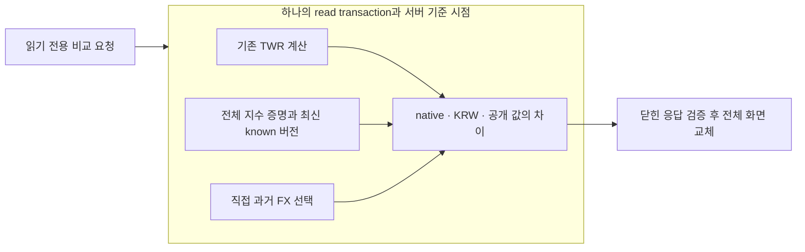

# G1.26 같은 기간의 KRW·USD 지수 비교

상태: [PR #50](https://github.com/YouSangSon/Omni-Folio/pull/50)을 main `6f154ef3d2815b5cb116dc8385107a0ad877f625`에 병합했다. 실제 API404 RED와 테스트 입력·분석 실패를 보완한 최종 head `e757cfa375f64d5ee2a54b167d28db423077ad1a`의 원격 Core/Client 전체·새 web/ARM64 release·권한/소스 일치가 통과했다. 설계·최종 코드의 독립 리뷰에서 차단 사항이 없고 main merge의 전체 tree가 테스트한 head와 일치한다. 실제 시장 자료의 정의·사용 권한·정확성과 배포·전체 Goal 완료는 별도다.

## 문제와 작동 원리

지수의 숫자가 올라갔다는 사실만으로 포트폴리오보다 좋은 성과였는지 알 수 없다. 비교 기간과 통화가 같아야 한다. 설명용 USD 지수100→110은 USD 기준+10%지만 USD→KRW가1,000→900이면 KRW 기준은 `(110×900)/(100×1,000)-1 = -1%`다. 포트폴리오 TWR이21%라면 KRW 기준 지수와의 차이는22%p다.

포트폴리오는 기존 원장 시작 이후의 누적 TWR을 그대로 사용한다. 같은 응답 안의 TWR에서 시작·기말과 보고서 시점을 가져와 각 지수의 native/KRW 수익률을 계산한다. 다른 시각에 조회한 기존 TWR 화면의 값을 합치지 않는다. USD 포트폴리오 TWR이나 연환산·위험/비용 조정 alpha를 새로 정의하지 않는다.

## 선택과 대안

| 방식 | 장점 | 비용과 제약 |
|---|---|---|
| 목록 조회 후 ID/버전 선택 API | 많은 지수·과거 버전의 명시적 선택에 유리 | 두 API와 선택 상태를 연결하고 조회 시점·버전 고정을 관리해야 함 |
| 최신 지수를 한 응답에서 함께 비교 | TWR과 지수를 같은 관찰에서 묶고 사용자 단계를 줄임 | 계산/응답은 최대32개로 제한하며 그 이상에는 후속 선택·페이지 방식이 필요 |

현재 사용자의 KRW·USD 비교에는 두 번째 방식을 선택했다. 공개 writer·새 저장 projection·provider 호출·새 의존성을 추가하지 않고 [G1.25](g1u-benchmark-series.md)의 완전한 원본 버전을 재사용한다. 32개는 출력/계산 한도이며 전체 저장 journal 증명 비용의 상한이 아니다. 33번째가 있으면 일부만 몰래 표시하지 않고 목록 전체를 거절하되 같은 TWR은 보존한다.

## 기간·버전·수치 계약

- query 없는 `GET /v1/portfolio/benchmarks`는 하나의 read transaction과 서버 clock을 소유한다. `portfolioTWRTx` helper는 clock·commit·rollback을 소유하지 않는다. 기존 TWR endpoint는 자신의 wrapper에서 마지막 commit을 수행하며 기존 DTO/골든을 유지한다.
- TWR이 empty/unavailable이어도 benchmark의 전체 물리 schema와 journal 증명을 생략하지 않는다. 보고서 cutoff 이전에 기록된 버전 중 ID별 최대 append sequence를 선택한다. 사전순 version이나 마지막 관측일로 최신을 추정하지 않는다. 선택 버전에 시작점이 없으면 과거 버전으로 보충하지 않는다.
- 각 끝점은 해당 경제 시각 이전의 가장 최근 관측이며 나이가24시간 이하여야 한다. UTC nanosecond를 보존한다. 지수 파일의 모든 점은 수집 시각 이전, 수집은 기록 시각 이전이어야 하고 선택 버전은 보고서에 알려진 상태여야 한다. 실제 선택 시각은 경제 경계와 다를 수 있으며 휴일 보간·미래 점·시장 calendar를 추측하지 않는다.
- USD 환산은 기존 `historicalXIRRFX`의 직접 USD→KRW 관측만 사용한다. 관측은 경제 시각 이전, 수집/기록은 보고서 이전이어야 한다. 같은 관측 시각은 처음 verified append를 유지하고, inverse/cross rate는 만들지 않는다. KRW 지수에는 FX를 적용하지 않는다.
- native growth는 `end/start`, KRW growth는 `(end×endFX)/(start×startFX)`를 exact rational로 계산한다. 각각 최종 rate에서만12자리 half-even을 적용하고128자 이내 canonical decimal로 표시한다. 시작 지수0은 unavailable, 종료 지수0은 양수 시작에서 실제−100%가 될 수 있다.
- native와 KRW는 독립 결과다. 각각 calculated에는 rate만, unavailable에는 사유만 둔다. FX 부족/오래됨은 유효한 native 값을 지우지 않는다. native의 표시 한도 초과가 KRW의 계산 가능성을 막지도 않는다. 미계산 값을0으로 채우지 않는다.
- `difference_percentage_points`는 **공개된** TWR rate와 **공개된** KRW 지수 rate의 차이×100이다. 별도 반올림을 하지 않는다. 부호 포함132자·소수 최대10자리까지 허용하며 화면에서 다시100배 하지 않는다. TWR−1과128자리9로 된 지수 rate의 차이는 `-10^130`%p로132자다. 이 차이는 수수료·세금·위험 조건을 통일한 초과성과 인증이 아니다.
- 제공자 authority는 owner 선언이며 보관 무결성만 verified다. 각 지수의 price/gross-total/net-total basis를 표시한다. 선택해 노출한 FX는 현재 local fixture이므로 일부가 없거나 stale이어도 sample 표시를 유지한다. 포트폴리오 sample과 지수 sample은 독립이며 전체 화면에는 둘 중 하나라도 있으면 예시 경고를 표시한다.

## 구현과 사용자 흐름

- `services/core/portfolio_twr.go`: 기존 계산 본문을 같은 transaction에서 재사용하는 helper와 기존 wrapper. 기존 응답 계약·골든은 변경하지 않는다.
- `services/core/portfolio_benchmarks.go`: 전체 proof 후 같은 transaction의 최신 known whole version 조회, 끝점 선택·직접 FX·독립 수치 상태·read-only HTTP. 별도 schema/migration은 없다.
- `contracts/openapi.json`의 닫힌6개 schema와 독립 수치/공유 응답 fixture: 기존 OpenAPI 데이터는 유지하며 새 path/schema만 추가한다.
- Flutter `models.dart`는 정확한 field set·metadata/기간·원본 통화·상태/사유·sample·양 끝의 시각·%p 관계를 검증한다. 32개 한도·중복 ID·모순된 값을 거절하고 전체 응답이 유효할 때만 교체한다.
- TWR 상세에서 `같은 기간의 지수와 비교하기`로 별도 화면에 들어간다. 한 GET만 요청하고 native/KRW·%p와 배당 기준, 예시/owner 자료와 실제 선택 관측 시각을 구분한다. 실패하면 원래 보고서 시점·원장 revision·TWR·모든 지수를 함께 유지한다. single flight·dispose guard와 기존 Material/Noto/테마·scroll/접근성을 재사용한다.
- `ui-styling`과 `ui-ux-pro-max`를 읽고, 후자의 Flutter stack 검색에서 constraints에 맞는 반응형 구성을 확인했다. 새 웹 스타일 패키지·폰트를 설치하지 않았다. 기존 known-good async 패턴이 이 화면의 전체 응답 보존 계약을 소유한다. 색만으로 수익/실패를 표현하지 않고 축약된 구현 내부 용어를 사용자 흐름에 넣지 않는다.

## 참고와 검증 범위

- [PP benchmark 문서](https://help.portfolio-performance.info/en/how-to/benchmarking/)의 같은 reporting period로 시작을 맞추는 원리, [base currency](https://help.portfolio-performance.info/en/reference/file/currency/)의 통화 환산 개념, [historical prices](https://help.portfolio-performance.info/en/concepts/historical-prices/)의 외화 가격과 환율 필요성을 참고했다. 코드·원문·그림·시장 data를 복제하지 않았다. PP의 close/day/calendar 관례와 자체 exact 사건 시각·24h 정책이 같다고 주장하지 않는다.
- RED: `74acdab7429bb52ce3a445dd9be47a94b277403f`, [Core40188669188](https://github.com/YouSangSon/Omni-Folio/actions/runs/40188669188), `TestPortfolioBenchmarksComparesKRWAndUSDWithOneTWRObservation`이 실제 HTTP404로 실패했다. 이후 전체 검사는 건너뛰었다.
- Python 표준 Fraction과 Decimal precision500/half-even의 독립 수치13개와 최대 %p 길이2개를 만들었다. +10% 지수와−10% FX의−1% KRW, 두 recurring ratio,0/전액손실, tie 반올림, native 한도 초과·KRW 계산 가능을 포함한다. 이는 가벼운 참조 계산이며 runtime 검사가 아니다.
- Go는 실제 SQLite/HTTP의 같은 clock·TWR 골든 보존·두 통화/FX·최신 known/버전 혼합 금지·nanosecond/24h·부분 FX·32/33개·한도 밖 손상·취소·query 거부·OpenAPI DTO 연결과 공유 응답 상태를 원격 검사했다. Flutter도 같은 응답의 parser·GET·화면 경로·오류/실패 보존·dispose·0/전액손실·native 독립 상태와 자동 접근성/작은 화면/200%/양쪽 theme를 원격 검사했다. 독립 리뷰의 비차단 제안인 세 목록 상태의 서로 다른 안내문도 assertion으로 확인했다.
- 로컬에서는 gofmt·고정 Dart formatter·JSON syntax·문서/참조 확인과 위 작은 참조 계산만 수행했다. Go/Flutter runtime·native build·DB stack은 실행하지 않았다. 아래 실행 증거는 기존 무료 공개 Ubuntu workflow의 최종 head에서 나온 것이다.
- 실제 KOSPI/S&P500 dataset의 정의·사용 권한, provider 시세·broker 성과·새 iOS binary·실기기/수동 screen reader·브라우저 runtime·VM 검증은 이번 구현의 증거와 구분한다. 저장된 synthetic 지수를 실제 시장 성과로 승격하지 않는다.

### 실패를 보완한 근거

- [첫 Core 실행](https://github.com/YouSangSon/Omni-Folio/actions/runs/40191808448)은 FX source/pair/observed_at 중복 금지 조건을 위반한 테스트 입력에서 실패했다. 같은 시각의 두 행을 허용하도록 저장 계약을 약화하지 않고 두 번째 기록의 거절과 원래 유효한 native/KRW 결과 보존을 검사하도록 고쳤다. [첫 Client 실행](https://github.com/YouSangSon/Omni-Folio/actions/runs/40191808424)은 lazy Overview 항목이 아직 생성되지 않아 그 항목의 ancestor에서 Scrollable을 찾지 못했다. 기존 TWR 테스트의 OverviewPage descendant Scrollable 경로를 재사용했다.
- [다음 Client 실행](https://github.com/YouSangSon/Omni-Folio/actions/runs/40192021622)은 집중63개·format 통과 후 두 fake의 명시 import에서 새 타입이 빠진 것과 parser throw의 중괄호 규칙으로 분석이 실패했다. 필요한 타입과 중괄호만 보완했다. 그 시점의 [Core 실행](https://github.com/YouSangSon/Omni-Folio/actions/runs/40192021614)은 집중 통과 후 전체 검사 중 소유 실행만 취소해 최종 head의 중복 전체 실행을 줄였다. 취소된 검사는 전체 성공으로 집계하지 않는다.
- 위 보완은 테스트·import·문장 블록에 한정되며 금융 계산·wire 계약·schema를 바꾸지 않았다. 초기 실패와 취소 로그는 각각 보관했다.

### 최종 원격 실행 증거

| 대상 | 확인한 결과 |
|---|---|
| 최종 head | `e757cfa375f64d5ee2a54b167d28db423077ad1a` |
| [Core40192233253](https://github.com/YouSangSon/Omni-Folio/actions/runs/40192233253) / job121165497476 | 집중 Go1.321s, 전체 core450.026s·내부5패키지, vet/format, Python39, JSON syntax30, 소유 자원 cleanup·source identity 모두 통과 |
| [Client40192233250](https://github.com/YouSangSon/Omni-Folio/actions/runs/40192233250) / job121165487729 | 집중63·전체327, Dart29파일 변경0·analyze, web/Android ARM64 release·권한 반례8개·source identity 모두 통과 |
| client tree | `41118df2bac1c1923748aa589c8a50cb87cd7861` |
| 새 APK | 23,481,098 bytes, SHA256 `729e3636ce65d64f5d459e99b9ca3c2f2195f1063723d99cac86c01e6bceeacc` |
| release 등록 코드 | SHA256 `5d31e4d80984b4f5254d2e6629d2cc2b16760ab4774a94faa863c48897f18326`, 테스트 plugin 제외·기존 file selector 유지 |
| 패키지/권한 | `com.example.omni_folio_client`, non-debuggable, arm64만 포함, INTERNET·기존 signature receiver 두 권한만 허용 |
| 병합 후 보존 | main `6f154ef3d2815b5cb116dc8385107a0ad877f625`의 전체 tree가 위 head의 `710ae3e1af015b7f0a40390693854e27d460cfc8`와 일치. 후속 증거 문서는 소스·계약·workflow를 바꾸지 않으며 같은 통과 결과를 재사용 |

Python39는 기존 공통 target에서 실행된 결과이며 JSON30은 syntax 검사다. 실행 시간은 이 runner의 검증 소요로, 제품 성능 개선율이나 byte-identical APK 재현 보증이 아니다.

Transfer check: USD 지수가10% 오르고 USD→KRW가10% 내려가면 KRW 기준은−1%다. FX가 없을 때 native10%까지 사라지거나 KRW0%로 바뀌면 잘못된 결과다. 새 버전에 시작점이 없을 때 옛 버전의 시작값을 붙여도 안 된다.
